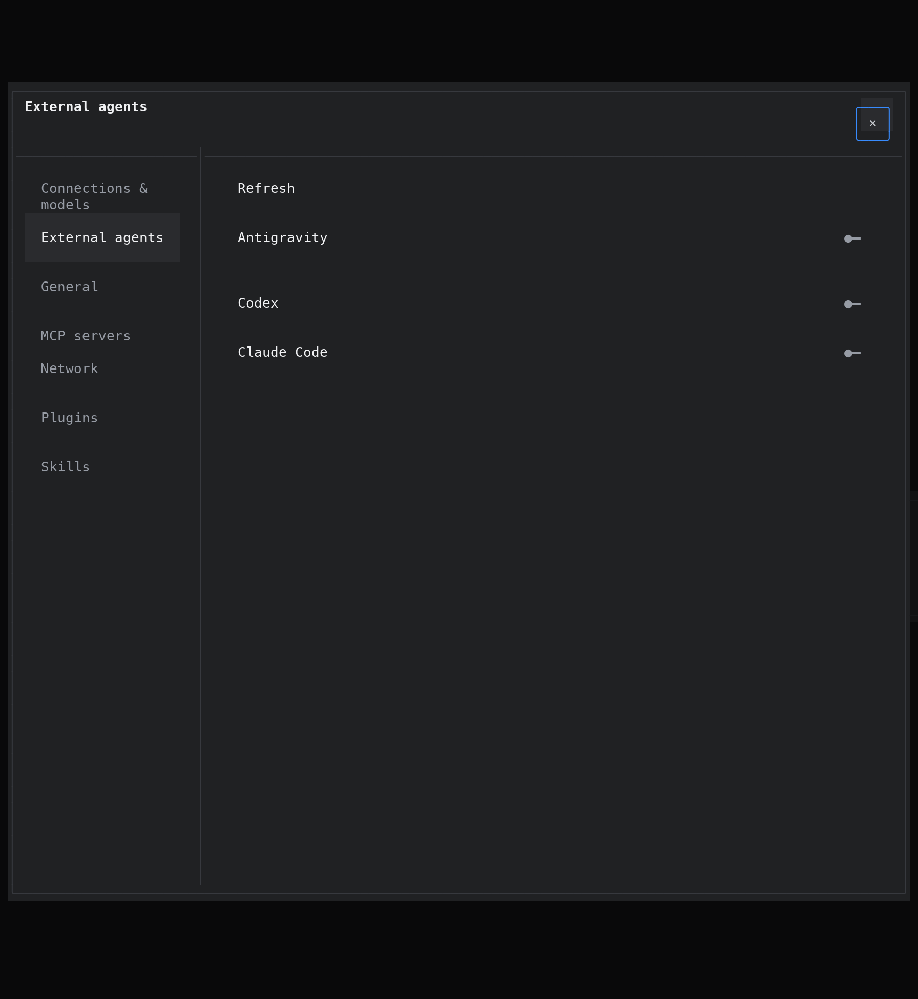
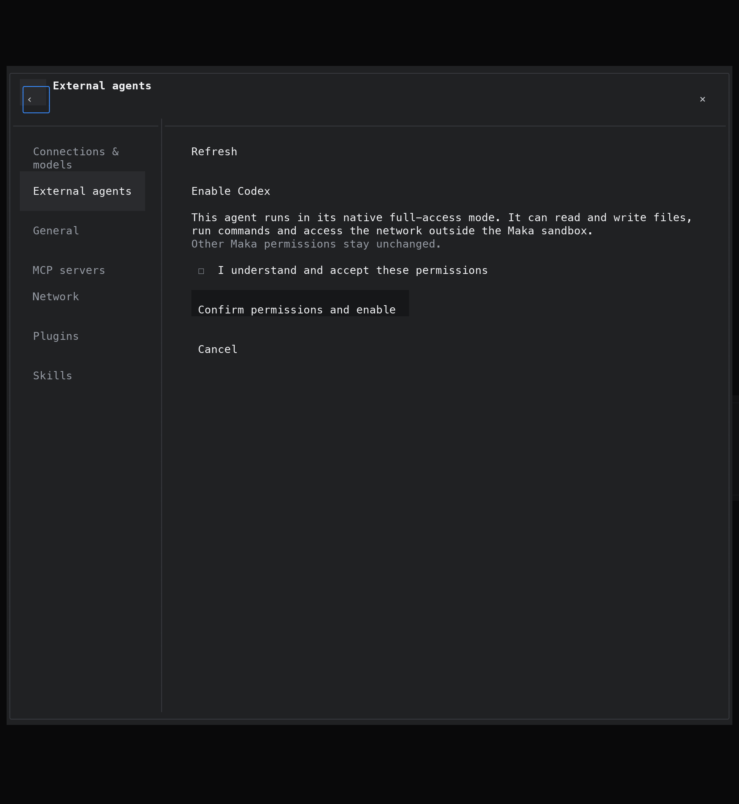

<!--
  Licensed to the Apache Software Foundation (ASF) under one
  or more contributor license agreements.  See the NOTICE file
  distributed with this work for additional information
  regarding copyright ownership.  The ASF licenses this file
  to you under the Apache License, Version 2.0 (the
  "License"); you may not use this file except in compliance
  with the License.  You may obtain a copy of the License at

      http://www.apache.org/licenses/LICENSE-2.0

  Unless required by applicable law or agreed to in writing,
  software distributed under the License is distributed on an
  "AS IS" BASIS, WITHOUT WARRANTIES OR CONDITIONS OF ANY
  KIND, either express or implied.  See the License for the
  specific language governing permissions and limitations
  under the License.
-->

# Native CLI settings evidence

These images are cropped rasterizations of the actual NSH
`AppView::render` / Ratatui buffers captured by
`external_agents_ui_consent_native_catalog_cache_and_failure_isolation`.
They are not desktop screenshots or UI mockups. The test uses a real isolated
Host and the settings plugin with fixture CLI discovery; real CLI execution
and resume are verified separately.

The 180×160-cell captures retain their original RGB colors, symbols and layout.
The images show columns 34–145 and rows 50–110, rasterized at twice the original
8×16 cell size with Menlo. PNG metadata records each source buffer's SHA-256.

Reproduce the source captures:

```sh
MAKA_NSH_EVIDENCE=/tmp/native-cli-ui-evidence \
  cargo test -p maka-cli --test integration \
  external_agents_ui_consent_native_catalog_cache_and_failure_isolation -- --nocapture
```

## Runtime selection



## Full-access consent




## Claude interactive images and workspace trust

A real Rust Host / Claude Code 2.1.318 PTY / isolated Magpie 0.1.3005 route completed
the opt-in two-turn Host-tool test in 21.33 seconds. The workspace was a newly
created temporary directory, not pre-trusted in the private Claude profile.
Maka answered only that directory's native trust dialog; Claude persisted it.

Turn one attached two distinct PNG uploads containing `7319` and `9831`.
The expected numbers were not included in either prompt. Claude returned
`7319 9831`; turn two resumed the same native session and recalled that answer
without reattaching. Both turns called the fresh invocation's `SessionRead`
bridge and recorded the corresponding successful original Host receipts.
This is real Host/CLI verification, not the Python probe or the JS fixture.

The focused Host regressions cover multi-image send/resume with an image-bearing
JSONL row larger than the old 8 MiB cap, a long UTF-8 text attachment, and
cancellation while startup/image/text input is still pending. They use explicit
control gates rather than sleep-based ordering. Submitted text must still
correlate through native JSONL; terminal echoes never prove model completion.

## Limit audit decisions

- **8 MiB native frames / Claude rows → 256 MiB.** User JSONL embeds full
  base64 images; 20 images of 5 MiB already require roughly 134 MiB. A finite
  per-buffer guard prevents malformed native output from growing forever.
- **MCP's inherited 4 MiB POST default → 256 MiB.** The positive regression sends
  a valid >4 MiB UTF-8 `SessionSend` request through MCP, verifies queued
  admission, then verifies the next native invocation receives the full text.
  An invalid-body/HTTP-error-only test was replaced, not kept as a second test.
- **128 pre-ACK events removed.** Retention uses the same 256 MiB byte budget,
  with a 1 KiB/event floor for object overhead. A controlled stream of 257
  distinct deltas must arrive in order, exactly once, in the final answer.
  No synthetic padding frame is needed for this count regression.
- **64 KiB / 128 history fragments → 8 MiB readable / 64 MiB encoded source,
  no fragment-count cap.** A fresh backend needs prior conversation, not merely
  one turn's delta. The regression switches runtimes after a 9 MB canonical
  UTF-8 field, checks the retained >7 MiB tail and explicit omission notice,
  then checks the steady-state turn does not replay it.
- **Short setup/RPC waits → five minutes.** agy new/load and CLI cold startup
  can include authentication/network/MCP work. Large Claude text also gets a
  size-proportional allowance. These are not whole-turn deadlines.
- **Codex model discovery follows every native cursor.** The existing catalog
  test now obtains its 20 models from two real fixture pages; no separate
  pagination implementation-detail test was added.
- **Codex config/feature overrides allowed.** Generic provider and feature
  defaults do not replace the explicit full-access/never-approval turn policy.

Paging of archived Host results, immutable upload ownership/digests, the captured
Host-tool ceiling, native conversation identity, original T1/T2 receipts and
unknown/cleanup/persistence fences remain. Those preserve data/authority or
recoverable delivery; they are not small native payload/count limits.


## In-flight input and agy model-surface findings

Codex steering uses the native `turn/steer` acknowledgement for the captured
active turn; Claude uses ordinary Enter in the original PTY. The controlled
Host regressions hold the original execution open, deliver corrected UTF-8
text and an immutable PNG without replacing that execution, preserve the
original message receipt, and retain the upload until physical settlement.
They also exercise obsolete Host-question closure, wrong-turn acknowledgements,
and native completion arriving before a rejected steering acknowledgement.
Native events stay in the Pipe across acknowledgement errors or cancellation.
Claude's intermediate durations cannot settle an invocation before all submitted
inputs have native user-row confirmation and a following assistant response.

These are wire/PTY fixture regressions, not an additional paid CLI live run.
The earlier real two-turn image/resume result above does not prove the
same-PTY busy-input ordering or second-message image numbering. The input
adapter observes the actual image labels rather than assuming a reset.

A metadata-only comparison of agy 1.5.0 found 13 CLI model/effort entries:
Gemini 4 Argon, Gemini 3.8 Flash, Claude Opus 5.5, Claude Sonnet 5.5, and
GPT-OSS 120B. Its ACP model selector exposes only the two Gemini families;
the legacy ACP model list has their six effort variants. Selecting the
CLI's Claude/GPT IDs through ACP returns `Unknown model ID`.
No inference about remaining quota follows from these directory observations.

The Magpie source examined was revision `6abacd4`. Its
`internal/agent/agy.go` and `internal/cli/agy_exec_unix.go` configure agy
as a Gemini API client of the Magpie gateway and exec the real CLI.
Magpie's Antigravity provider separately owns OAuth and Google internal-RPC
model discovery/generation; it is not a native agy ACP integration or proof
that ACP can execute all CLI models. Maka does not adopt that independent
authentication path or modify the user's agy profile. The advertised ACP
`_meta.antigravity.tier` extension remains unspecified here.


## Stream-json integration and ordinary instruction messages

The current agy route is native `--print= --input-format stream-json
--output-format stream-json`, not ACP. Its model catalog comes from
`agy models`, preserving the native model/effort IDs; directory membership
is not a claim about quota. Each invocation owns a private
`--add-dir/.agents/plugins/maka` plugin with the authenticated Host MCP
configuration. Native identity is committed before Host admission and the
first bootstrap message; MCP loads lazily, and the actual task follows
bootstrap completion plus the captured catalog confirmation. The user's
home, login and global settings are not rewritten.

All three adapters keep native system prompts unchanged. Maka instructions
are one separate ordinary user message wrapped in
`<maka_system_instructions>`, not a prefix in the actual task. Codex uses
native `thread/inject_items`; a real metadata-only daemon/proxy probe
acknowledged that exact method without starting a model turn. Claude uses
a separate ordinary PTY submission and confirms its JSONL result before the
actual task; its acknowledgement is not user-visible task output.

A real agy CLI driven by a local fake Gemini service accepted its native
`read_file` tool's `Path` argument and put PNG `inlineData` into the next
model request. The decoded SHA-256 exactly matched the uploaded PNG.
This proves byte delivery into native model context, not real-model visual
understanding. Maka passes only ordered image paths/media types, with no
tool-specific reminders; the original upload identity and material lifetime
remain owned through physical settlement.

The held-request native probe showed that `queuedMessages:
"send-immediately"` does not enable active-turn mutation in print mode.
Focused static analysis of agy 1.5.0
(`e61679b8ba54abae9a56534208e21f65e1dede6e4eb0144dbd64535f42d07724`)
agrees: `runStreamInput` calls `handleStreamMessage` synchronously,
which calls `runStreamTurn` and emits its final result before returning
to the receive loop. JSON decoding can read ahead in its own goroutine;
that is not concurrent model dispatch. `control_request` and
`control_response` return unsupported; other unknown events are warned
and ignored. Maka therefore retains later-invocation queue semantics for agy,
rather than claiming unsupported native steering.

Evidence provenance: REA 6.8.0 Go metadata Evidence
`ev_1226ad2ec11cac39ea93d6894be98eddf8d8951134c48c8a7c296d473ab04a40`
identifies the shipped artifact. The focused call/branch findings above
come from independent Go function/type tables and ARM64 disassembly,
not from that metadata Evidence and not from recovered original source.
The relevant shipped locations are `streaminput.go:136`
(`0x102e667d0`), `:181` (`0x102e66c60`), and `:219`
(`0x102e672f0`); the final emitter interface slot was independently
resolved from type metadata. Ghidra's unsupported Go 1.28 RTTI and startup
timeouts do not invalidate those separate observations, but do limit
automated decompilation claims. No upstream implementation source is copied.


### Final checks for this continuation

- `native_external`: 33 passed, 1 opt-in paid live test ignored. This
  includes original identity/resume, ordinary instructions in all three
  adapters, Host effects/receipts, cancellation, images, history and the
  four live-invocation steering regressions.
- The subsequent bootstrap-observation correction passed the three-runtime
  initial/resume case again, including persisted native ToolStart/ToolResult
  during agy bootstrap while keeping acknowledgement text out of the answer.
  The agy image-lifetime regression and four parser/path/result unit tests
  also passed against the final adapter.
- EventLog steering/executor unit tests: 4 + 3 passed. Integration steering,
  interrupt and queue cases: 3 + 1 + 3 passed. The exact returned source
  sequence preserves the existing queue ordering and edited source/receipt.
- Engine's production merged/steered sender-origin replay test passed.
- SDK generation/check, native-library Clippy with `-D warnings`,
  changed-file rustfmt, Biome and `git diff --check` passed.
- Metadata-only real agy startups echoed full Gemini, Claude and GPT-OSS
  model/effort IDs unchanged and exited zero without any User/model turn.
- No new paid three-provider live matrix was run. Earlier ACP paid-live
  evidence is historical and does not validate this replacement stream route.
