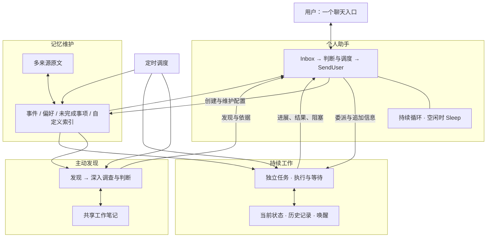

<!--
  Licensed to the Apache Software Foundation (ASF) under one
  or more contributor license agreements.  See the NOTICE file
  distributed with this work for additional information
  regarding copyright ownership.  The ASF licenses this file
  to you under the Apache License, Version 2.0 (the
  "License"); you may not use this file except in compliance
  with the License.  You may obtain a copy of the License at

      http://www.apache.org/licenses/LICENSE-2.0

  Unless required by applicable law or agreed to in writing,
  software distributed under the License is distributed on an
  "AS IS" BASIS, WITHOUT WARRANTIES OR CONDITIONS OF ANY
  KIND, either express or implied.  See the License for the
  specific language governing permissions and limitations
  under the License.
-->

# Borges 理解一个人并持续把事情做成

我想做的个人助手，是一个能逐渐理解我、接住身边变化，并把事情推进下去的存在。

它应该知道我正在做什么，哪些事情对我重要，哪些信息可能改变我的决定。遇到问题，它能先查清楚；遇到机会，它能主动带回来；我交代过的事情，即使需要等几天，也应该有人继续负责。工作、生活、兴趣和偶然冒出来的想法，都在同一个人的世界里。

我把这套想法称为 **Borges**。它从 Maka 的个人助手探索中长出来，把 Personal Agent 对人的持续理解，与 Worker Agent 对工作的持续推进，放进同一个系统。

这篇文章沿着问题的演进来讲：为什么我需要它，几次架构转向解决了什么，以及它们最终怎样落到代码里。

## 从 Personal Agent 和 Super Agent 两种出发点说起

Personal Agent 吸引我的地方，是它围绕一个人展开。人的偏好、目标、习惯、关系和生活背景，不应该每次聊天都重新交代。助手知道这些，才可能在我没提出完整问题之前，发现有价值的事情。

Muse 是这条思路的一个直观参照。它强调结合个人背景和目标主动提供帮助，也包含跨应用执行和长期任务能力。这里让我关注的是：AI 如何从一次性的问答工具，变成持续参与个人生活的助手。[Muse 官方介绍](https://about.fb.com/news/2026/09/introducing-muse-personal-ai-agent/)

另一种出发点，是把 Agent 放进真实工作的组织方式里。工作会被发起、认领、讨论、追加信息、交接和验收；人不在线时，也应该继续推进。Raft 把人和 Agent 放进同一个协作空间，围绕消息、任务、文件协作；DSH Super Agent 的原型，则提供了从消息入口进入、在独立任务环境执行并返回结果的实践。[Raft 官方文档](https://docs.raft.build/welcome/)、[DSH Super Agent 原型](https://github.com/deepseek-ai/dsh-superagent-prototype)

我把它们理解为两种设计重心：**一个从“这个人需要什么”出发，一个从“这件事怎么完成”出发。** 这不是产品能力的硬分类，Muse 也能执行，协作型 Agent 也可以拥有记忆。对我来说，重要的是这两种重心怎样结合。

只理解用户，帮助可能停留在聊天和建议；只接受任务，很多值得做的事情仍然需要用户自己发现、整理成需求，再交给系统。我希望把中间这一段也接起来。

## Borges：理解与行动应该互相生长

Borges 的核心，是让理解用户和推进工作形成循环。

助手从历史和当前情况里获得理解，主动发现可能有价值的方向；调查以后形成判断，把合适的信息带给用户，或者在已有授权下继续做事。工作中的新事实、用户的选择和实际结果，再进入下一次理解。

**Personal Agent 维持与人的连续关系，Worker Agent 维持对具体工作的责任。** 用户可以只面对一个助手，后台则根据事情的需要组织执行。

## 三种信息团与它们之间的桥梁

我把助手面对的信息理解为三个彼此联系的信息团：脑内的信息、电脑和应用里的信息，以及外部世界的信息。这个划分关心的是助手怎样接近这些信息、理解它们，并让它们产生联系。

- **脑内信息，是必须通过我才能补齐的信息。** 我的真实意图、顾虑、尚未表达的偏好，以及需要我作出的选择，都不能仅靠读取电脑确定。我可以主动告诉助手，它也可以带着调查结果来问我。这些交流让它理解我，反馈则不断修正它的推测。

- **电脑信息，应该由助手全盘接住。** 聊天、文件、日历、工作记录和应用中的变化，已经存在于我的数字生活里。在授权范围内，助手应主动接入、关联、调查和跟进这些信息，而不是等我发现问题，再复制材料、复述背景、指定它去哪个应用查。这里的“电脑”也包括我使用的云端应用。全盘接住意味着对信息的后续处理负责：重要变化有人留意，相关背景有人查，已经答应的事情有人继续推进。

- **外部信息，是一个不断变化、几乎无限大的信息团。** 公告、知识、服务、工具、活动和机会都在其中。它们大多还没有与我建立联系，但某一条信息一旦结合我的处境，就可能变得重要。助手需要走出去调查，也需要把外部的新变化带回来。

在这个目标里，**脑内信息应该是唯一必须依赖用户交互才能补齐的信息来源。** 能从电脑和外部世界取得的事实，由助手自己查；只有我知道的意图、取舍和决定，再通过交流获得。它仍然会把有价值的发现和结果告诉我，但不应把本可自行完成的信息搜集转嫁给我。

**index 是这些信息在不同维度上的投影。** 同一批原文可以投影成事件、偏好、时间线或未完成事项。它既缩短查找路径，也提供新的观察角度，让原本散落的事实更容易被放到一起。投影不等于全部信息，助手仍然可以回到原文，或者直接向外寻找新的内容。

在这个理解里，**发现是在信息团之间搭出可能有价值的小桥，判断则是沿着桥调查。** 从一个兴趣、一段经历，或者几件事的组合出发，助手联想到一个尚未证实的方向：它可能与用户有关，也可能值得进一步探索。这时，桥表达的是一种可能性，还不是推荐结论。

举一个完全虚构的例子：用户林舟保存了一份面包烘焙教程，日历里还有周六去虚构城市“云港”的安排。助手可以联想到：那天附近是否有适合新手的烘焙体验课？接着查课程时间、地点、报名条件，判断是否与行程合适，必要时再询问用户的兴趣。调查支持这个方向，就继续探索；不合适就放弃，或者留下暂缓的原因。调查中如果发现课程要求自带工具，又可以延伸出借用工具或选择其他课程的方向。这里的人物、地点和情境均为虚构，仅用于说明联想如何扩展。

调查也会产生新的出发点。查课程时，可能发现报名信息分散，进而想到整理一份比较表；查活动时，可能发现它与日历中的安排冲突。新的认识可以留下来，和其他信息继续发生联系。一次联想可以来自一个点，也可以来自多个点，不需要规定成固定的节点配对。

因此，我希望保留的，是这种能够持续扩展的理解：从已有信息出发，经由联想向外搭桥，在调查中修正认识，再把有价值的结果带回用户的生活。桥梁可以帮助解释发现怎样发生，具体实现则仍需通过实验验证，不必先把所有信息固化成一张严格的关系图。

我期待的体验是：有人发来一条消息，助手自己接住它，查清相关背景，完成已有授权内能做的准备，再把真正需要我决定的地方带过来。我提起一个打算，它也能主动寻找已有信息，把问题往前推进。我的参与主要是表达想法、补充只有自己知道的情况，以及作出选择。

这也把多 source、记忆 index 和主动发现放到了同一条线上：接住分散的信息，组织出可以理解的视角，再从中发现值得调查和行动的方向。

## 从多来源信息到主动发现

这部分要解决的是一个完整问题：电脑和应用里不断产生的信息，怎样变成对用户有用的理解和帮助？多 source 负责接入，记忆 index 帮助组织，主动发现负责联想和调查。它们之间需要连贯，单独把某一层做得复杂，并不能保证最终有用。

### 先接住信息并保留回到原文的路径

聊天、日历、文件和其他应用，各自掌握事情的一部分。来源接入需要让助手知道有哪些信息可用，怎样查询，以及怎样回到具体原文。它不要求把所有外部系统的正文一次性复制下来，但应该让已经接入的信息可以被可靠地找到。

原文保留事实、时间、条件和后续变化。助手处理一条新消息时，可以查它关联的历史；调查一个方向时，也可以跨来源核对。新的变化应当能进入系统，而不需要用户再次转述。

### 用 index 提供视角和更短的路径

在这些原文上，Agent 可以按需要建立事件、偏好、时间线、未完成事项等索引。一个条目可以引用多段原文，同一段原文也可以参与不同的索引。双向引用帮助 Agent 从一个入口进入，再换角度理解同一件事。

索引的价值在于缩短查找路径、提供更多视角，并减少每次重新阅读全部历史的成本。它是可回查的组织结果，不能代替原文，也不应成为所有探索的唯一入口。

索引可以暂时落后。读取时，Agent 应能知道哪些范围已经整理，哪些变化尚未覆盖，再按需补查增量和最新原文。后台维护负责更新索引，实际整理完成后才推进覆盖范围。读过原文，并不等于已经把它纳入索引。

### 从信息视角走向联想和调查

有了索引，主动性也不会自然出现。实验中，助手会照着未完成事项催办、反复挑熟悉线索、检查本机状态，或者发现一件能说的事就结束探索。它也可能列出很多疑问，却没有真正去查。

我希望它能借助不同视角，把事情联系起来，并向外探索。工作、生活、兴趣和机会都可以成为方向；索引里没有现成条目，也可以继续调查。这就是前面所说的搭桥：先产生一种可能有价值的联系，再通过调查判断它是否成立、现在是否值得告诉用户。

两阶段的尝试由此而来。发现端打开方向，判断端继续深入。我们观察到，持续的判断上下文有时能让调查比单轮发现走得更远。用前面的虚构场景解释：发现端想到烘焙体验课，判断端继续查课程是否适合新手、能否报名、行程是否允许，最后才形成具体建议。

反复从头启动发现又会带来时间、成本和重复问题。因此，我们继续尝试保留发现与判断的上下文，通过共享工作笔记记录线索和调查进展，让后续工作能够接上已有认识。

这份笔记只是探索中的随手记：看到什么、查到哪里、为什么继续或暂缓。它不能替代原文、用户记忆和任务状态，也不能因为写了“已报告”，就算用户已经收到。没有找到证据不等于事情不存在，用户没有回应也不等于不感兴趣。暂时不推荐的事实，应当允许在新的情况下重新产生价值。

图式发现也是这条探索的一部分。我想保留的是联想不断生长的能力，而不是维护复杂关系本身。目前的实验还没有证明图式方案优于两阶段发现，形式化的图也可能变成昂贵的记事本。

这三层最终应该连成一条工作路径：**多来源接住事实，index 提供视角，发现与判断向外调查，再把新认识和有用结果带回来。** 新事实可以被后续索引维护吸收，明确需要推进的事情可以进入持续工作。评价这部分的标准，是它能否减少用户搜集背景的负担，并带来原本容易错过的帮助。

## 持续工作：让 Agent 学会跨越时间

最初研究 Today AI、Muse 一类助手时，我很快遇到了一个问题：围绕长期目标工作，究竟意味着什么？

普通 Agent 已经能观察、判断、调用工具，再根据结果继续。它在一轮内可以做很多事。但现实任务还有时间这一维：等同事回复，等材料补齐，等一个版本发布，等外部状态满足条件。事情没有完成，只是现在不能继续。

当时我的直觉是，这像一个更大范围的 Agent loop：把外部事件和时间也纳入其中。

因此，持续工作先要具备三件事：知道自己在完成什么，保存当前情况，以及在暂时无法推进时，把工作交给未来的自己。下一次醒来，要根据新情况重新判断。

这里有一个很重要的顺序：**新信息先改变当前状态，Agent 再根据当前状态决定做什么。** 唤醒事件只是让它回来看看，不应该把它锁进某个早先写好的动作。

我也不想把持续工作做成提前拆好很多步骤的流水线。计划可以帮助组织顺序，但环境会变，用户会纠正，原来的路径也可能已经没有必要。更合适的方式是：能继续就继续，走一步看一步；只有真的遇到等待条件，才保存进展并退出。

所以，持续工作的记事内容逐渐变成了“给未来的信”：做过什么、结果怎样、当前判断是什么、为什么停在这里、后续可能需要什么。它带时间，也保留操作历史。未来的 Agent 可以参考这些判断，但仍然要对完成用户目标负责。

这也解释了为什么我反复反对随意增加轮次上限和整轮硬时限。把一个已经开展工作的任务机械截断，很容易留下“报告写了，但没人收尾”“任务停了，但用户不知道”的半成品。等待应该有明确理由，完成应该对得上目标，失败和阻塞应该暴露出来。

真正的持续工作能力，是事情跨过了时间，仍然有人接着负责。

## 为什么不能把所有事都放进同一个长期 Agent

既然持续工作能够接收新信息、保存进展、等待和恢复，似乎可以直接让它成为整个个人助手。

但我后来举了一个很具体的问题：今天一点开始跟进 A，五天后 A 的回复才回来。这五天里，我还会讨论 B、C、生活安排和其他临时想法。所有事情都堆在一个 Session 里，A 的上下文很容易被淹没。

个人助手和具体任务，需要的连续性不同。个人助手要持续理解我，任务要持续记住它自己的目标、证据、进度和等待条件。把两者混在一起，既容易拖慢聊天，也容易让任务之间相互干扰。

于是，架构逐渐形成了现在的分工：面向用户的助手负责接收信息、调度和交流；复杂、耗时或需要等待的工作，有自己的执行上下文。简单的事情，助手可以直接处理，不必为了架构整齐而把每个动作都委派出去。

后台执行者也不能变成一组与用户各说各话的角色。它们的进展、重要发现、失败和澄清请求，需要回到同一个交互入口。这样，用户知道自己答应过什么，系统也知道已经向用户表达过什么。

我想统一的是用户的体验，以及系统对事情的责任，而不是强迫所有工作共享一段越来越长的上下文。

## 联动之后，帮助可以走得更远

持续工作、记忆和主动发现，单独存在都很有用。把它们连起来，才会出现我真正想要的体验。

以“用户正在准备一次重要展示”为例。下面是设计示例，用来说明联动，并非宣称某次测试已经完整做到了：

聊天里有客户的关注点，文档里有材料版本，日历里有行程，另一段交流提到演示设备还没归还。记忆索引让这些分散的信息容易被找到，主动发现则可能意识到它们共同影响展示是否顺利。

它不应立刻把四条记录原样转发给我。它可以先核对：哪些材料已经更新，设备是否真的还没回来，行程变动是否已经处理。查清后，助手把影响和选择讲明白，需要我决定的地方再问我。

如果我说“把演示材料和设备这两件事跟到准备好”，具体工作就有了明确目标。执行者先完成现在能做的部分，需要等回复时保存状态；新材料出现后继续核对，用户补充标准时更新判断，最后把结果带回来。

同时，主动发现仍可以探索其他有价值的方向。它需要知道已有工作，避免把同一个问题反复当作新发现，但也不能因为“有任务在跟”就放弃调查新的风险或跨事项联系。

这形成了一个连续过程：**从信息中理解，从理解中发现，从发现中调查，从明确需求中推进，再让结果丰富之后的理解。** 用户看到的可以只是几次自然的交流，背后却有事情一直在往前走。

## 从定时探索，走向接住现实中的变化

定时主动发现适合留出空间做开放探索，但现实生活并不按固定周期发生。

有人发来消息，日历被修改，工作出现异常，这些变化可能需要及时响应。我后来把这个问题拆成三个：事件怎么进入助手；进入之后怎样驱动调查和工作；怎样让成本可控。

这也是 Borges 下一步的重要方向：让系统既能定期看看更广的世界，也能及时接住身边的新情况。

事件本身通常不足以支持结论。收到一条消息之后，助手可能需要查相关会话、任务、文件和背景，才知道它只是普通更新，还是一个需要我决定的问题。接入层要把事件可靠地送达，调查者负责形成判断，面向用户的助手负责交流和调度。

我希望助手在合适的时候已经做过准备，再来找我。已授权的工作就推进；需要选择、补充信息或批准的动作，就把真正需要我参与的部分表达清楚。用户不应该还要管理系统内部哪一个 Agent 接了消息、哪一个 Agent 忘了收尾。

## 最后，这些想法在 Maka 里怎样实现

目前这套能力的主体位于 Maka 的 Runtime Host，围绕四个模块组织。它们复用 Agent runtime，由宿主管理生命周期、持久化和消息投递。

| 模块 | 核心职责 | 内部主要组件 |
| --- | --- | --- |
| 个人助手 Bot | 接住用户与后台信息，决定直接处理还是委派，统一交流，处理系统失败和澄清请求 | Inbox、Agent loop、SendUser、Sleep、调度与配置工具 |
| 主动发现 | 利用历史、索引和外部信息寻找线索，调查价值与不确定性，把发现交回 Bot | 发现 Session、判断 Session、共享工作笔记、定时入口 |
| 持续工作 | 围绕具体目标执行，必要时等待，恢复后继续，返回结果或阻塞 | 独立任务上下文、状态与记录、唤醒机制、提交检查 |
| 记忆维护 | 保存和访问原文，建立不同视角的索引，持续维护覆盖范围 | 来源适配、原文引用、多 index、增量维护与 checkpoint |

Bot 的运行方式，是一个接收信息的循环。消息经 Inbox 进入；只有调用 SendUser 才会向用户发送内容，普通模型文本不构成发送；没有需要继续处理的事情时调用 Sleep，等待新输入。发送和休眠是两件独立的事。

持续工作沿用同样的执行能力，但每个任务保有自己的目标和状态。当前实现区分立即继续、等待和完成；等待和完成有独立检查，避免把“应该做了”当成“已经完成”。审查本身也需要克制，不能通过无休止补证让任务永远无法收尾。

记忆的观察范围和完成覆盖范围分开管理。来源检查可以发现新数据，只有索引整理真正提交 checkpoint，才推进覆盖。来源失败应该作为失败暴露，不能冒充没有增量。这样 Agent 才能知道自己看到的索引有多新，什么时候需要补查原文。

以上是已经在代码中存在的核心结构。2026 年 10 月 31 日核对的本地分支还在开发事件接入、快速调查等路径，不能把它们写成已经稳定部署的完整产品。联想图和更低成本的持续探索，也仍属于实验与研究。

Borges 想实现的是一个长期相处的助手：理解会随着交互积累，承诺过的事情有人继续负责，周围的信息变化能转化为实际帮助。用户只需要和它说话、判断和选择，后台复杂度由系统承担。

---

**资料与实现依据**

本文按设计问题组织，梳理个人助手、持续工作、信息组织与主动发现之间的关系。

实现说明基于 2026 年 10 月 31 日的开发快照，基线提交为 `3a74dd9ca`，事件接入部分包含当时的开发改动。主要位置是 `packages/runtime-host/src/assistant/` 下的 `bot/host.ts`、`index-initiative/prompt.ts`、`proactive-matters/prompt.ts`、`memory-network/controller.ts` 和 `service.ts`。整体设计也可参见 [Maka 个人助手讨论](https://github.com/apache/maka/discussions/6252)。
