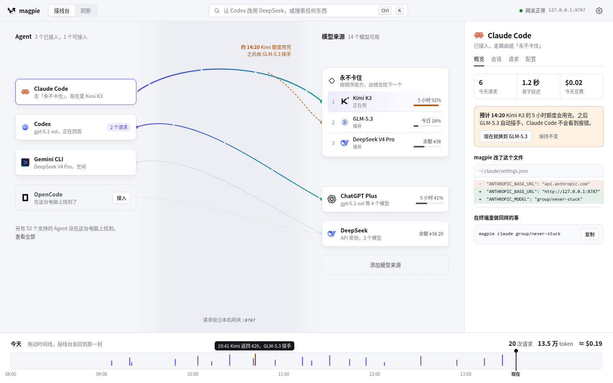
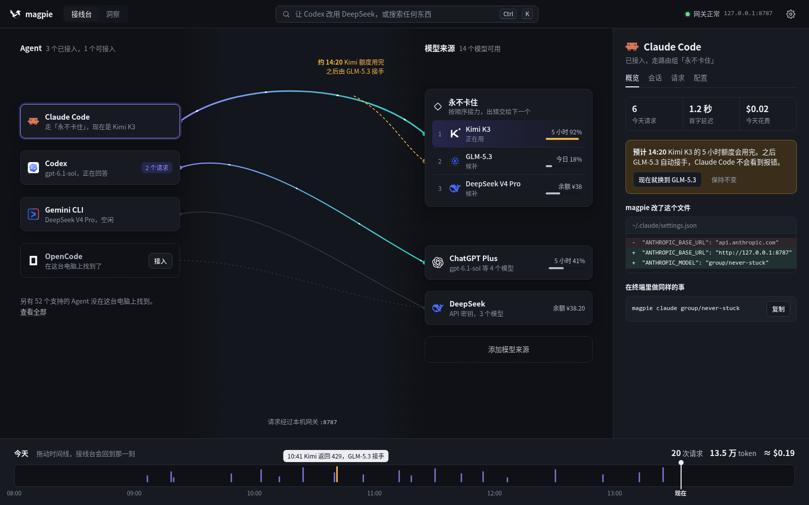
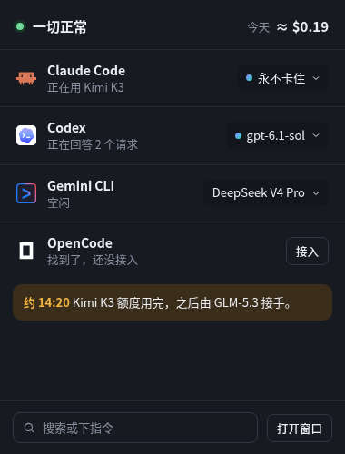

# magpie 下一代界面：鹊桥接线台（Switchboard）

> **状态（2026-11-07 校注）**：2026-10-13 方案/快照，之后无更新；是否重启未定。文内 `E:` 盘路径属 Windows 工作区（已于 10 月撤除）。

> v0.2 · 2026-10-13 · 适用 `magpie-hub`（fork 自 `yetone/magpie`）
> v0.2 相对 v0.1：补上了**视觉世界、标志性设计和可运行的高保真原型**。v0.1 的信息架构保留，但用设计技能逐条复审并改写。





原型源文件：`mockups/switchboard.html`（浏览器直接打开，连线上的光点会流动）、`mockups/tray.html`。

---

## 0. 一句话

**magpie 的名字就是答案：喜鹊搭桥。**
七夕传说里，喜鹊在银河上搭起鹊桥，让隔岸的两个人相见。magpie 做的正是同一件事：左岸是 Agent，右岸是模型，中间那条河就是本机网关。主界面就画这座桥：**哪座桥亮着、桥上有谁在走、哪座桥快断了、断了之后会落到哪里。**

---

## 1. 调用了哪些设计技能

你本地 `01-设计系统与设计还原` 下的技能，我从 skills.sh / GitHub 拉了同名的上游版本来用（我访问不到你电脑上的副本，若你本地有改动，以你的为准）：

| 你本地的技能 | 上游来源 | 在本文里用来做什么 |
| --- | --- | --- |
| impeccable | `pbakaus/impeccable` | 定位 **Operate 模式**（工具界面，任务优先）；"一个标志性设计"原则；craft-floor 品质底线与禁用清单；overdrive 的"功能型惊艳" |
| design-taste-frontend | `leonxlnx/taste-skill` | 三个旋钮定调；反 AI 味清单（紫色光晕、千篇一律的卡片） |
| ui-ux-pro-max | `nextlevelbuilder/ui-ux-pro-max-skill` | 跑了检索脚本拿到推荐方案，**然后否决了它**（见 2.3） |
| design-critique | `anthropics/knowledge-work-plugins` | 第 9 节对 v0.1 的结构化评审 |
| ui-styling / design-system / design-system-patterns | nextlevelbuilder、`wshobson/agents` | 第 5 节令牌分层（原始值 → 语义 → 组件） |
| theme-factory / brand-guidelines / canvas-design | `anthropics/skills` | 明暗两套与 Omarchy 主题如何共存 |
| （另加）emil-design-eng | `emilkowalski/skills` | 第 6 节动效决策：按使用频率决定动不动、怎么动 |

没有用到的：figma、shadcn、firecrawl-website-design-clone、image-to-code、brand-landingpage 等。这些是还原或落地页用途，和本需求无关（YAGNI）。

---

## 2. 设计判断（Design Read）

### 2.1 界面类型

impeccable 的分类：**Operate**，用户来是为了完成任务。所以布局、导航、控件必须是"同类工具里的熟悉样子"，视觉世界只能贡献四样东西：**字体、色板、密度、一个标志性设计**。鹊桥就是这个标志性设计，其他地方一律克制。

### 2.2 三个旋钮（taste-skill）

| 旋钮 | 值 | 理由 |
| --- | --- | --- |
| DESIGN_VARIANCE 版式变化 | 6 | 只有中间的桥是非对称、有表现力的；两岸保持规整 |
| MOTION_INTENSITY 动效强度 | 4 | 只有真实请求才会让桥动；没有装饰性动画 |
| VISUAL_DENSITY 信息密度 | 6 | 开发者工具需要一屏看全，但不是驾驶舱 |

### 2.3 被否决的方案（独立思考）

ui-ux-pro-max 对"开发者工具 · AI 网关 · 实时监控"给出的推荐是：OLED 深色 `#0F172A` + 运行绿 `#22C55E` + JetBrains Mono + 卡片交错入场动画，页面模式是"FAQ/文档落地页"。

否决理由：
1. frontend-design 技能明确把"近黑底 + 单一亮绿强调色"列为 AI 生成设计最常见的套路之一；
2. 页面模式匹配错了（magpie 不是文档站）；
3. 深色作默认不符合使用场景：magpie 跟随系统，现有用户两种都有；
4. 等宽字体当"技术感装饰"是 craft-floor 明令禁止的，等宽只给代码、模型 ID 和数字；
5. 交错入场动画用于每天打开几十次的工具，会让人觉得慢。

**我从它那里只保留了交付前检查清单**（第 8 节）。

---

## 3. 视觉世界：喜鹊

所有视觉选择都从喜鹊本身取材，而不是从"科技感"取材：

| 喜鹊的特征 | 界面里的对应 |
| --- | --- |
| 黑白羽色，对比分明 | 中性色严格只用墨与纸两族，不出现第三种灰调（冷灰贯穿） |
| 翅膀与尾羽在光下泛出**蓝紫到青绿的金属结构色** | **鹊羽光泽（Sheen）**：只出现在"正在传输的桥"上，从靛蓝渐变到青绿。别的地方都不用渐变 |
| 搭鹊桥 | 主画布的连线是**拱形的桥**，不是直线或折线 |
| 喜鹊爱收集亮晶晶的东西 | 两岸的卡片就是它收集的东西：Agent 和模型来源 |

为什么不是紫色光晕的老套路：现有 `--accent #4f46e5` 是 magpie 已有的品牌色，**保留它**作为光泽的起点，只加一个青绿终点。这样做是在已有身份上演进，而不是推翻（impeccable："Refinement preserves"）。

---

## 4. 五个亮点

### 亮点 1 · 鹊桥（标志性设计）

- 每个已接入的 Agent 到它的目标之间是一座**拱桥**（三次贝塞尔曲线，拱高随两端距离变化）。
- 桥的状态只用三种编码，且都**不只靠颜色**区分：

| 状态 | 线 | 端点 | 其他 |
| --- | --- | --- | --- |
| 正在传输 | 鹊羽光泽渐变，2.4–3px | 实心 | 每个进行中的请求是一粒光点沿桥走过 |
| 空闲 | 中性灰 1.6px | 实心小点 | 不动 |
| 可接入（建议） | 点状虚线 | 无 | 左岸卡片是虚线框加"接入"按钮 |

- 光点数量 = 实际并发请求数（上限 8），请求结束光点就消失。**界面动不动完全由真实流量决定**，网关空闲时整个画面是静止的（Calm Technology）。
- 落点精确到**组内成员**：Claude Code 的桥落在"永不卡住"组里的第 1 名 Kimi K3 身上，而不是笼统地落在组上。故障转移发生时，桥的落点以弹簧动画滑到下一名成员。

### 亮点 2 · 预见（Foresight）

**界面不仅显示现在，还显示接下来会发生什么。** 这是本设计最"超前"的地方，但它不是新功能，而是把 magpie 已经有的数据（额度窗口、重置时间、近期消耗速率）组合成一句话：

> **约 14:20** Kimi 额度用完，之后由 GLM-5.3 接手。

- 画布上：一条琥珀色虚线从当前的桥分叉出来，落到下一名候补成员身上，这是**未来的桥**。
- 检查器里：同一句话，配两个按钮："现在就换到 GLM-5.3" / "保持不变"。
- 规则：只在预计 2 小时内会发生切换时显示；同时只显示最近的一条。
- 预测方法：最近 30 分钟消耗速率线性外推到当前窗口剩余额度；数据不够（少于 3 个点）就不显示，**宁可不说也不乱说**。

### 亮点 3 · 回放（Rewind）

底部时间线不是装饰性的火花线（craft-floor 禁止用火花线充当内容），而是**每一个请求一根刻度**：高度 = token 数，琥珀色 = 发生过故障转移。

- 拖动播放头，整个接线台回到那一刻：哪些桥亮着、落在谁身上、当时额度多少。
- 悬停在琥珀刻度上直接说清楚发生了什么："10:41 Kimi 返回 429，GLM-5.3 接手"。
- 数据来源：已有的 `usage.jsonl` 与路由页的"请求故事"/回放能力，不需要新的后端。

### 亮点 4 · 真相差异（Truth Diff）

magpie 的承诺是"只改 Agent 配置里最关键的那个键"。那就**把它摊开给人看**：检查器里直接显示 magpie 改了哪个文件、哪几行（红删绿增），下方是在终端里做同样事情的等价命令，可一键复制。

这让人和 Agent 读到的是同一个事实（Dual-Audience UI），也是对"它到底动了我什么"这个信任问题最直接的回答。

### 亮点 5 · 原位变形（Morph）

点击任意一张卡片或一座桥，检查器不是"弹出"，而是用 View Transitions API 从被点击的元素**变形展开**（WebView2 与 macOS WKWebView 都支持同文档 View Transitions；不支持的环境直接切换，不做降级动画）。关闭时缩回原处。空间关系始终清楚：检查器里的内容就是"那张卡片的放大版"。

---

## 5. 设计令牌

### 5.1 色板（原始值 → 语义，沿用现有变量名并扩展）

| 语义 | 浅色 | 深色 | 用途 |
| --- | --- | --- | --- |
| `--canvas` 纸 | `#F5F6F8` | `#0F1116` | 画布。冷白，避开"奶油纸"套路色 |
| `--surface` | `#FFFFFF` | `#171A21` | 卡片、检查器 |
| `--ink` 墨 | `#14161B` | `#ECEEF3` | 正文。深色模式的墨是喜鹊黑，带一点蓝 |
| `--muted` | `#737887` | `#8A90A0` | 次要文字（对比度 ≥ 4.5:1） |
| `--line` | `#E3E5EA` | `#262A33` | 分隔线 |
| `--river` | `#ECEEF3` | `#13161C` | 网关之河：两岸之间的浅色通道 |
| `--sheen-a` | `#4F46E5` | `#8E8CFF` | 鹊羽光泽起点（= 现有品牌色） |
| `--sheen-b` | `#0E9F9A` | `#2DD4BF` | 鹊羽光泽终点 |
| `--amber` | `#B45309` | `#F2B544` | 预见、降级、故障转移 |
| `--green` | `#15803D` | `#6FD99B` | 网关正常 |

**使用纪律**：光泽渐变只允许出现在"正在传输的桥"和托盘里"正在传输"的小圆点上。按钮、标题、背景一律不用渐变，也不用渐变文字。

Omarchy 主题：只需映射 `--sheen-a / --sheen-b / --river` 三个变量，其余继承主题。

### 5.2 字体

| 角色 | 字体 | 说明 |
| --- | --- | --- |
| 界面 | 系统字体（Segoe UI Variable / SF Pro / 系统中文字体） | Operate 模式下原生预期优先；Settings 里已有的界面字体选择继续生效 |
| 代码、模型 ID、文件路径、命令 | 系统等宽（Cascadia Mono / SF Mono），用户可改 | **只用于真正的代码和数据** |
| 数字 | 界面字体 + `tabular-nums` | 花费、token、百分比上下对齐 |

字号阶梯：12 / 13.5 / 14.5 / 17 / 19。只用 400、500、600 三个字重。

### 5.3 形状与层次

- 圆角统一一套：控件 7–8px，卡片 10px，组卡片 12px。
- 不做"卡片套卡片"：路由组内的成员用分隔线，不是嵌套卡片。
- 阴影带偏移和柔和模糊，且只给两岸卡片；检查器用一条边线区分，不用阴影。
- 主题化浏览器默认件：选中文本颜色、焦点环、滚动条都从色板取色（craft-floor 指出这是最容易被忽略的细节）。

---

## 6. 动效（按 emil-design-eng 的频率决策表）

| 交互 | 每天频率 | 决策 | 参数 |
| --- | --- | --- | --- |
| Ctrl+K 意图栏开关 | 上百次 | **不做动画** | 立即出现（参照 Raycast） |
| 列表上下键导航 | 几十次 | 不做动画 | — |
| 卡片悬停 | 几十次 | 只变边框颜色 | 120ms ease |
| 按下按钮 | 几十次 | 轻微缩放 | `scale(.97)`，120ms |
| 检查器打开/关闭 | 偶尔 | 原位变形 | 240ms，`cubic-bezier(.32,.72,0,1)` |
| 故障转移，桥落点滑动 | 偶尔 | 弹簧 | bounce 0.15，约 400ms，这是**唯一一个精心编排的时刻** |
| 光点沿桥流动 | 有请求时 | 匀速 | linear，2.4s 一个来回 |
| 首次接入成功 | 一次 | 可以有一点惊喜 | 桥从左岸"长"到右岸，600ms |

全局规则：只给 `transform / opacity / stroke-dashoffset` 做动画，不用 `transition: all`；`prefers-reduced-motion` 下关闭光点和弹簧，只保留颜色变化。

---

## 7. 布局

### 7.1 桌面窗口（≥1280px）

| 区域 | 尺寸 | 内容 |
| --- | --- | --- |
| 标题栏 | 高 56 | 品牌、`接线台 / 洞察` 两个页面、意图栏（居中）、网关状态、设置 |
| 左岸 | `clamp(260px, 22vw, 320px)` | 已接入、可接入的 Agent；其余 52 个折叠成一句话 |
| 河（网关） | 弹性 | 鹊桥、预见虚线 |
| 右岸 | `clamp(280px, 24vw, 340px)` | 路由组、供应商、"添加模型来源" |
| 检查器 | 388px，可拖宽到 560 | 选中对象的概览、预见、真相差异、等价命令 |
| 回放 | 高 132 | 今天的每个请求刻度、播放头、汇总 |

信息架构仍是 v0.1 的结论：8 个一级页面收成 2 个页面加设置。会话、资源库、请求故事都进检查器；网关进标题栏的状态灯；插件进设置。

### 7.2 托盘面板（380 × 500）




2 秒内回答三个问题：**是否正常、花了多少、接下来会不会出事**。每行右侧就是现有的一键切换目标，正在传输的目标前面有一颗光泽小圆点（桥在面板里的缩影）。

### 7.3 窄屏（<1024px）与无障碍

桥在窄屏不可读，不硬缩，直接换成托盘同款的列表（同一份数据，两种投影）。这个列表也是读屏器读到的真实结构，SVG 桥只是装饰层（`aria-hidden`）。接线有键盘等价操作：选中 Agent → Enter → 方向键选目标 → Enter。

### 7.4 另外两种组织方式（为什么没选）

按 impeccable 的要求，同一个视觉世界下比较了三种组织方式：

| 方案 | 做法 | 结论 |
| --- | --- | --- |
| **A 鹊桥（选中）** | 两岸 + 桥 + 检查器 + 回放 | 关系一眼可见；标志性设计和产品本质是同一件事 |
| B 指令优先 | 首页只有一个大意图栏，下方是最近操作（类似 Raycast） | 对新用户太空；看不到整体状态。保留为意图栏 |
| C 矩阵 | 行 = Agent，列 = 来源，格子 = 是否接入 | 60 × 30 的稀疏矩阵，绝大多数格子是空的。保留为窄屏投影 |

---

## 8. 品质底线（交付前检查）

来自 craft-floor 与 ui-ux-pro-max 的检查清单，原型已逐条对照：

- [x] 正文对比度 ≥ 4.5:1，大字 ≥ 3:1（浅色和深色都检查）
- [x] 图标用的是仓库里的真实 SVG（`internal/gui/assets/icons`），没有用 emoji 或 Unicode 符号代替
- [x] 没有标题上方的小号大写标签（eyebrow）、没有"01/02/03"编号、没有渐变文字、没有卡片嵌套
- [x] 等宽字体只出现在代码、路径、命令里
- [x] 状态都设计了：传输中、空闲、可接入、预见、故障转移、空状态（"添加模型来源"）
- [ ] 加载中：额度读取未返回时，显示"正在读取额度"文字，而不是长时间的骨架屏（解决截图 3 的问题）
- [ ] 错误：网关端口被占用时，标题栏状态灯变红，点击直接给出解决方法
- [ ] 在 1024 / 1280 / 1920 宽度和 125%、150% 缩放下实测（Windows 是你的主环境，必须测）

---

## 9. 对 v0.1 的评审（Before / After / Why）

| v0.1 | v0.2 | 理由 |
| --- | --- | --- |
| 没有视觉方向，只有 ASCII 线框 | 喜鹊 / 鹊桥的视觉世界 + 可打开的高保真原型 | Operate 界面也需要一个让人记住的标志性设计 |
| 连线是"线宽 + 颜色 + 粒子"的通用接线图 | 拱形鹊桥，落点精确到组内成员 | 从产品名字取材，而不是从"科技感"取材 |
| 用 `◉ ◆ ○` 等字符当图标 | 仓库里的真实 Agent/供应商 SVG | craft-floor：字符不能代替图标系统 |
| `AGENTS · 3 已接入` 大写标签加中点拼接 | "Agent　3 个已接入，1 个可接入" | 大写标签和中点拼接都是生成感很重的套路 |
| 底部 Pulse 用火花线 | 每个请求一根刻度，可拖动回放 | 火花线是内容的替身；刻度本身就是内容 |
| 只显示现在 | 加入"预见"：显示接下来会怎样 | 网关的价值在于"不出事"，提前说出来才是安心 |
| 检查器底部写等价命令 | 加上配置文件差异 | 回答"magpie 动了我什么"这个信任问题 |
| 动效只写了时长 | 按使用频率决定动不动 | 每天上百次的操作不该有动画 |
| 粒子最多 8 个，常驻流动 | 光点数 = 真实并发数，空闲时静止 | 安静技术：没事的时候界面不说话 |

---

## 10. 对抗式审查（新增针对 v0.2 的部分）

| 攻击 | 回应 |
| --- | --- |
| 鹊桥是文化符号，海外用户看不懂 | 不需要看懂传说。拱形的桥本身就是"连接两岸"的通用隐喻；中文文案里也不出现"鹊桥"二字，只叫"接线台" |
| "预见"如果预测错了，反而让人不信任 | 数据不足不显示；只说"约"；预测错误时，下次的提示会给出更宽的时间范围。这是**最需要消融实验验证的元素** |
| 回放需要保存每一刻的状态，太重 | 不保存画面，只回放事件：已有的使用记录 + 路由记录足以重建任意时刻的连线与落点 |
| View Transitions 在 Linux WebKitGTK 上不稳定 | 只作为增强；不支持时直接切换，功能完全一致 |
| 和上游合并冲突 | 新外壳放在独立文件（`shell.js`、`bridge.js`、`inspector.js`、`bridge.css`），只读 `/api/state`，旧页面保留为"经典布局"开关 |

v0.1 中的其他对抗审查条目（连线混乱、老用户肌肉记忆等）仍然有效，不重复。

---

## 11. 消融实验（更新）

| 实验 | 去掉 | 指标 | 保留门槛 |
| --- | --- | --- | --- |
| A1 | 拱桥（换成"→ 目标"文字） | 找出"哪个 Agent 在故障转移"的用时 | 快 ≥ 30% |
| A2 | 光点 | 判断"现在有没有请求在跑"的准确率 | 提升 ≥ 10% |
| A3 | 预见 | 额度耗尽前用户主动处理的比例；对预测的信任评分 | 主动处理率提升，且信任 ≥ 4/5 |
| A4 | 回放拖动（只保留静态刻度） | 排查"上午为什么变慢"的用时 | 快 ≥ 40% |
| A5 | 真相差异 | 首次使用者的信任评分 | 提升 ≥ 1 分 |
| A6 | 原位变形（改为直接切换） | 主观"流畅感"评分 | 无显著差异就删，省维护成本 |

---

## 12. 不自信的点

1. **预见的准确度**：线性外推对突发的长对话不准，可能需要按 Agent 分别建模。这是最大的未知。
2. **组成员很多时桥的落点**：一个组有 10 个账号时，组卡片会很高；会沿用现有 `FOLD_AT` 折叠规则，但视觉效果需要原型验证。
3. **WebView2 上 SVG 动画的性能**：原型在 Chromium 上没问题，但没有在低端 Windows 上测过。
4. **你本地技能的版本**：我用的是上游同名技能，你本地的 `impeccable`、`ui-ux-pro-max` 等若有自定义规则，第 5、6、8 节可能需要按它们修订。
5. **原型的数据是虚构的**：截图里的额度、价格、时间都是示意，用来展示状态，不代表真实值。

---

## 13. 落地路线

| 阶段 | 内容 | 验收 |
| --- | --- | --- |
| P0 | 令牌扩展、新外壳（标题栏 + 检查器容器）、经典布局开关 | `internal/gui/tests` 全部通过；现有页面无变化 |
| P1 | 两岸 + 检查器（含真相差异与等价命令），桥先用静态直线 | 消融 A1、A5 的对照组 |
| P2 | 拱桥、光点、故障转移弹簧、意图栏 | A1、A2 |
| P3 | 回放时间线、托盘新版 | A4；托盘 2 秒判断准确率 ≥ 95% |
| P4 | 预见、原位变形 | A3、A6 |

模块：

```
internal/gui/assets/
├── shell.js       外壳：标题栏、意图栏、检查器容器、回放带
├── bridge.js      两岸与鹊桥（复用 routing.js 的 wiresTo / fly / fold）
├── inspector.js   按对象类型挂载现有渲染函数
├── foresight.js   预见计算（纯函数，可单测）
├── bridge.css     新增样式，不改 app.css 既有选择器
└── app.js         只增加少量导出
```
