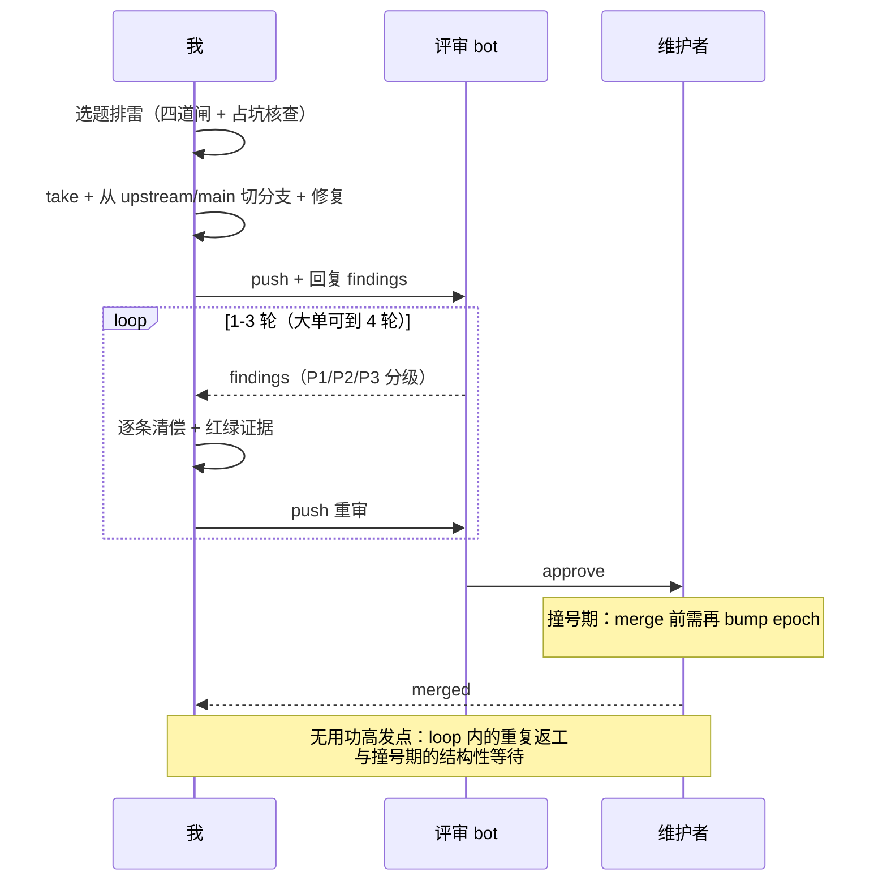
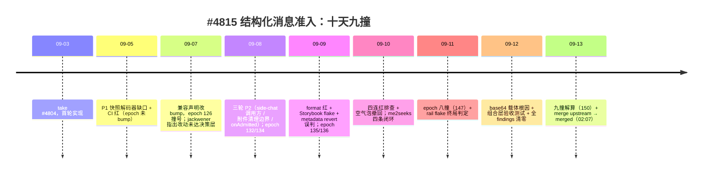
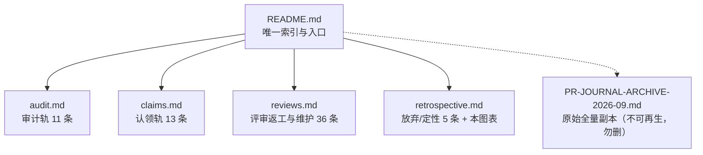

# 复盘：放弃单、定性单与无用功分析

> 没产出 PR 的工也算工：放弃原因、定性结论、弯路模式与图表都在这份。

## 无用功六模式（基于 PR-001 → PR-042 全量台账 + 25 单合并记录）

```mermaid
flowchart TD
    subgraph P1["模式一：教训未沉淀（重复踩坑）"]
        A1["#4801 生成文档误加 frontmatter<br>CI 红"] --> A2["#4816 换会话同病再犯<br>又一轮 CI 红"]
    end
    subgraph P2["模式二：评审建议未独立验证就执行"]
        B1["me2seeks 提出 trim 谓词"] --> B2["Astro-Han 证伪：<br>存量空白事件被判不可见<br>#4804 原故障复现"]
        B2 --> B3["撤回 + 消融实验入规矩"]
    end
    subgraph P3["模式三：并行会话声称未核验"]
        C1["另一会话报告<br>all findings addressed"] --> C2["逐条核验发现<br>四单声称全有水分"]
    end
    subgraph P4["模式四：环境噪音当回归"]
        D1["audit 端点抽风 / symlink EPERM<br>EBUSY / Storybook 滚动几何"] --> D2["多轮排查白费<br>后才用 stash 对照定性"]
    end
    subgraph P5["模式五：选题排雷不足"]
        E1["#4388 池 9 选 7 已被占"] --> E2["#4783 要 GPU 资源<br>门槛没提前查 → 放弃"]
        E2 --> E3["#4360 过期 issue<br>白读半天才定性"]
    end
    subgraph P6["模式六：工作区状态错乱"]
        F1["切分支不重建依赖<br>幽灵类型错误"] --> F2["被自动任务切到 main<br>对着错误分支白看半天"]
    end
    P1 --> BREAK["打破机制：沉淀区 + 编号文档<br>（06/09 号文档、单课沉淀）"]
    P2 --> BREAK
    P3 --> BREAK2["打破机制：子代理逐条核验<br>（PR-036 起成为固定动作）"]
    P4 --> BREAK3["打破机制：stash 对照实验<br>一份证据服务自检与 PR 表格"]
    P5 --> BREAK4["打破机制：选题四道闸 + 排雷三查<br>（#5231 撞车 #5233 被提前拦下）"]
    P6 --> BREAK5["打破机制：动手前 branch --show-current<br>+ 按依赖序重建"]
```

## 一条 PR 的标准生命周期（泳道视角）

## 最长链路样本：#4815 长征时序（09-03 → 09-13）

## 台账新目录信息架构

## 统计（截至 2026-09-13）

- 合并 **26** / 在途 **2**（#5125 等复审、#5258 等审）/ 放弃或定性 **2**（#4783、#4360）/ 被取代关单 **1**（#5116）/ **0 被拒**
- 返工密度最高的单：#4815（reviews.md 里 20+ 条，九度撞号 + 四轮评审）
- 无用功占比最高的三类：环境噪音误判、教训未沉淀的重复踩坑、并行会话不同步

---

以下为原始复盘条目。

> 没产出 PR 的工也算工：放弃原因、定性结论、弯路模式与图表都在这份。

### 单2 ｜ #4360 context compression 不自动触发 —— 定性为过期 issue，无 PR
- 日期 / 链接：2026-09-04 / issue 评论区（评论 id 5543291567）
- 动机：四道闸初筛通过（bug、2 条评论均为报告人补图），L3 定性后否决代码改动
- 分析：①自动压缩随 #4348 落地（08-31，与 issue 同日），#4486/#4653 先后加固，#4634 生产数据证实触发器工作；②手动 `/compact` 桌面端（#2612，08-10）和 CLI/TUI（pi-tui-runner.ts:3530）都有；报告人 source build 无提交号，大概率早于 #4348
- 改动：无代码。发证据型 triage 评论：请报告人更新到 09-03 后的 main 重试；若仍不触发指向 #4634（可能是 failOpen 假象）；索要 build commit + surface
- 验证：全部主张落到文件行号/提交号（desktop-slash-command.ts:33、pi-tui-runner.ts:3530、36f058c90/92fa52819/6ab725176 时间线）
- 后果：等报告人回应；不 take 不占坑
- 经验一条：**老 issue 先查"是不是已经被时间修好"**——#3522 类快速演进的仓库里，一两个月前的 issue 可能已被大改造覆盖；把每个主张钉到提交号再下结论，triage 评论本身也是有效交付

### 单8 中途 ｜ #4783 Terminal-Bench 4.0 —— 放弃（资源门槛）
- 动机：issue 要求 eval 结果换 TB 4.0 重跑，但自己承认无 token/GPU（ASF 不提供，GH runner 无 GPU）；eval 记录文档改不出真实数据，改网站链接指向不存在的文档=造假；#3522 也明确 eval 记录不在审计范围
- 处置：不 take 不评论，记录放弃理由
- 经验一条：**要真金白银资源才能交付的单不接**——接了只能交假货

### 单8 ｜ #4776 flaky Host 生命周期测试（进行中，已 take）
- 现场：两个测试的等待预算与内核契约不匹配（撤单者 @UncertaintyDeterminesYou4ndMe 在 #4784 的诊断）：①owner-loss 测试把退出断言挂在 Client 自己的 transport `connection.closed`（2s 探活超时就触发，Host 忙时过早起表）；②owned-exit 测试 5s 上限 < 内核 `shutdownGraceMs` 10s，慢机被 SIGKILL 记不洁退出
- 修法（照 #4784 测试侧方案实现并署名）：launcher `idleGraceMs` 60s + `initialConnectionTimeoutMs` 10s；退出断言改 `waitForProcessExit(pid, 20s)` 直接对进程；"prompt" 拆成 shutdown 开始（读 registration 的 draining 状态）+ 结束（settle 15s）两段
- 验证中：聚焦双绿；全量 runtime-host 套件（~1700 测试）Windows 本机在跑

### 复盘核对补记 ｜ 2026-09-08（本session收尾时）
- **事实核对**（git ls-remote + check-runs API）：本session记录的 6 个 head 之后，另一会话继续推进了 4 个分支——#4814→`c10d35c48`（进一步改为"guard-bind 边界起算退出预算"，即 Astra 建议的 guard-bound 信号方向）、#4815→`816e6dc5a`（补 renderer 架构检查修复）、#4801→`c8a692586`、#4816→`c5d2c2f7a`；`11207629d` 与 `b12ce2e6` 两处 CI 均 **success**；#4981 仍 open。台账先前的记录与远端事实一致，无需改正，仅补此核对结论。
- **文档归档**：WORKFLOW 速查表 +3 行（electron 镜像、format:check 纪律、破坏性 git 操作与分支校验同命令）；单课沉淀 +1 条（#4814/#4815 门控测试与 epoch 撞车五要点）；PR-COMMANDS 环境区 +2 命令（ELECTRON_MIRROR、epoch guard 验证）。

### 9月实际交付盘点（2026-09-08 核对 pulls API）

计划 10 槽，实际 9 月交付 **15 条 PR、14 条已合并**（1 条 open：#4815）。逐条：

| PR | 主题 | 状态 |
| --- | --- | --- |
| #4506 | cli：被拒边界后退出码 1（认领 #4388） | ✅ 合并 09-05 |
| #4513 | i18n：resume-park/连接错误文案本地化（认领 #4489） | ✅ 合并 09-02 |
| #4514 | desktop：Agent Graph 心跳/脉冲/秒表（认领 #3878） | ✅ 合并 09-05 |
| #4517 | desktop：Storybook Windows glob 修复（自发 #4516） | ✅ 合并 09-02 |
| #4518 | docs：Recovery and resume 审计（#3522-A1） | ✅ 合并 09-03 |
| #4566 | runtime-host 测试等待墙钟化（认领 #4510） | ✅ 合并 09-07 |
| #4794 | docs：Model access 审计（#3522-A5） | ✅ 合并 09-07 |
| #4797 | runtime：history-compact 指令尾随化 | ✅ 合并 09-07 |
| #4798 | docs：Provenance 审计（#3522-A11） | ✅ 合并 09-07 |
| #4799 | docs：Tools and capabilities 审计（#3522-A4） | ✅ 合并 09-07 |
| #4800 | docs：Sandbox and privacy 审计（#3522-A6） | ✅ 合并 09-07 |
| #4801 | docs：CLI and distribution 审计（#3522-A8） | ✅ 合并 09-08 |
| #4814 | runtime-host：owned-Host lifecycle 测试边界 | ✅ 合并 09-08 |
| #4815 | runtime-host：structured-only Messages 准入（四层） | 🟡 open，等真 Host 验收测试 + 重审 |
| #4816 | docs：Desktop and frontend 审计（#3522-A9） | ✅ 合并 09-08 |

（#4802 blog 翻译 09-05 自己关闭：superseded by #4768。）

**审计轨 #3522 已由本计划清掉 7 组**：A1、A4、A5、A6、A8、A9、A11 + 最早的 Bots。
**仍 open 的唯一 PR #4815**：P1 四层修复已推（fef4f355a + 测试 54a454d1f），等真 Host 子进程验收测试（方案已在 PR 上回复 reviewer）+ 重审。
**下一个审计候选**：A10 Computer use（9 份，最大组）仍无人认领；A2/A3/A7/Index 在他人手里进度未知。
