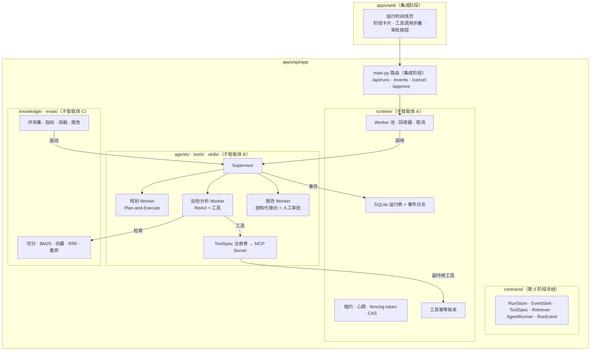

# agent-hub 升级报告与三智能体并行开发计划（v1）

> **目标岗位**：道通科技 · AI Agent 开发工程师（深圳 · 30–60K · 3–5 年 · Python）
> **代码基线**：`ggbdpq/agent-hub`，13 个提交，最后提交 2026-10-01（`docs(readme): 校准任务恢复行为与验证矩阵`）
> **执行方式**：zcode 主线程（集成者）+ 3 个并行子智能体（A / B / C）
> **原则**：先冻结契约，再并行开发；能互不干扰的先做，有文件重叠的全部放到最后由主线程串行集成
> **标注**：【事实】= 已在代码中核实；【决策】= 本计划的取舍；【不自信】= 需要你或实现时再确认

---

## 0. 一页结论（TL;DR）

1. **现状**：agent-hub 是一个做得不错的**前端与流式事件工程 Demo**（SSE 解码、Zod/Pydantic 契约镜像、A2UI 卡片、任务状态机、支付幂等），但后端**不是 Agent**：对话是剧本或单次 LLM 调用，没有工具调用、没有规划、没有多智能体、没有评测。与目标 JD 的匹配度约 3/10。
2. **升级方向（第一性原理）**：JD 真正考的是三件事——**能编排（Multi-Agent / Plan-and-Execute / Tool·MCP·Skill）、能扛住生产（持久化 / 断点恢复 / 重试 / 权限 / 追踪）、能证明效果（评测 / 成本 / 消融）**。升级只围绕这三件事，其余一律 YAGNI。
3. **方案**：新增一个**设备巡检多智能体**场景（贴合道通的无人机 / 巡检业务），采用“Supervisor + 3 个 Worker”的 LangGraph 编排；运行时用 SQLite 实现**租约 + 心跳 + fencing token + CAS**，真正做到进程崩溃后断点续跑、旧执行无法覆盖新结果；RAG 检索巡检规程并产出**可回溯的证据**；评测框架统计成功率、工具调用准确率、时延 P50/P95 与 Token 成本，并跑消融实验。
4. **并行切分**：A = 持久化运行时，B = 智能体编排 + 工具 / MCP / Skill，C = 知识检索 + 评测。三者只通过第 0 阶段冻结的接口（`app/contracts/`）交互，各自独占目录；`main.py`、跨端契约、前端、CI、README 等共享文件全部留到第 4 阶段集成。
5. **周期**：约 21 天（对应 60 天复习计划的第 3–5 周）。第 0 阶段 2 天（串行）→ 第 1–3 阶段 12 天（三路并行）→ 第 4 阶段 5 天（串行集成）→ 第 5 阶段 2 天（对抗式审查、消融、蒸馏成简历与面试话术）。

---

## 1. 思维模型选型：本需求用哪些、怎么用

不是每个“顶级思维模式”都适用。以下按“对本需求的杠杆”排序，并写明落点；未入选的也写明原因。

| 思维模型 | 在本计划中的具体用法 | 落点章节 |
|---|---|---|
| **第一性原理** | 从 JD 的 6 条职责 + 6 条要求反推“必须能被代码证明的能力”，而不是从技术清单出发堆功能 | §3 |
| **契约先行（Contract-First）** | 并行的前提是接口先冻结：`RunStore`、`EventSink`、`ToolSpec`、`Retriever`、`AgentRunner` 五个接口 + 事件 Schema 在第 0 阶段定稿 | §5 |
| **高内聚低耦合 / 端口与适配器** | 每个子智能体只拥有一个目录（高内聚），只依赖 `contracts`（低耦合）；LLM、向量库、存储都是可替换适配器 | §5、§6 |
| **文件所有权矩阵（Ownership Matrix）** | 每个文件只有一个写入者；需要改别人文件时写“集成请求”，由主线程统一合并，消除合并冲突 | §6.2 |
| **奥卡姆剃刀** | SQLite 代替 Postgres + Redis；自写 Supervisor 代替黑盒封装库；确定性规则做异常检测，不引入视觉模型 | §4.3 |
| **YAGNI** | 不做：长期记忆、知识图谱、真实无人机接入、多租户鉴权、K8s 部署、复杂前端 | §4.4 |
| **绞杀者模式（Strangler Fig）** | 保留现有“花语”演示与其 E2E 不动；新能力走新路由 `/api/runs`，旧路由逐步弃用，避免回归 | §4.2 |
| **先红后绿（Red-Green）** | 每个关键不变量先写失败测试：崩溃续跑、旧执行写入被拒、副作用工具不重复执行 | §7 |
| **故障注入 / 混沌测试** | 测试中主动 `kill -9` worker、让工具超时、让 LLM 返回非法 JSON，验证运行时而非提示词兜底 | §7、§9 |
| **对抗式审查（Red Team Review）** | 集成前主线程按清单逐项“试图证明它是错的”；子智能体之间交叉审查 | §10 |
| **消融实验（Ablation）** | 每个设计点都要能被关掉并对比指标：去掉 Supervisor、去掉规划、去掉重排、只用 BM25…… | §11 |
| **批判性思维 / 独立思考** | 对既有 README 与简历表述做事实核查（如“重启恢复在途任务”实际不成立） | §2.2 |
| **列出不自信的点** | 单列一章，标明风险、验证方式与默认选择 | §12 |
| **蒸馏（Distillation）** | 项目完成后把结果压缩为 3 条简历要点 + 10 道题的实践证据，旧的“设计”答案升级为“实践” | §13 |

**未入选**：“领域驱动设计全套战术建模”——场景规模太小，引入聚合 / 领域事件等概念会增加认知负担，只借用“限界上下文 = 目录边界”这一点。

---

## 2. 现状审计（基于代码核实）

### 2.1 代码规模与能力

| 模块 | 文件 | 行数 | 实际能力 |
|---|---|---|---|
| 对话 | `apps/api/app/agent.py` | 124 | 确定性剧本：按关键词判定场景，输出固定事件序列 |
| LLM | `apps/api/app/llm.py` | 248 | 单次 OpenAI 兼容流式调用 + ```card 围栏解析，校验失败降级为文本；**无工具调用、无多轮** |
| 证据 | `apps/api/app/evidence.py` | 36 | 3 条写死的证据（可信度 88 / 72 / 91），按场景挂载 |
| 任务 | `apps/api/app/tasks.py` | 150 | 进程内字典 + JSON 快照；`sleep` 模拟进度；哈希尾号 7 确定性失败 |
| 订单 | `apps/api/app/orders.py` | 109 | 支付沙箱：状态机 + 验签 + 幂等回调 |
| 共享契约 | `packages/shared/src/` | ~470 | SSE 解码器、Zod 契约、骨架屏断点 |
| 测试 | pytest 5 个文件、node:test 3 个、Playwright 1 个 | — | 契约 / 状态机 / SSE / E2E 均进入 CI |

后端依赖只有 `fastapi`、`uvicorn`、`pydantic`（+ `httpx` 测试）。

### 2.2 事实核查：已发现的问题（必须在升级中修掉或改口径）

| # | 问题 | 证据 | 影响 |
|---|---|---|---|
| F1 | **“重启恢复在途任务”不成立**：`restore_snapshots()` 只把快照读回内存，没有重新调度 `_run()`，状态为 `running` 的任务永远停在原地（僵尸任务） | `tasks.py` `restore_snapshots` 无 `create_task(_run(...))` | README 表述过度；对应面试第 8、10 题的短板 |
| F2 | 去重判断写错：`if task.status not in _TASKS` 拿**状态**去比对**任务 ID 字典的键**，恒为真 | `tasks.py` 第 ~70 行 | 当前无害，但说明缺少针对恢复路径的测试 |
| F3 | 快照写入非原子：`write_text` 直接覆盖，进程在写入中途崩溃会留下半个 JSON（随后被 `except: continue` 静默跳过，任务丢失） | `_persist()` | 崩溃一致性缺失 |
| F4 | 证据不是检索出来的：证据按场景静态挂载（`_scene_evidence_refs`），与模型实际输出无关；可信度是写死的常量，不是“服务端计算” | `llm.py`、`evidence.py` | “证据溯源”只是 UI 演示；README 中“可信度由服务端计算”应改口径 |
| F5 | 后端没有任何 Agent 能力：无工具、无规划、无循环、无多智能体 | 全仓无 tool / function calling 代码 | 与 JD 第 1–3 条职责不匹配 |
| F6 | 无评测、无 Trace、无成本统计 | — | 与 JD 第 6 条职责、加分项不匹配 |
| F7 | 无数据库、无缓存、无 Docker | `pyproject.toml` 依赖 | 与 JD“工程化能力”不匹配 |

> 结论：F1–F4 属于**口径风险**，F5–F7 属于**能力缺口**。升级完成前，简历与 README 中关于 agent-hub 的“重启恢复”“服务端计算可信度”表述应先降级。

---

## 3. 第一性原理：从 JD 反推必须交付的能力

| JD 条目 | 面试官真正想验证的 | 必须交付的可验证产物 | 负责方 |
|---|---|---|---|
| 职责 1：任务理解、规划、工具调用、上下文管理、状态流转、执行控制 | 你能写出一个**受控**的 Agent 循环，而不是 Prompt 拼接 | Plan-and-Execute 规划节点 + ReAct 执行节点；步数 / Token / 工具调用预算由运行时强制 | B |
| 职责 2：Multi-Agent，Supervisor 调度、子任务分发、并行、汇总、异常处理 | 子任务超时 / 失败 / 取消时系统还能给出确定结果 | Supervisor + 3 Worker；多设备扇出并行、扇入汇总；子任务失败降级为“部分完成”且可解释 | B（编排）+ A（取消与超时原语） |
| 职责 3：Tool / Skill / MCP，统一接入 | 工具有元数据、权限、可发现性，不是硬编码函数 | `ToolSpec` 注册表（读 / 写 / 高危分级）；同一注册表同时暴露为 MCP Server；Skill = 提示词 + 工具子集 + 输出 Schema | B |
| 职责 4：巡检场景业务 Agent（规划、巡检分析、异常识别、设备调度、结果生成） | 你理解业务闭环 | 巡检计划 → 遥测分析 → 异常判定（带证据）→ 工单（需人工审批） | B + C |
| 职责 5：Runtime、执行引擎、持久化、断点恢复、失败重试、权限、日志追踪、监控 | **最核心的生产化能力** | SQLite 持久化运行表 + 事件日志 + 检查点；租约 / 心跳 / fencing token；`kill -9` 后续跑；幂等工具账本；按序号续传事件 | A |
| 职责 6：效果评测，成功率、工具准确率、时延、成本 | 你能用数据证明改动有效 | 评测集 + 指标报告 + 消融矩阵；CI 中跑离线回归 | C |
| 要求 3：LangGraph / LangChain 等至少一种框架 | 框架熟练度 | 使用 LangGraph 的 StateGraph、条件边、并行分发、检查点、人工中断 | B |
| 要求 5：FastAPI、RESTful、数据库、缓存、异步任务、Docker、日志监控 | 后端基本功 | 新 `/api/runs` 系列接口、SQLite、异步 worker、`docker compose up` 一键启动、结构化日志 | A + 集成 |
| 加分：RAG、向量数据库、上下文检索优化 | 检索工程 | BM25 + 向量混合召回 + RRF 融合 + 可选重排；Recall@k / MRR 报告 | C |
| 加分：评测、Trace、质量门控、失败恢复、成本优化 | 同上 | 质量门：评测指标低于阈值时 CI 失败 | C + 集成 |
| 加分：开源框架源码阅读 / 二次开发 | — | 已有 Maka / Magpie 贡献，不在本项目重复 | — |

---

## 4. 目标架构

### 4.1 总体分层



### 4.2 新旧共存（绞杀者模式）

- **保留不动**：`agent.py`、`llm.py`、`evidence.py`、`orders.py` 以及现有花语 E2E。
- **修复后保留**：`tasks.py`（修 F1–F3，由 A 负责）。
- **新增**：`/api/runs` 系列路由承载巡检多智能体；前端新增 `/runs` 页面，导航中把“花语顾问”标为“流式渲染演示”。
- 【决策】不把花语改造成 Agent：花店场景与 JD 无关，改造投入产出比低。

### 4.3 关键技术取舍（奥卡姆剃刀）

| 决策点 | 选择 | 放弃的方案 | 理由 |
|---|---|---|---|
| 存储 | **SQLite（WAL 模式）** | Postgres + Redis | 单机演示足够；租约与 CAS 用一条 `UPDATE ... WHERE` 即可实现，原理与分布式版本一致；`RunStore` 是接口，后续可换 Postgres |
| 编排框架 | **LangGraph（StateGraph 手写 Supervisor）** | `langgraph-supervisor` 等封装包、CrewAI | 手写才能讲清路由、超时与失败策略；JD 点名 LangGraph |
| 检查点 | **LangGraph SQLite 检查点** | 自研 | 断点恢复交给框架，运行时只管“谁有权执行”（租约），职责分离 |
| 异常检测 | **确定性规则（阈值 + 滑动窗口 z-score）作为工具** | 让 LLM 判断数值异常 | 数值判断交给代码，LLM 只做解释与决策；可测、可复现 |
| 向量检索 | **内存 / SQLite 存向量 + 余弦相似度** | Chroma、Milvus、pgvector | 语料只有几十篇；接口可替换，面试讲“为何此规模不需要向量数据库”比堆组件更有说服力 |
| 离线可测 | **确定性脚本 LLM（FakeLLM）+ 可选真实 LLM** | 只用真实 LLM | CI 必须离线、可断言；真实模型只用于评测报告 |
| MCP | **官方 Python SDK 暴露同一 ToolSpec 注册表** | 另写一套工具 | 单一事实源，避免两套工具行为漂移 |

### 4.4 明确不做（YAGNI）

长期记忆 · 知识图谱 · 视觉 / 图像识别 · 真实设备与无人机接入 · 多租户与鉴权 · K8s · 流式 Token 级多智能体输出 · 前端复杂可视化（图编辑器等）。
面试被问到时的口径：“为什么不做”与“需要时怎么接”（接口已预留）。

---

## 5. 第 0 阶段：契约冻结（主线程串行，第 1–2 天）

> 这是并行开发能成立的唯一前提。**第 0 阶段结束前，不启动任何子智能体。**

### 5.1 主线程一次性提交的共享文件

| 文件 | 内容 | 之后的写入者 |
|---|---|---|
| `apps/api/pyproject.toml` | 一次性加齐依赖：`langgraph`、`langgraph-checkpoint-sqlite`、`langchain-core`、`mcp`、`numpy`、`rank-bm25`（或自写 BM25）、`pytest-asyncio` | **仅主线程** |
| `apps/api/app/contracts/__init__.py` 等 | 五个接口 + 事件模型（见 §5.2） | **仅主线程**（变更走集成请求） |
| `apps/api/app/runtime/__init__.py`、`agents/`、`tools/`、`skills/`、`knowledge/`、`apps/mcp_inspection/`、`evals/` | 空包与 README 占位 | 各自所有者 |
| `apps/api/tests/conftest.py` | 公共夹具：临时 SQLite 路径、FakeLLM 工厂、冻结时钟 | **仅主线程** |
| `fixtures/inspection/` | 设备清单（20 台）、遥测样本、巡检规程语料（约 30 篇，**注明为合成数据**） | 主线程起草，C 可追加语料 |
| `AGENTS.md` | 项目规则、所有权矩阵、提交规范、禁止事项 | 仅主线程 |
| `docs/adr/0003~0006` | 存储选型、编排选型、事件协议、工具权限模型 | 仅主线程 |
| `docs/integration-requests/{A,B,C}.md` | 各子智能体的“集成请求”收件箱（只追加） | 各自追加自己的文件 |

### 5.2 冻结的接口（签名级）

```python
# app/contracts/events.py —— 运行事件（跨模块唯一事件格式）
class RunEvent(BaseModel):
    run_id: str
    seq: int                 # 每个 run 内严格递增，由 RunStore 分配
    type: Literal[
        "run.queued", "run.started", "run.resumed", "run.completed",
        "run.failed", "run.cancelled", "run.partial",
        "node.started", "node.completed", "node.failed",
        "tool.called", "tool.result", "tool.denied", "tool.deduplicated",
        "plan.created", "evidence.attached", "approval.required", "approval.resolved",
        "metric.usage",      # tokens / cost / latency
    ]
    node: str | None = None          # supervisor / planner / inspector / reporter
    attempt: int                     # 第几次执行（续跑后递增）
    payload: dict
    ts: datetime

# app/contracts/runtime.py
class RunStore(Protocol):
    def create_run(self, kind: str, input: dict, idempotency_key: str | None) -> RunRecord: ...
    def claim(self, worker_id: str, lease_s: int) -> Claim | None: ...          # 返回 fencing_token
    def heartbeat(self, run_id: str, token: int, lease_s: int) -> bool: ...     # False = 已失去租约
    def append_event(self, run_id: str, token: int, event: NewEvent) -> RunEvent: ...  # token 过期则拒绝
    def finish(self, run_id: str, token: int, status: TerminalStatus, result: dict | None, error: str | None) -> bool: ...
    def request_cancel(self, run_id: str) -> RunRecord: ...
    def is_cancel_requested(self, run_id: str) -> bool: ...
    def get(self, run_id: str) -> RunRecord | None: ...
    def events_after(self, run_id: str, after_seq: int) -> list[RunEvent]: ...

class ToolLedger(Protocol):   # 副作用工具的幂等账本
    def begin(self, key: str, tool: str, args_hash: str) -> LedgerEntry: ...    # 已存在则返回原记录
    def complete(self, key: str, result: dict) -> None: ...
    def fail(self, key: str, error: str, retryable: bool) -> None: ...

# app/contracts/tools.py
class ToolSpec(BaseModel):
    name: str
    description: str
    input_schema: type[BaseModel]
    output_schema: type[BaseModel]
    effect: Literal["read", "write", "dangerous"]   # write 必须走账本；dangerous 必须人工审批
    allowed_nodes: set[str]                          # 哪些节点可调用（权限隔离）
    timeout_s: float
    retry: Literal["safe", "never", "ledger"]        # 超时后能否重试
    handler: Callable[..., Awaitable[BaseModel]]

# app/contracts/knowledge.py
class Retriever(Protocol):
    async def search(self, query: str, k: int, filters: dict | None = None) -> list[Chunk]: ...
class Chunk(BaseModel):
    chunk_id: str; doc_id: str; title: str; text: str; score: float; source_path: str

# app/contracts/agent.py
class AgentRunner(Protocol):     # 评测与 Worker 都只依赖它
    async def run(self, run_id: str, input: InspectionRequest, ctx: RunContext) -> InspectionReport: ...
class RunContext(BaseModel):     # 运行时注入给编排层的能力
    emit: Callable[[NewEvent], Awaitable[None]]
    cancelled: Callable[[], bool]
    budget: Budget               # max_steps / max_tool_calls / max_tokens / deadline
    ledger: ToolLedger
    retriever: Retriever
    llm: ChatModelFactory
```

### 5.3 每个接口附带的“替身实现”

主线程在 `contracts/fakes.py` 提供：`InMemoryRunStore`、`InMemoryLedger`、`StaticRetriever`（返回固定 Chunk）、`ScriptedAgentRunner`（返回固定报告）、`FakeLLM`（按脚本回放消息与工具调用）。
**作用**：A、B、C 互相不等待——B 用 `InMemoryRunStore` 和 `StaticRetriever` 开发，C 用 `ScriptedAgentRunner` 开发评测框架，A 用一个最简“空图”验证续跑。

### 5.4 第 0 阶段验收

- `python -m pytest -q` 全绿（含替身实现的冒烟测试）。
- `docs/adr/0003~0006` 合入；`AGENTS.md` 所有权矩阵合入。
- 打标签 `contracts-v1`。之后任何契约变更都需升到 `contracts-v2`，并在三个分支同步 rebase。

---

## 6. 并行开发的组织方式

### 6.1 分支与工作区

```bash
git switch -c upgrade/base && git tag contracts-v1
git worktree add ../ah-A -b feat/runtime    contracts-v1
git worktree add ../ah-B -b feat/agents     contracts-v1
git worktree add ../ah-C -b feat/knowledge-eval contracts-v1
```

- 每个子智能体只在自己的 worktree 内工作，只提交、不推送、不合并；**推送与合并只由主线程执行**。
- 【不自信】zcode 是否原生支持“一个子智能体绑定一个 worktree”需要你确认；不支持时，退化为三个独立克隆目录，规则不变。

### 6.2 文件所有权矩阵

| 路径 | A 运行时 | B 编排 | C 知识与评测 | 主线程 |
|---|:-:|:-:|:-:|:-:|
| `app/runtime/**`、`tests/runtime/**` | **写** | 读 | 读 | 审 |
| `app/tasks.py`、`tests/test_tasks.py`（修 F1–F3） | **写** | — | — | 审 |
| `app/agents/**`、`app/tools/**`、`app/skills/**`、`apps/mcp_inspection/**`、`tests/agents/**`、`tests/tools/**` | 读 | **写** | 读 | 审 |
| `app/knowledge/**`、`evals/**`、`tests/knowledge/**`、`tests/evals/**`、`fixtures/inspection/corpus/**`（追加） | 读 | 读 | **写** | 审 |
| `app/contracts/**`、`pyproject.toml`、`conftest.py`、`AGENTS.md`、`docs/adr/**` | 读 | 读 | 读 | **写** |
| `app/main.py`、`app/schemas.py`、`packages/shared/**`、`apps/web/**`、`e2e/**`、`.github/**`、`README.md`、`docker-compose.yml`、`Dockerfile` | — | — | — | **写（第 4 阶段）** |
| `docs/integration-requests/A.md` / `B.md` / `C.md` | 追加自己的 | 追加自己的 | 追加自己的 | 读并处理 |

**硬规则**：子智能体发现需要修改不属于自己的文件时，**停止修改**，在自己的集成请求文件中写明“文件 / 改动 / 原因 / 是否阻塞”，然后用替身或本地适配绕过，继续开发。

### 6.3 每日节奏

1. 每个子智能体收尾时输出“日报”：完成的任务 ID、测试命令与结果、未解决问题、集成请求。
2. 主线程每天一次：读三份日报 → 处理集成请求（必要时发布 `contracts-v1.x` 的**向后兼容**补丁）→ 对三个分支做只读审查，不合并。
3. 不允许子智能体之间直接通信；所有协调经主线程（避免上下文污染与决策漂移）。

---

## 7. 子智能体任务书（第 1–3 阶段，并行，第 3–14 天）

> 每项任务格式：**目标 → 产物 → 先红后绿的测试 → 验收命令**。任务按依赖排序，同一子智能体内串行，子智能体之间并行。

### 7.1 子智能体 A：持久化运行时（Durable Runtime）

**使命**：保证“任何时刻 `kill -9`，任务都能被正确接管；过期执行者的任何写入都被拒绝；副作用不会重复发生”。这一块对应 JD 职责 5，以及面试第 7、8、10 题。

| ID | 任务 | 关键设计 | 先写的失败测试 |
|---|---|---|---|
| A0 | 修复旧任务模块 F1–F3 | 原子写入（临时文件 + `os.replace`）；恢复时对 `queued/running` 重新调度；修正去重判断 | `test_restart_resumes_running_task`、`test_partial_snapshot_not_lost` |
| A1 | SQLite 模式与迁移 | 表 `runs(run_id PK, kind, status, input, result, error, version, attempt, lease_owner, lease_expires_at, fencing_token, cancel_requested, idempotency_key UNIQUE, created_at, updated_at)`；`run_events(run_id, seq, ..., PRIMARY KEY(run_id, seq))`；`tool_ledger(key PK, tool, args_hash, status, result, error, retryable, updated_at)`；WAL 模式；`busy_timeout` | 模式创建幂等；重复 `idempotency_key` 返回同一 run |
| A2 | 状态机 | 合法迁移表：`queued→running→{completed, failed, cancelled, partial}`，`running→queued`（租约过期回收）；**终态吸收**：终态之后任何迁移都拒绝 | 参数化测试覆盖所有非法迁移 |
| A3 | 租约认领与 fencing token | `claim`：单条 `UPDATE runs SET lease_owner=?, lease_expires_at=?, fencing_token=fencing_token+1, attempt=attempt+1, status='running' WHERE run_id=(SELECT ... WHERE status='queued' OR (status='running' AND lease_expires_at<now) LIMIT 1) RETURNING ...` | 两个 worker 并发认领，只有一个成功 |
| A4 | CAS 写入 | `append_event` / `finish` 都带 `WHERE fencing_token=? AND status='running'`；影响行数为 0 即视为已失去所有权，抛 `LeaseLost` | **核心测试**：worker1 暂停 → 租约过期 → worker2 接管并完成 → worker1 醒来写结果被拒，最终结果仍是 worker2 的 |
| A5 | 心跳与回收器 | 心跳间隔 = 租约 / 3（默认租约 15 秒、心跳 5 秒）；心跳失败立即通过 `RunContext.cancelled()` 让编排层停下；回收器在启动时与每 10 秒扫描过期租约 | `test_kill9_then_reclaimed_within_lease`（子进程 + `SIGKILL`） |
| A6 | 事件日志与续传 | `seq` 在事务内分配（`MAX(seq)+1`）；`events_after(run_id, after_seq)` 支撑 SSE `Last-Event-ID` | 并发追加时 seq 无空洞、无重复 |
| A7 | 工具幂等账本 | 键 = `run_id:node:step:tool_call_id`（由编排层生成，续跑时可复现）；`begin` 已存在且已完成 → 直接返回原结果并发 `tool.deduplicated` 事件；处于进行中且超时 → 标记“未知”，**不自动重试**，交由工具的 `retry` 策略决定 | `test_write_tool_not_executed_twice_after_crash` |
| A8 | 协作式取消 | `request_cancel` 只置标记；编排层在节点边界与工具调用前检查；正在执行的工具按 `timeout_s` 结束；最终由持有租约的 worker 写入 `cancelled` | 取消与完成竞争时，以先成功 CAS 者为准，另一方被拒 |
| A9 | Worker 池与续跑入口 | `RuntimeWorker.run_forever()`：认领 → 构造 `RunContext` → 调用 `AgentRunner.run`（开发期用 `ScriptedAgentRunner`）→ CAS 写终态；续跑时发 `run.resumed`，`attempt` 递增 | 端到端：创建 → 运行到一半 kill → 新 worker 续跑 → 完成，事件序列可解释 |
| A10 | 结构化日志与运行指标 | 每条日志带 `run_id / attempt / seq / node`；暴露 `get_metrics()`：在途数、回收次数、租约丢失次数、平均时长 | 日志字段快照测试 |

**A 的验收命令**：`pytest tests/runtime -q`（含故障注入用例）；`python -m app.runtime.demo_crash` 打印“崩溃 → 回收 → 续跑 → 完成”的事件序列。

**A 的边界提醒**：A 不 import `langgraph`。检查点由 B 在编排层使用，A 只负责“谁有权执行”和“写入是否有效”——这是两层不同的一致性问题，混在一起会高耦合。

### 7.2 子智能体 B：多智能体编排 + 工具 / MCP / Skill

**使命**：交付一个可解释、可控、可中断的巡检多智能体。对应 JD 职责 1–4、要求 3–4，以及面试第 1、3、5、7 题。

| ID | 任务 | 关键设计 | 先写的失败测试 |
|---|---|---|---|
| B0 | 领域模型与假设备 | `InspectionRequest(site, device_ids, window, goal)`、`InspectionReport(findings[], work_orders[], status, coverage)`；`apps/api/app/tools/devices.py` 读取 `fixtures/inspection/` 的设备与遥测 | Schema 往返测试 |
| B1 | ToolSpec 注册表 | 工具：`list_devices`(read)、`get_telemetry`(read)、`detect_anomaly`(read，确定性规则)、`search_procedures`(read，调用 `Retriever`)、`create_work_order`(write，走账本)、`dispatch_drone`(dangerous，需审批，**仅模拟**)；注册时校验 Schema 与权限 | 未注册工具、越权节点调用 → `tool.denied` 事件而不是异常崩溃 |
| B2 | 工具执行器（运行时强制层） | 统一入口 `execute_tool(spec, args, ctx)`：权限检查 → 参数 Schema 校验 → 预算扣减 → 超时控制 → `write` 走账本 → 结果 Schema 校验 → 发事件；**所有约束在这里，不在提示词里** | 超预算、超时、参数非法、重复写入四类用例 |
| B3 | 规划 Worker（Plan-and-Execute） | 输出结构化 `Plan(steps[{device_id, checks[]}])`；Schema 校验失败最多重试 2 次，仍失败 → 退回“全量默认检查计划”（确定性兜底） | FakeLLM 返回非法 JSON 时走兜底 |
| B4 | 巡检分析 Worker（ReAct） | 每个设备一个子任务；最多 6 步；只允许调用读工具；结论必须引用 `detect_anomaly` 的输出与 `search_procedures` 的 `chunk_id` | 结论引用了不存在的 chunk_id → 判定为无效结论并剔除 |
| B5 | Supervisor 与并行扇出 | LangGraph `StateGraph`：`supervisor → planner → (Send 扇出多个 inspector) → 汇总 → reporter`；每个子任务 `asyncio.wait_for` 超时；失败子任务记录原因并继续，最终状态 `partial` + 覆盖率 | 3 台设备中 1 台超时 → 报告 `partial`，覆盖率 2/3，原因可读 |
| B6 | 上下文隔离 | 子任务只接收“任务简报 + 该设备的数据摘要”，不接收全局消息历史；返回结构化 `Finding`，Supervisor 只汇总结构化结果 | 断言子任务输入 Token 上限；断言子任务看不到其他设备数据 |
| B7 | 报告 Worker + 人工审批 | 结构化输出工单；`create_work_order` 可直接执行（幂等）；`dispatch_drone` 触发 LangGraph `interrupt()` → 发 `approval.required` → 恢复时读审批结果 | 审批拒绝 → 不执行，报告中写明；进程在等待审批期间重启 → 恢复后仍在等待审批 |
| B8 | 检查点与续跑 | LangGraph SQLite 检查点，`thread_id = run_id`；配合 A 的续跑入口，续跑从最后一个完成的节点继续；已完成的写工具因账本不会重复执行 | 在 reporter 之前 kill → 续跑后 planner / inspector 不重跑 |
| B9 | MCP Server | `apps/mcp_inspection/server.py` 从同一注册表生成 MCP 工具（stdio + streamable HTTP）；`dangerous` 工具在 MCP 侧默认不暴露 | 用 MCP 客户端列出工具并调用 `get_telemetry` 成功 |
| B10 | Skill 封装 | `app/skills/<name>/SKILL.md + skill.py`：一个 Skill = 系统提示片段 + 工具白名单 + 输出 Schema；三个 Skill：`telemetry-triage`、`procedure-lookup`、`work-order-drafting`；Worker 通过 Skill 加载能力 | Skill 声明之外的工具不可用 |
| B11 | 单智能体基线（供消融） | `SingleReActRunner`：同样的工具，一个 ReAct 循环做完全部，不规划、不分工 | 能跑通同一评测样例 |
| B12 | `InspectionAgentRunner` 实现 `AgentRunner` | 对外唯一入口；通过 `RunContext` 使用运行时能力，不直接 import `runtime` | 用 `InMemoryRunStore` 跑通完整流程 |

**B 的验收命令**：`pytest tests/agents tests/tools -q`；`python -m app.agents.demo --fake-llm` 打印完整事件序列；`python -m apps.mcp_inspection.server --list-tools`。

**B 的边界提醒**：LLM 只通过 `ctx.llm` 获取；真实模型适配（OpenAI 兼容）可复用 `llm.py` 的 Provider 解析思路，但**不修改 `llm.py`**，在 `app/agents/models.py` 内自建。

### 7.3 子智能体 C：知识检索 + 评测

**使命**：让“证据”真正来自检索，让“效果”真正有数字。对应 JD 职责 6、加分项 RAG / 评测，以及修复 F4。

| ID | 任务 | 关键设计 | 先写的失败测试 |
|---|---|---|---|
| C0 | 语料与标注 | 约 30 篇合成巡检规程（光伏逆变器、变电站、桥梁、风机等），每篇注明“合成数据”；为检索评测标注 60 条“问题 → 相关 chunk_id” | 标注引用的 chunk 必须存在 |
| C1 | 切分 | 按标题层级切分，保留标题路径作为前缀；块大小与重叠可配置；`chunk_id = doc_id#path#n`，**内容不变则 ID 不变**（保证证据引用稳定） | 重复切分 ID 稳定 |
| C2 | BM25 检索 | 中文需分词：【不自信】`jieba` 还是字符 bigram，按 Recall@5 结果决定 | 关键词命中用例 |
| C3 | 向量检索 | `Embedder` 接口：离线 `HashingEmbedder`（确定性，供 CI）+ OpenAI 兼容 embedding（供评测报告）；向量存 numpy 数组 + 余弦相似度 | 离线嵌入确定性 |
| C4 | 混合召回与融合 | RRF（倒数排名融合，k=60）；可选重排器接口（默认关闭；评测时可接兼容 rerank API） | 融合结果包含两路的头部结果 |
| C5 | `HybridRetriever` 实现 `Retriever` | 返回带分数与来源路径的 `Chunk`；空结果时返回空列表，**不编造** | 无相关内容的问题返回空 |
| C6 | 检索评测 | Recall@1/3/5、MRR、平均检索耗时；输出 `evals/reports/retrieval-*.md` | 指标计算单元测试（手算样例） |
| C7 | 智能体评测集 | 60 条巡检用例：`input`、期望异常设备、期望工具调用序列（集合 + 关键顺序约束）、期望工单字段、禁止调用的工具；分三档难度；包含 10 条“故障注入”用例（工具超时、LLM 非法输出、子任务失败） | 数据集 Schema 校验 |
| C8 | 评测框架 | 只依赖 `AgentRunner`（开发期用 `ScriptedAgentRunner`）；指标：任务成功率、异常识别 Precision/Recall、工具调用 Precision/Recall、参数准确率、越权调用次数、步数、时延 P50/P95、输入 / 输出 Token、成本（按可配置单价）；每条用例保存完整事件序列便于复盘 | 指标计算单元测试 |
| C9 | 消融框架 | 配置矩阵一次跑完并出对比表：见 §11 | 配置组合展开正确 |
| C10 | 质量门 | `evals/gate.py`：离线（FakeLLM）基线指标低于阈值 → 退出码非 0（**真正让 CI 失败**，吸取 qoder 架构检查只打印不失败的教训） | 指标低于阈值时退出码为 1 |
| C11 | 报告生成 | Markdown + JSON；包含“方法、样本量、置信区间或至少是方差、已知偏差”；**离线报告标注“仅验证流程，不代表模型效果”** | 报告快照测试 |

**C 的验收命令**：`pytest tests/knowledge tests/evals -q`；`python -m evals.run --suite retrieval`；`python -m evals.run --suite agent --runner scripted`；`python -m evals.gate`。

### 7.4 三路并行的时间线

```mermaid
gantt
    dateFormat  X
    axisFormat  D%s
    section 主线程
    第0阶段 契约冻结           :0, 2
    每日审查与集成请求          :2, 14
    第4阶段 串行集成            :14, 19
    第5阶段 审查/消融/蒸馏       :19, 21
    section A 运行时
    A0-A2 修复/模式/状态机      :2, 5
    A3-A5 租约/CAS/心跳回收     :5, 9
    A6-A10 事件/账本/取消/Worker :9, 14
    section B 编排
    B0-B2 领域/工具/执行器       :2, 6
    B3-B7 规划/分析/Supervisor/审批 :6, 11
    B8-B12 检查点/MCP/Skill/基线 :11, 14
    section C 知识与评测
    C0-C5 语料/切分/混合检索     :2, 7
    C6-C9 检索评测/评测集/框架/消融 :7, 12
    C10-C11 质量门/报告          :12, 14
```



---

## 8. 第 4 阶段：串行集成（主线程，第 15–19 天）

> 所有“有重叠”的工作都在这里。顺序按**依赖方向**排列：先底层后上层，每步合并后全量测试必须全绿再进入下一步。

| 步骤 | 内容 | 涉及文件 | 验收 |
|---|---|---|---|
| I1 | 合并 A（运行时） | `runtime/**`、`tasks.py` | 全量 pytest 绿；旧 E2E 绿（F1 修复不破坏旧行为） |
| I2 | 合并 C（知识与评测） | `knowledge/**`、`evals/**` | 检索评测可跑 |
| I3 | 合并 B（编排）并替换替身 | `agents/**`、`tools/**`、`skills/**`、`mcp_inspection/**`；把 `StaticRetriever` 换成 `HybridRetriever`、`InMemoryRunStore` 换成 SQLite 实现 | `python -m app.agents.demo` 使用真实依赖跑通 |
| I4 | 处理集成请求 | 汇总三份 `integration-requests`，发布 `contracts-v2`（如需要） | 三方测试仍绿 |
| I5 | API 路由 | `main.py`：`POST /api/runs`（支持 `Idempotency-Key` 头）、`GET /api/runs/{id}`、`GET /api/runs/{id}/events`（SSE，支持 `Last-Event-ID`）、`POST /api/runs/{id}/cancel`、`POST /api/runs/{id}/approvals/{approval_id}`；在 `lifespan` 中启动 worker 与回收器 | httpx 集成测试 |
| I6 | 跨端契约 | `schemas.py` 与 `packages/shared/src/contracts.ts` 镜像 `RunEvent`；共享 fixture 双端对账 | `test_contracts.py` 与 `contracts.test.ts` 绿 |
| I7 | 前端运行页 | `apps/web/src/features/runs/`：按节点分组的时间线，默认只显示阶段与结论，工具调用折叠展示，`approval.required` 显示审批按钮，刷新后按 `Last-Event-ID` 续传（面试第 6、8 题） | 手动验收 + 截图 |
| I8 | E2E | 新增三条：①创建巡检 → 完成；②运行中重启 API 进程 → 页面自动续上且最终完成；③审批流 | Playwright 绿 |
| I9 | Docker 与 CI | `Dockerfile`（api / web）、`docker-compose.yml`（api + web + 持久化卷）；CI 增加 `pytest tests/runtime`、`python -m evals.gate` | `docker compose up` 后可演示；CI 绿 |
| I10 | 文档 | README 新增“巡检多智能体”章节与架构图；修正 F1、F4 的旧表述；ADR 补充决策结果 | 对照 §2.2 逐条核对 |

**集成阶段的冲突处理原则**：主线程只做“接线”，不在集成阶段新增功能；发现子模块缺陷时，开新任务回到对应子智能体修复，而不是主线程顺手改（保持所有权清晰）。

---

## 9. 关键不变量与验证矩阵

> 这些不变量是面试时最能拉开差距的地方，每一条都必须有自动化测试作证。

| 不变量 | 由谁保证 | 测试 | 对应面试题 |
|---|---|---|---|
| 同一时刻一个 run 只有一个有效执行者 | A：租约 + fencing token | 并发认领测试 | 10 |
| 过期执行者的写入一律无效 | A：CAS | 暂停 → 接管 → 迟到写入被拒 | 10 |
| 进程崩溃后任务最终会结束（完成 / 失败 / 部分完成），不会永远 running | A：回收器 + 续跑 | `SIGKILL` 故障注入 | 8、10 |
| 写工具不会因重试或续跑执行两次 | A：账本 + B：可复现的调用键 | 崩溃后续跑的重复执行测试 | 7 |
| 超时状态未知的写工具不自动重试 | B：`retry=never/ledger` 策略 | 超时用例 | 7 |
| 权限、步数、Token、工具调用次数由代码强制 | B：工具执行器 + 预算 | 越权 / 超预算用例 | 3 |
| 子任务失败不拖垮整体，结果可解释 | B：Supervisor 超时与 `partial` | 1/3 子任务超时用例 | 5 |
| 结论必须引用真实存在的证据 | B + C：`chunk_id` 校验 | 引用不存在 chunk 的用例 | — |
| 事件序号严格递增，可断点续传 | A：事务内分配 seq | 并发追加 + `events_after` | 8 |
| 终态不可逆 | A：状态机 | 非法迁移参数化测试 | 10 |
| 评测指标低于阈值时 CI 失败 | C：质量门 | 退出码测试 | 2 |

---

## 10. 对抗式审查清单（第 5 阶段，第 20 天）

主线程以“试图证明它是错的”的立场逐项审查；建议额外开一个**全新上下文**的审查子智能体，只给它代码与本清单，不给开发过程（避免同源偏差）。

**运行时**
- [ ] 时钟：租约比较用的是数据库时间还是进程时间？两个进程时钟不一致时会怎样？（建议统一用 SQLite 的时间函数）
- [ ] `claim` 的子查询 + 更新在 SQLite 中是否真正原子？在 WAL 下并发写是否会出现 `database is locked`，是否设置了 `busy_timeout` 与重试？
- [ ] 心跳协程被事件循环阻塞（比如同步 CPU 计算）时，租约是否会误过期？
- [ ] 取消与完成同时发生时，最终状态是否只取决于谁先 CAS 成功？

**编排**
- [ ] 续跑时，工具调用键是否真的可复现？如果 LLM 在续跑后给出不同的计划，键会不会变化导致重复执行？（应以“已提交到检查点的工具调用”为准）
- [ ] Supervisor 的循环是否有硬上限？LangGraph `recursion_limit` 是否设置？
- [ ] 子任务的上下文是否真的被隔离？有没有通过共享状态字段间接泄露？
- [ ] 人工审批等待期间重启，恢复后审批结果是否只被消费一次？

**检索与评测**
- [ ] 评测集是否被用来调参后又用来报告结果（数据泄露）？需划分开发集 / 测试集
- [ ] 离线 FakeLLM 下的“成功率”是否被误当成模型效果写进 README 或简历？
- [ ] 样本量 60 条时，两个配置的差异是否在噪声范围内？报告中是否给了方差或多次运行结果？
- [ ] 合成语料是否在 README 中明确标注？

**口径**
- [ ] README 与简历中的每一个数字，是否都能在 `evals/reports/` 中找到出处？

---

## 11. 消融实验设计（第 5 阶段，第 20–21 天）

> 目的：证明每个复杂度都“物有所值”；没有收益的设计要敢于删掉（奥卡姆剃刀的实证版）。

| 实验 | 对照组 | 实验组 | 观察指标 | 预期 / 判定 |
|---|---|---|---|---|
| E1 多智能体是否必要 | Supervisor + 3 Worker | 单个 ReAct（B11） | 成功率、工具调用精度、时延、Token | 若单智能体在成功率差距 < 3 个百分点且成本更低，**应在 README 中如实写明**，并说明多智能体在哪类用例上才有优势 |
| E2 规划是否必要 | 有 planner | 无 planner，直接扇出全量检查 | 步数、Token、成功率 | — |
| E3 并行是否必要 | Send 扇出并行 | 串行逐台设备 | 时延 P50/P95 | 并行应显著降低时延 |
| E4 上下文隔离 | 子任务只看简报 | 子任务看完整历史 | 输入 Token、错误归因 | — |
| E5 检索方式 | 混合 + RRF | 仅 BM25 / 仅向量 | Recall@5、MRR | — |
| E6 重排 | 开启 | 关闭 | Recall@1、时延 | 若收益不显著则默认关闭 |
| E7 运行时约束 vs 提示词约束 | 工具执行器强制权限 | 只在提示词中声明权限 | 越权调用次数 | 用于面试第 3 题的直接证据 |

**执行要求**：真实模型下每个配置至少跑 3 次取均值与范围；报告写明模型名称、日期、单价与样本量。【不自信】真实模型评测的 API 费用需要你确认预算，建议先用便宜模型跑全量，再用目标模型跑子集。

---

## 12. 不自信的点（风险登记）

| # | 不自信的点 | 风险 | 默认选择 | 如何验证 |
|---|---|---|---|---|
| U1 | LangGraph 当前版本的 API 细节（`Send`、`interrupt`、异步 SQLite 检查点的包名与用法）可能与记忆不一致 | 子智能体 B 卡在 API 上 | 第 0 阶段先写一个 30 行的“扇出 + 中断 + 检查点”试验脚本，跑通后再冻结 ADR-0004 | 试验脚本进 CI |
| U2 | zcode 的子智能体是否支持独立工作区、能否限制可写路径 | 文件所有权只能靠约定 | 在提示词中写明所有权，并由主线程合并前用 `git diff --name-only` 校验越界 | 合并脚本检查 |
| U3 | SQLite 在多进程 worker 下的并发写表现 | 偶发锁冲突 | 单进程多协程 worker；多进程只用于崩溃测试 | 压测脚本 |
| U4 | 中文 BM25 分词方案 | 检索效果 | 字符 bigram（零依赖），与 jieba 对比后定 | C6 报告 |
| U5 | 合成巡检数据与真实业务差距 | 面试被质疑“玩具数据” | 明确标注合成；面试重点讲方法与不变量，而不是业务指标 | — |
| U6 | 多智能体相对单智能体可能**没有**显著收益 | “多智能体”卖点被消融否定 | 如实报告；把卖点转为“知道何时不该用多智能体”（与面试第 1 题呼应） | E1 |
| U7 | 21 天工期对 3 个子智能体是否足够 | 延期挤占复习时间 | P0 / P1 / P2 分级（见下）；第 14 天未完成的 P2 直接砍掉 | 每日日报 |
| U8 | 道通的真实技术栈与业务（无人机巡检）细节未知 | 场景贴合度 | 只做通用“设备巡检”，不虚构道通内部系统 | — |
| U9 | 是否需要 Postgres 版 `RunStore` 来回应“熟悉数据库” | 面试官追问 | 不做；讲清“接口已隔离、迁移只需替换 SQL 方言与锁语义” | — |

**优先级分级（工期不够时按此裁剪）**
- **P0（必须）**：A0–A9、B1–B8、B12、C0–C8、I1–I8
- **P1（应该）**：A10、B9 MCP、B10 Skill、B11 单智能体基线、C9 消融、C10 质量门、I9 Docker
- **P2（可选）**：C4 重排、C11 报告美化、前端审批的完整交互

---

## 13. 蒸馏：完成后如何进入简历与面试

### 13.1 简历个人项目（完成并有报告后再替换，数字以 `evals/reports/` 为准）

> **agent-hub：巡检多智能体平台（Python · FastAPI · LangGraph · SQLite · React）**
> - 基于 LangGraph 实现 Supervisor + 规划 / 巡检分析 / 报告三类 Worker：Plan-and-Execute 规划、多设备并行扇出、子任务超时降级为部分完成；工具按读 / 写 / 高危分级，权限、步数与 Token 预算由运行时强制，高危操作经人工审批
> - 自研持久化运行时：租约 + 心跳 + fencing token + CAS 写入，进程被强制终止后自动接管并从检查点续跑，过期执行者的写入一律拒绝；写工具经幂等账本保证不重复执行；事件按序号持久化，支持断点续传
> - 同一工具注册表同时暴露为 MCP Server 与 Skill；混合检索（BM25 + 向量 + RRF）为结论提供可回溯证据；评测集 N 条，统计成功率、工具调用准确率、P95 时延与 Token 成本，并以消融实验对比单智能体与多智能体（结果：____）

### 13.2 面试十题的升级（“设计”→“实践”）

| 题 | 升级前 | 升级后可讲的证据 |
|---|---|---|
| 1 何时用 Agent | 识别客户工作流 vs coding-agent | + E1 消融：单智能体与多智能体的真实对比数据 |
| 3 提示词 vs 运行时 | coding-agent 权限与熔断 | + E7：只靠提示词时的越权次数 vs 运行时强制 |
| 5 主 / 子智能体 | 仅研发流程 | + 产品级 Supervisor：上下文隔离、超时、部分完成 |
| 7 超时重试 | 音频 BFF 补偿 | + 工具幂等账本与“状态未知不自动重试” |
| 8 刷新与重连 | 仅页面刷新续追（有僵尸任务） | + `kill -9` 续跑 E2E + `Last-Event-ID` 续传 |
| 10 崩溃恢复与旧结果覆盖 | 设计 | + fencing token / CAS 的自动化测试 |

---

## 14. 子智能体启动提示词（可直接粘贴到 zcode）

### 14.1 通用前缀（三个子智能体共用）

```text
你是 agent-hub 升级项目的子智能体 {A|B|C}。工作目录：{worktree 路径}，分支：{分支名}，基线标签 contracts-v1。
必须先阅读：AGENTS.md、docs/adr/0003~0006、apps/api/app/contracts/**、本计划第 {7.1|7.2|7.3} 节。
规则：
1. 只修改所有权矩阵中属于你的路径；需要改其他文件时，停止修改，在 docs/integration-requests/{A|B|C}.md 追加请求，并用 contracts/fakes.py 中的替身绕过。
2. 每个任务先写失败测试，确认失败后再实现；提交信息格式 `feat(<模块>): <任务ID> <摘要>`，一个任务一个提交。
3. 不推送、不合并、不修改 pyproject.toml / main.py / 前端 / CI。
4. 不编造数据与指标；需要假设时写入代码注释与日报的“假设”栏。
5. 每次收尾输出日报：完成的任务 ID、测试命令与结果、未解决问题、集成请求、你对自己实现最不自信的 3 个点。
```

### 14.2 各自的专属段

- **A**：“你的唯一目标是：任何时刻强制终止进程，任务都能被正确接管，过期执行者的写入一律被拒绝，写工具不重复执行。禁止 import langgraph。按 A0→A10 顺序执行。”
- **B**：“你的唯一目标是：交付可解释、可控、可中断的巡检多智能体。所有约束必须在工具执行器与预算中由代码强制，不能只写在提示词里。只通过 RunContext 使用运行时能力，禁止 import app.runtime。按 B0→B12 顺序执行；B1 完成后先跑通 U1 的 LangGraph 试验脚本。”
- **C**：“你的唯一目标是：让证据来自真实检索、让效果有可复现的数字。评测框架只依赖 AgentRunner 接口，开发期使用 ScriptedAgentRunner。离线报告必须标注‘仅验证流程，不代表模型效果’。按 C0→C11 顺序执行。”

---

## 附录 A：术语表

| 术语 | 含义 |
|---|---|
| 租约（Lease） | 执行者在有效期内独占任务的权利，需靠心跳续期 |
| fencing token | 每次认领递增的令牌；写入时校验令牌，令牌过期的写入被拒绝，用于阻止“旧执行者晚完成覆盖新结果” |
| CAS | 比较并交换：只有当当前值符合预期时才写入 |
| 幂等账本 | 记录写工具调用键与结果的表；同一键再次调用直接返回原结果 |
| Plan-and-Execute | 先产出结构化计划，再逐步执行 |
| ReAct | 推理与行动交替：思考 → 调用工具 → 观察 → 再思考 |
| Supervisor | 负责分派、汇总与异常处理的上层智能体 |
| RRF | 倒数排名融合，把多路检索结果按排名合并 |
| 消融实验 | 去掉某个组件，观察指标变化，以证明该组件的价值 |
| 绞杀者模式 | 新功能走新路径，旧功能保持运行并逐步替换 |

## 附录 B：第 0 阶段检查清单

- [ ] 依赖一次加齐并锁定版本
- [ ] 五个接口 + `RunEvent` 定稿，`fakes.py` 替身可用
- [ ] LangGraph 试验脚本（扇出 + 中断 + 检查点）跑通（U1）
- [ ] 合成设备 / 遥测 / 规程 fixture 提交
- [ ] `AGENTS.md` 所有权矩阵、提交规范、日报模板
- [ ] ADR-0003 存储、0004 编排、0005 事件协议、0006 工具权限
- [ ] 三个集成请求文件创建
- [ ] `contracts-v1` 打标签，三个 worktree 创建
