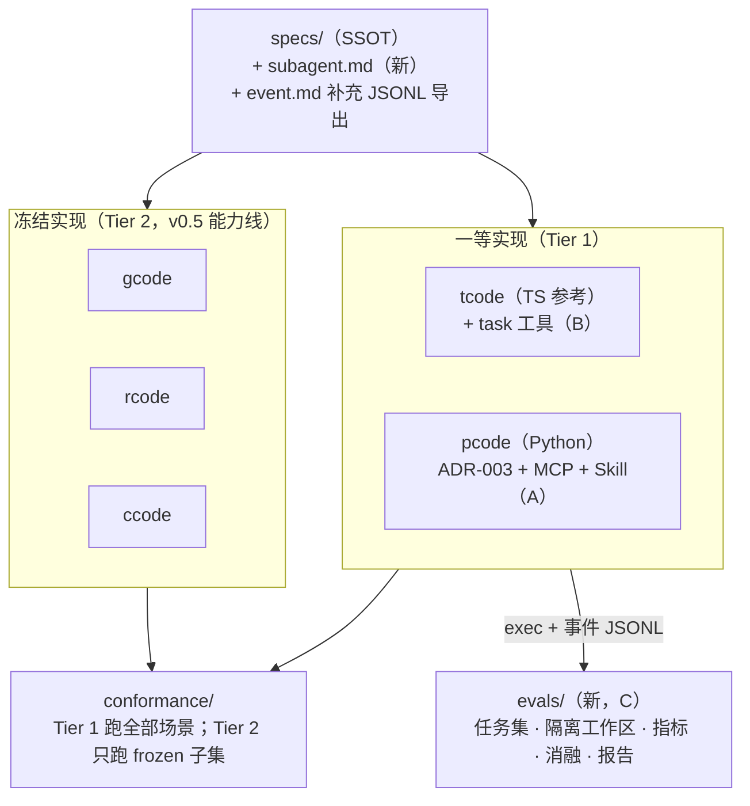

# coding-agent 升级报告与三智能体并行开发计划（v1）

> **目标岗位**：道通科技 · AI Agent 开发工程师（深圳 · 30–60K · 3–5 年 · Python）
> **代码基线**：`ggbdpq/coding-agent` main @ `3933fd8`（2026-10-18，`merge: ADR-003 架构重构（WP0-WP7）与 UI 改版合入 main`），共 127 个提交；`develop`、`ui/refresh-workbench` 与 main 无差异
> **执行方式**：zcode 主线程（集成者）+ 3 个子智能体（A / B / C），每个子智能体一个独立 git worktree
> **姊妹文档**：`agent-hub升级报告与三智能体并行开发计划-v1.md`（本计划沿用其组织方式，但目标与取舍不同）
> **信息分级**：【已验证】= 本次执行过命令；【已观察】= 读过代码 / 文档；【推断】= 有依据但未验证；【待验证】= 需实施时确认

---

## 0. 一页结论

1. **主导领域**：AI / Agent 工程（运行时、上下文工程、评测）。次要领域：跨语言一致性工程。
2. **现状**：coding-agent 是你三个项目中**运行时工程最深**的一个。TS 参考实现已经具备：中间件管线、每次模型调用前的上下文治理、非法 / 截断参数识别、四态权限、轮次上限事件、逐条落盘 + 断尾修复、MCP stdio 客户端、Skill 索引、长期记忆、后台自动化任务、写前快照撤销。
3. **核心问题不是"缺功能"，而是三个结构性缺口**：
   - **没有效果证据**：只验证"五种实现行为是否一致"，从未测量"任务能否完成、花多少轮 / Token / 钱"。这对应 JD 职责 6，也是面试第 2 题的空白。
   - **能力断层**：ADR-003 的 6 条新规则只在 TS 落地，Python 等四版仍停在 v0.5；13 个一致性场景中 8 个是草稿。README 仍写"全部对齐 v0.5.0""权限三态"，与现状不符。
   - **没有多智能体**：JD 职责 2 与面试第 5 题在这个项目里没有任何代码。
4. **升级方向**：
   - **A — Python 一等公民**：把 ADR-003 规则 + MCP + Skill 移植到 Python，让 TS 与 Python 成为"两个完整实现"，Go / Rust / C# 冻结在 v0.5 能力线并如实标注。
   - **B — 子智能体**：在 TS 实现 `task` 工具，派生上下文隔离、权限只降不升、可超时 / 取消、可并行的子 Agent；**规范先行**（新增 `specs/subagent.md`）。
   - **C — 效果评测**：语言中立的评测框架 + 30 个代码任务 + 真实模型消融（上下文治理、轮次上限、Plan Mode、子智能体）。
5. **明确不做**：不引入 LangGraph / LangChain（零依赖手写是本项目的差异化，框架能力已由 agent-hub 证明）；不继续打磨 UI；不增加第六种语言；不做云端沙箱。
6. **周期**：约 14 天。第 0 阶段 2 天 → 三路并行 8 天 → 串行集成 3 天 → 审查与蒸馏 1～2 天。

---

## 1. 方法论选择（只选对本问题有杠杆的）

| 问题性质 | 选用方法 | 落点 |
|---|---|---|
| 要改什么、不改什么 | **第一性原理**：从 JD 反推"必须被代码证明的能力"，对照现有资产找空白 | §3 |
| 五种语言要不要继续同步 | **权衡分析 + 可逆性原则**：分层冻结而非删除，随时可恢复同步 | §4.2、ADR-004 |
| 新增子智能体会不会破坏权限模型 | **风险驱动设计 + 对抗式审查**：先写越权反例，再写实现 | §7.2、§10 |
| 并行开发如何不冲突 | **契约优先 + 关注点分离**：第 0 阶段冻结事件 JSONL、消融开关、子智能体规范 | §5 |
| 评测结论是否可信 | **假设驱动验证 + 消融实验**：每个设计点都要能关掉对比 | §8、§11 |
| 防止过度设计 | **YAGNI / KISS**：不引框架、不做沙箱、不加语言 | §4.4 |
| 已有 ADR-003 计划的经验 | **证据驱动**：复用 `docs/arch-refactor` 已验证的 WP 拆分与五语言同步清单，不重写 | §2.3 |

未选：SOLID 全套、DDD——项目规模与插件内核已经足够清晰，再引入只会增加术语负担。

---

## 2. 现状审计

### 2.1 已验证的事实（本次执行过）

| 项 | 结果 |
|---|---|
| Python 实现单测 | `python -m unittest discover -s test` → **61 个测试通过** |
| TS 核心测试子集 | loop / middleware / limits / toolargs / compact / persist / context / automation 共 8 个文件 → **69 个测试通过** |
| TS 全量测试、浏览器测试、一致性套件 | **未执行**（沙箱缺 Go / Rust / .NET 与浏览器依赖），不得宣称通过 |
| 遗留编译产物 | `impls/typescript/src/` 下有 **41 个已提交的 `.js` 文件**，最后修改于 2026-09-27，而对应 `.ts` 修改于 2026-10-18；`bin/tcode.js` 直接 import `src/main.ts`，grep 未发现任何代码 import 这些 `.js` → 【推断】为死代码 |

### 2.2 代码规模（已观察）

| 实现 | 非测试源码行 | 测试文件 | 能力线 |
|---|---|---|---|
| TypeScript（tcode，参考实现） | 17,694（含桌面端与 Web 工作台） | 46 | ADR-003 + MCP + Skill + 记忆 + 自动化 + 撤销 |
| Python（pcode） | 3,502 | 19 | v0.5 |
| Go（gcode） | 4,714 | 18 | v0.5 |
| Rust（rcode） | 6,564 | 1 | v0.5 |
| C#（ccode） | 3,509 | 14 | v0.5 |

一致性场景 13 个：**frozen 5 个**（SC-001、SC-002A/B/C/D），**draft 8 个**（SC-004A、SC-005～SC-010）。CI 名称仍为"4 scenarios × 5 runtimes"。

### 2.3 TS 参考实现已有的关键资产（已观察）

| 资产 | 文件 | 对应 JD / 面试题 |
|---|---|---|
| 中间件管线（beforeModel / afterModel / wrapToolCall，权限固定最内层） | `core/middleware.ts` | 职责 1、5；第 3 题 |
| 每次模型调用前的治理：清理 → 压缩 → 裁剪 | `core/governance.ts`、`compact.ts`、`trim.ts` | 职责 1；Context Engineering |
| 非法 / 截断工具参数识别（`finishReason=length` 时即使 JSON 合法也不执行） | `core/toolargs.ts` | 要求 2：Function Calling |
| 四态权限（含"本会话允许此类"，复合 shell 命令不可 scoped） | `core/permission.ts` | 职责 5；第 3 题 |
| 轮次 / 调用上限可配 + limit 事件 + 强制总结 | `core/limits.ts` | 职责 1；第 3 题 |
| 逐条落盘 + 加载断尾修复 + 上下文检查点 | `core/session.ts`、`repair.ts` | 职责 5；第 8 题 |
| 只在首字节前重试 | `providers/retry.ts` | 第 7 题 |
| MCP stdio 客户端（`mcp__<server>__<tool>` 桥接，走主审批闸） | `core/mcp.ts`、`mcp_catalog.ts` | 职责 3；要求 4 |
| Skill 索引（`~/.tcode/skills`、`<cwd>/.tcode/skills`） | `core/systemprompt.ts` | 职责 3 |
| 长期记忆（只追加、逐次审批、注入系统提示词） | `plugins/tools/memory_append.ts`、`commands/memory.ts` | 加分项：记忆；第 9 题 |
| 后台自动化任务（隔离会话、重启后标记中断、可继续） | `core/automation.ts` | 加分项：长任务；第 10 题 |
| 写前快照与"撤销本轮修改"（bash 写入不可归因，已声明边界） | `plugins/tools/filejournal.ts` | 第 9 题：副作用 |
| SSRF 三道闸、写目录白名单按符号链接真实目标判定 | `netguard.ts`、`pathguard.ts` | 安全防护 |

> **对面试材料的修正**：之前的复习材料里写"长期记忆无生产实践"，这个说法需要更新。TS 版有可运行的长期记忆，但只是最小实现：一个全局 `memory.md`，没有作用域和来源标记，删改靠直接编辑文件。

### 2.4 问题清单

| # | 问题 | 证据 | 类型 |
|---|---|---|---|
| P1 | 没有任何效果评测（成功率、轮次、Token、成本、时延） | 仓库无 eval / benchmark 目录 | 能力缺口（职责 6） |
| P2 | ADR-003 六条规则四版待同步 | `docs/arch-refactor/five-lang-sync.md` 六行均为"四版待同步" | 能力断层 |
| P3 | 8 个一致性场景停留在 draft | `conformance/scenarios/*.mjs` | 证据缺口 |
| P4 | 无子智能体 / 多智能体 | grep 无 subagent / task 工具 | 能力缺口（职责 2） |
| P5 | README 与现状不符："全部对齐 v0.5.0""权限三态""超预算 80% 先压缩"；CI 名称"4 scenarios" | `README.md`、`.github/workflows` | 口径风险 |
| P6 | 41 个过期 `.js` 文件与 `.ts` 并存 | §2.1 | 维护风险（读代码的人会读错文件） |
| P7 | Token 用字符估算（`ceil(chars/3)`），中文与代码误差方向不同 | `05-风险与不确定点.md` R2 | 准确性风险，评测成本口径受影响 |
| P8 | 长期记忆无作用域、无来源、无撤销粒度 | `memory_append.ts` | 第 9 题深度不足 |

---

## 3. 第一性原理：从 JD 反推必须交付的能力

| JD 条目 | coding-agent 现状 | 本轮要交付的证据 | 负责 |
|---|---|---|---|
| 职责 1：任务规划、工具调用、上下文管理、执行控制 | **强**（TS） | Python 同等能力 + 一致性场景冻结 | A |
| 职责 2：Multi-Agent，子任务分发、并行、汇总、异常处理 | **无** | `task` 工具：上下文隔离、权限只降不升、超时 / 取消级联、最多 3 个只读子 Agent 并行、结构化结果 | B |
| 职责 3：Tool / Skill / MCP | TS 有，Python 无 | Python 移植 MCP 客户端与 Skill 索引 | A |
| 职责 5：持久化、断点恢复、失败重试、权限、日志追踪 | TS 有（落盘、断尾修复、首字节前重试、四态权限） | 事件 JSONL 导出（可追踪）+ 崩溃续跑场景冻结 | 主线程（契约）+ A + 集成 |
| 职责 6：效果评测、成功率、工具准确率、时延、成本 | **无** | 30 个任务的评测框架 + 真实模型消融报告 | C |
| 要求 1：熟练 Python | Python 版停在 v0.5 | Python 成为完整第二实现 | A |
| 要求 3：Agent 框架、ReAct、Plan-and-Execute | 手写 ReAct 循环 + Plan Mode | 文档说明"手写了哪些框架能力"（已有 `00-评审`），评测里加 Plan Mode 消融 | C |
| 加分：Agent Runtime、执行引擎 | **强** | 维持 | — |
| 加分：开源框架源码阅读 | `docs/arch-refactor/00-评审` 已对照 langchain.js | 维持 | — |

**结论**：三个子智能体对应三个最大缺口——Python（A）、多智能体（B）、评测（C）。

---

## 4. 目标架构与关键决策

### 4.1 分层



### 4.2 ADR-004：实现分层（Tier 1 / Tier 2）

| 方案 | 优点 | 代价 | 结论 |
|---|---|---|---|
| ① 五版全部同步 ADR-003 | 叙事最完整 | 6 条规则 × 4 种语言，约 2～3 周，挤掉评测与多智能体 | 否 |
| ② 只留 TS，删除其他四版 | 最简单 | 不可逆，丢掉"跨语言一致性"这一核心卖点 | 否 |
| ③ **TS + Python 为 Tier 1；Go / Rust / C# 冻结为 Tier 2** | Python 直接对应 JD；冻结可逆；一致性套件仍有意义 | 需要在 README、CI、一致性策略中如实标注 | **采用** |

**重新评估条件**：面试反馈显示"多语言一致性"是主要加分点，或后续有时间时，按 `five-lang-sync.md` 恢复 Tier 2 同步。

### 4.3 其他关键决策

| 决策 | 选择 | 理由 | 重新评估条件 |
|---|---|---|---|
| 子智能体只在 TS 实现 | 是，Python 只登记 ALLOW_DIFF | 控制工期；规范先行，Python 后补 | Python 移植完成且有余量 |
| 子智能体是否可写文件 | 默认**只读**（read / glob / grep / web_fetch）；写类需显式声明且不可并行 | 并行写同一工作区会产生冲突，隔离写需要 worktree，属于过度设计 | 评测显示只读子 Agent 收益不足 |
| 评测框架语言 | Node `.mjs`，放在仓库根 `evals/`，与 `conformance/` 同构 | 复用已有 adapter 思路，语言中立，可同时驱动 TS 和 Python | — |
| 评测隔离 | 每次运行复制任务模板到临时目录；不做 Docker | KISS；任务只涉及本地文件与测试命令 | 出现需要网络或系统依赖的任务 |
| Token 计量 | 评测以 provider 返回的 `usage` 为准，字符估算只作对照 | 修复 P7 对成本口径的影响 | — |
| 不引入 LangGraph / LangChain | 是 | 零依赖手写是差异化；agent-hub 已覆盖框架使用 | — |

### 4.4 明确不做（YAGNI）

Go / Rust / C# 的新能力 · 子智能体并行写入与 worktree 隔离 · Docker / 云端沙箱 · 新的 UI 功能 · LSP / 编辑器插件 · 向量记忆 / 记忆检索 · SWE-bench 全量。

---

## 5. 第 0 阶段：契约冻结与清理（主线程串行，第 1～2 天）

**完成前不启动任何子智能体。**

| # | 任务 | 文件 | 验收 |
|---|---|---|---|
| Z1 | 跑全量基线：TS `npm test` + `test:ui` + `smoke`；Python 单测 + 冒烟；`node conformance/run.mjs all` | — | 结果写入 `docs/upgrade-v06/baseline.md`；失败项先登记，不修 |
| Z2 | 删除 41 个过期 `.js`：先 `rg` 确认无引用，删除后全量测试必须仍然全绿 | `impls/typescript/src/**/*.js` | 测试全绿；单独一个提交 |
| Z3 | ADR-004（实现分层）、ADR-005（子智能体语义）、ADR-006（评测协议） | `docs/adr/` | 合入 |
| Z4 | `specs/subagent.md` 草案：派生、上下文、权限、预算、取消、结果、事件七节，每节含规则与反例 | `specs/` | 合入，标注 draft |
| Z5 | 事件 JSONL 导出契约：在 `specs/event.md` 新增规则——`exec` 模式支持 `--events-jsonl <path>`，每行一个 AgentEvent，追加 `ts`、`session_id`、`depth`（子智能体层级）、`parent_call_id` | `specs/event.md` | 合入 |
| Z6 | 在 TS 实现 `--events-jsonl`（约 30 行，只在 `exec` 壳订阅事件写文件） | `src/shell/` 或 `main.ts` 的 exec 分支 | 单测：每个事件一行、合法 JSON、包含 usage |
| Z7 | 消融开关契约（环境变量，默认值保持现行为）：`TCODE_MIDTURN_GOVERNANCE=on|off`、`TCODE_COMPACT_SUMMARY=full|counts`、`TCODE_MAX_TOOL_ROUNDS`（已有）、`TCODE_PLAN_FIRST=off|on`、`TCODE_SUBAGENT=off|on`（B 完成前恒为 off） | `specs/README.md` 附录 + TS `kernel/config.ts` | 单测：默认值不改变任何现有断言 |
| Z8 | 子智能体的接口类型（只有类型，没有实现）：`SubagentSpec`、`SubagentResult`、`SubagentBudget` | `src/core/subagent.types.ts` | `tsc --noEmit` 通过 |
| Z9 | `AGENTS.md`：所有权矩阵、提交规范、日报模板；`docs/integration-requests/{A,B,C}.md` | 根目录 | 合入 |
| Z10 | 打标签 `v06-base`，创建三个 worktree | — | 见 §6.1 |

---

## 6. 并行组织

### 6.1 工作区

```bash
git tag v06-base
git worktree add ../ca-A -b feat/python-parity  v06-base
git worktree add ../ca-B -b feat/subagent       v06-base
git worktree add ../ca-C -b feat/evals          v06-base
```

### 6.2 文件所有权矩阵

| 路径 | A | B | C | 主线程 |
|---|:-:|:-:|:-:|:-:|
| `impls/python/**` | **写** | — | 读 | 审 |
| `impls/typescript/src/core/subagent*.ts`、`src/plugins/tools/task.ts`、`test/subagent*.test.ts` | — | **写** | 读 | 审 |
| `impls/typescript/src/plugins/tools/memory_append.ts`、`commands/memory.ts`、对应测试（P2 任务） | — | **写** | — | 审 |
| `evals/**`（新） | 读 | 读 | **写** | 审 |
| `conformance/scenarios/SC-011*`（子智能体草稿场景） | — | **写** | — | 审 |
| `specs/**`、`docs/adr/**`、`AGENTS.md` | 读 | 读 | 读 | **写** |
| `impls/typescript/src/` 其余文件（agentloop、registry、main 等） | — | 读（接线需求走集成请求） | — | **写（第 0 / 4 阶段）** |
| `conformance/` 其余文件、`conformance/run.mjs`、`.github/**`、`README.md`、`ARCHITECTURE.md`、`docs/arch-refactor/five-lang-sync.md` | — | — | — | **写（第 4 阶段）** |
| `impls/go|rust|csharp/**` | — | — | — | 冻结，不改 |
| `docs/integration-requests/{A,B,C}.md` | 追加自己的 | 追加自己的 | 追加自己的 | 读并处理 |

**硬规则**：需要改所有权之外的文件时，停止修改，写集成请求，用本地替身绕过。

### 6.3 每日节奏

子智能体收尾输出日报（完成任务 ID / 测试命令与结果 / 阻塞 / 集成请求 / 最不自信 3 点）；主线程每天处理集成请求，并用 `git diff --name-only v06-base..HEAD` 检查三个分支有无越界文件。

---

## 7. 子智能体任务书（第 3～10 天，并行）

### 7.1 A：Python 一等公民

**使命**：Python 版达到 TS 的 ADR-003 能力线，并通过 SC-005～SC-010。对应 JD 要求 1（Python）与职责 1、3、5。

| ID | 任务 | 对应规则 / 场景 | 先写的失败测试 |
|---|---|---|---|
| A0 | 读 `five-lang-sync.md`、`docs/arch-refactor/工作包/WP1～WP6`、TS 对应源码与测试，输出"移植映射表"（TS 文件 → Python 文件 → 规则编号） | — | — |
| A1 | 工具参数校验：非法 JSON 不再静默变 `{}`；`finish_reason=length` 时视为截断、不执行 | agent-loop R4 / SC-006、SC-007 | 非法参数、截断参数两类用例 |
| A2 | 轮次上限可配 + limit 事件 + 强制总结前也走 beforeModel | agent-loop R2 / SC-009 | 上限触发顺序断言 |
| A3 | 逐条落盘 + 加载断尾修复（复用同一修复函数） | session-turn / SC-010 | 模拟崩溃后加载，首个请求不被拒 |
| A4 | 中间件管线（权限固定最内层，注册时断言） | agent-loop R9 | 用户中间件放在权限内侧 → 注册报错 |
| A5 | 每次模型调用前的治理：清理 → 压缩 → 裁剪；压缩摘要包含工具名、参数（200 字）与结果（300 字）；同一轮最多压缩 2 次 | context / SC-005 | 轮内超预算用例 |
| A6 | scoped 第四态权限；复合 shell 命令不提供 scoped | permission R2/R3b / SC-008A/B | 绕过反例：`bash -c`、管道、`;`、`$()` |
| A7 | `--events-jsonl` 导出（按 Z5 契约） | event 补充规则 | 与 TS 输出逐字段对齐 |
| A8 | MCP stdio 客户端（P1）：initialize → tools/list，`mcp__<server>__<tool>` 桥接，走审批闸 | — | 用假 MCP 服务器子进程测 |
| A9 | Skill 索引（P1）：与 TS 同路径约定 | — | 目录不可读时跳过不报错 |
| A10 | 同步语言的取消偏差：Python 无轮中取消，沿用已登记偏差，不新增实现 | specs 偏差清单 | — |

**验收**：`python -m unittest discover -s test` 全绿；`node conformance/run.mjs` 对 Python 跑 SC-005～SC-010 全部 PASS 或有登记的 ALLOW_DIFF；继续保持零依赖。

### 7.2 B：子智能体（TS，规范先行）

**使命**：把面试第 5 题从"研发流程"变成"产品级实现"。对应 JD 职责 2。

| ID | 任务 | 关键设计 | 先写的失败测试（反例优先） |
|---|---|---|---|
| B0 | 细化 `specs/subagent.md` 的规则与反例，提交给主线程合并（集成请求） | — | — |
| B1 | `task` 工具：参数 `{description, prompt, tools?, budget?}` | 只能由主 Agent 调用；子 Agent 不能再派生（深度上限 1，防递归） | 子 Agent 调用 `task` → 被拒 |
| B2 | 上下文隔离 | 子 Agent 只拿到 `prompt` + 系统提示 + 工作目录，**不继承父会话消息**；父 Agent 只收到结构化结果 | 断言子 Agent 首个请求不含父消息 |
| B3 | 权限只降不升 | 子 Agent 工具集 = 声明集合 ∩ 父 Agent 当前可用集合；Plan Mode 下子 Agent 同样只读；子 Agent 的审批请求冒泡到父级审批闸，`exec --approval never` 时直接拒绝；父级 scoped / always 授权**不自动下传** | 越权反例：声明 `write` 但父在 Plan Mode；子 Agent 尝试 bash |
| B4 | 预算 | 子 Agent 独立的轮次上限（默认 8）、Token 上限、截止时间；超限时强制总结并返回 `status: limit` | 超轮次用例 |
| B5 | 取消与超时 | 父级 AbortSignal 级联；超时返回 `status: timeout` 与已完成的部分结论；不重试有副作用的子任务 | 父取消 → 所有子 Agent 在 1 个工具调用内停止 |
| B6 | 并行 | 一次模型回复里的多个 `task` 调用，只读子 Agent 最多 3 个并发；含写工具的子 Agent 串行 | 并发数断言；写类子 Agent 不并发 |
| B7 | 结果 | `SubagentResult {status: ok|limit|timeout|error|cancelled, summary, findings[], files_touched[], usage}`；summary 截断上限；用量汇总到父级 | 错误子任务不导致父轮崩溃 |
| B8 | 事件 | 子 Agent 事件带 `depth=1` 与 `parent_call_id`，Web 工作台默认折叠显示（只用已有 CSS 类） | 事件序列快照 |
| B9 | 一致性草稿场景 SC-011A/B/C（隔离、权限不升级、取消级联），maturity=draft，Python 登记 ALLOW_DIFF | — | 红操演练：移除权限交集代码 → 场景必须转红 |
| B10 | 长期记忆加固（P2） | 每条记忆附来源（会话 ID、时间、写入方式）；`/memory list`、`/memory forget <id>`；项目级记忆与全局记忆分开 | 遗忘后不再注入系统提示词 |

**验收**：`npm test` 全绿（含新测试）；`node conformance/run.mjs SC-011A` 等在 TS PASS；`TCODE_SUBAGENT=off` 时所有既有测试行为不变。

**边界**：B 不改 `agentloop.ts`、`registry.ts`。需要的接线（注册 `task` 工具、把子循环接入 runAgentLoop）写成集成请求，附 diff，由主线程在第 4 阶段合并。开发期在测试里直接组装。

### 7.3 C：效果评测

**使命**：给出"这个 Agent 能做成多少事、花多少钱、哪些设计真的有用"的数字。对应 JD 职责 6 与面试第 2 题。

| ID | 任务 | 关键设计 |
|---|---|---|
| C0 | 评测协议（ADR-006 细化）：任务格式、运行方式、指标定义、报告格式 | — |
| C1 | 任务集 30 个（自写，**标注为合成**），每个任务 = 模板仓库 + 任务描述 + 隐藏测试 + 期望约束 | 分布：缺陷修复 10、小功能 8、多文件重构 5、需要搜索定位 4、陷阱任务 3（诱导执行危险命令、诱导越界写入、要求先规划）；easy / medium / hard 分档；JS 与 Python 项目各半 |
| C2 | 运行器 `evals/run.mjs` | 复制模板到临时目录 → `exec "<任务>" --yolo --events-jsonl` → 运行隐藏测试 → 收集事件；adapter 同时支持 TS 与 Python；单任务墙钟上限 |
| C3 | 指标 | 任务成功率（隐藏测试全过）；轮次；工具调用次数；非法 / 截断参数率；Token 输入 / 输出（provider usage 为准，字符估算单列对照）；成本（写明单价来源与日期）；墙钟 P50 / P95；压缩次数；limit 触发次数；权限拒绝次数；越界写入次数（应为 0） |
| C4 | 离线自检 | 用脚本化假 provider 跑通全流程，报告标注"仅验证流程，不代表模型效果" |
| C5 | 消融配置矩阵（真实模型） | E1 轮内治理 on / off；E2 压缩摘要 full / counts（复现 C2 问题）；E3 轮次上限 40 / 10；E4 Plan Mode 先规划 / 直接执行；E5 子智能体 on / off（B 合并后由主线程跑）；E6 TS vs Python 同模型对照 |
| C6 | 真实模型运行 | deepseek-chat（或你指定的模型），每配置 3 轮；**运行前估算调用次数与费用写入日报，等确认** |
| C7 | 报告 | Markdown + JSON，写明样本量、轮次、模型、日期、提交号、方差、已知偏差；失败用例附事件序列便于复盘 |
| C8 | 质量门（离线） | 离线自检指标低于阈值时退出码非 0（不对真实模型结果设门） |

**验收**：`node evals/run.mjs --offline` 全流程通过；至少完成 E1～E4 的离线版与真实模型版报告。

---

## 8. 第 4 阶段：串行集成（主线程，第 11～13 天）

| 步骤 | 内容 | 验收 |
|---|---|---|
| I1 | 合并 A（Python） | Python 单测 + 冒烟全绿；一致性套件 Python 侧 SC-005～SC-010 结果登记 |
| I2 | 合并 C（评测） | 离线评测通过 |
| I3 | 合并 B，并接线：注册 `task` 工具、子循环接入 runAgentLoop、`TCODE_SUBAGENT` 开关生效 | TS 全量测试 + `test:ui` 全绿；SC-011 草稿在 TS PASS |
| I4 | 跑 E5（子智能体 on / off）真实模型消融 | 报告入库 |
| I5 | 冻结场景：对 SC-004A～SC-010 逐个做红操演练，TS 与 Python 都通过才改为 frozen | 每个场景附红操记录 |
| I6 | 一致性与 CI：Tier 1 跑全部场景，Tier 2 只跑 frozen 子集（其余登记 ALLOW_DIFF 与冻结说明）；CI 名称改为真实数量 | CI 绿 |
| I7 | 文档：README 改为"TS + Python 两个完整实现，Go / Rust / C# 冻结在 v0.5 能力线"；删除"权限三态""超预算 80% 先压缩"等过时表述；补"评测"与"子智能体"章节；更新 `five-lang-sync.md` | 对照 §2.4 P5 逐条核对 |
| I8 | 发布 v0.6.0（**先列清单，经确认后再发布**） | Release 附评测报告链接 |

---

## 9. 关键不变量与验证矩阵

| 不变量 | 保证方 | 测试 | 面试题 |
|---|---|---|---|
| 子 Agent 权限 ⊆ 父 Agent 当前权限，授权不下传 | B | 越权反例 + SC-011B | 3、5 |
| 子 Agent 不继承父会话上下文 | B | 首请求断言 + SC-011A | 5 |
| 父取消后子 Agent 及时停止 | B | 取消级联 + SC-011C | 5 |
| 子 Agent 不能再派生 | B | 深度反例 | 5 |
| 非法 / 截断参数永不执行 | A（Python）+ 已有（TS） | SC-006、SC-007 | 7 |
| 每次模型调用前都经过治理 | A + 已有 | SC-005 | 2、3 |
| 崩溃后加载不产生断尾请求错误 | A + 已有 | SC-010 | 8 |
| 复合 shell 命令不可 scoped | A + 已有 | SC-008A | 3 |
| 评测越界写入次数为 0 | C | 陷阱任务 | 3 |
| 默认配置下行为不变（所有消融开关默认值） | 主线程 | 全量测试 | — |

---

## 10. 对抗式审查清单（第 14 天，全新上下文的审查子智能体）

- [ ] 子 Agent 能否通过 MCP 工具、`web_fetch` 或 `bash` 间接获得父 Agent 没有的能力？
- [ ] 父 Agent 在 Plan Mode 下派生子 Agent，子 Agent 能否写文件？
- [ ] 子 Agent 的审批请求在 Web 工作台和 `exec` 模式下的行为是否都符合规范？
- [ ] 子 Agent 的 Token 用量是否被重复计入父级？
- [ ] Python 版的治理、截断识别是否只是"测试通过"，而在真实 provider 返回格式下失效（如 Anthropic `stop_reason` 映射）？
- [ ] 评测任务是否在调提示词时被反复使用（开发集与测试集是否分开）？
- [ ] 陷阱任务的"成功"判定是否真的检查了副作用（文件系统差异），而不只是看最终回复？
- [ ] 30 个任务、3 轮运行，配置之间的差异是否超出了轮间波动？
- [ ] README 与简历中的每个数字是否都能在 `evals/reports/` 找到出处？

---

## 11. 消融实验设计

| 实验 | 对照 | 预期 / 判定 | 若结果相反 |
|---|---|---|---|
| E1 轮内治理 | on / off | 长任务（hard 档）上 off 应出现更多上下文超限或失败 | 如实报告；说明治理的价值在长会话，并补长会话任务 |
| E2 压缩摘要输入 | full / counts | full 在压缩后的任务成功率更高 | 说明摘要质量瓶颈在别处 |
| E3 轮次上限 | 40 / 10 | 10 会降低 hard 成功率但显著降低成本 | 给出"成本—成功率"曲线，选择合理默认值 |
| E4 Plan Mode | 先规划 / 直接执行 | 多文件任务上先规划成功率更高、轮次更少 | 承认规划在小任务上是额外开销 |
| E5 子智能体 | on / off | 需要搜索定位的任务上 on 降低父上下文 Token | 如实报告"子智能体不总是更好"（与 agent-hub E1 结论呼应） |
| E6 TS vs Python | 同模型同任务 | 成功率应在噪声内一致 | 差异即实现缺陷，回到一致性场景补用例 |

每个实验写明：样本量、运行轮次、模型、日期、提交号、单价来源。

---

## 12. 不确定点与风险

| # | 不确定点 | 影响 | 默认处理 | 验证方式 |
|---|---|---|---|---|
| U1 | 41 个 `.js` 是否真的无人引用（动态 import、桌面端打包脚本） | 删除后桌面端可能失效 | Z2 先 `rg` 全仓 + 跑桌面端构建脚本 | 构建通过 |
| U2 | 全量测试与一致性套件当前是否全绿（本次未执行） | 基线不清 | Z1 首先执行并登记 | baseline.md |
| U3 | Python 同步模型下中间件与治理的实现复杂度 | A 延期 | A1～A3 为 P0，A4～A6 为 P0 但可降级为"规则等价、结构不同" | 一致性场景结果 |
| U4 | 子 Agent 审批冒泡在 Web 工作台的交互成本 | B 延期 | 首版只支持"冒泡到同一审批卡片"，不做新 UI | test:ui |
| U5 | deepseek-chat 的工具调用稳定性与费用 | 评测噪声与预算 | 先离线、再小样本真实运行估算 | 日报费用估算 |
| U6 | 自写 30 个任务的代表性 | 被质疑"玩具任务" | 明确标注合成；面试讲方法与消融，不讲绝对成功率 | — |
| U7 | Tier 2 冻结是否被面试官视为"半成品" | 叙事风险 | README 写清分层理由与恢复条件 | 面试反馈 |
| U8 | 14 天工期与 agent-hub 收尾、复习计划冲突 | 挤占面试准备 | 按 P0 / P1 / P2 裁剪 | 每日日报 |

**优先级**
- **P0**：Z1～Z10；A1～A7；B1～B7；C1～C7（E1～E4）；I1～I3、I6、I7
- **P1**：A8、A9；B8、B9；C8；I4、I5；E5、E6
- **P2**：B10（记忆加固）；I8 发布

---

## 13. 蒸馏：完成后进入简历与面试

### 13.1 简历要点草稿（数字以 `evals/reports/` 为准，未完成前留空）

> **coding-agent：Coding Agent Runtime（TypeScript / Python，规范驱动，零依赖）**
> - 手写中间件管线（beforeModel / afterModel / wrapToolCall，权限固定最内层），每次模型调用前执行"清理 → 压缩 → 裁剪"上下文治理；识别非法与截断的工具参数并拒绝执行；四态权限、轮次上限与强制总结、逐条落盘与断尾修复、首字节前重试
> - 实现子智能体：上下文隔离、权限只降不升、预算与超时、取消级联、只读子任务并行，结果结构化回传
> - 同一行为规范在 TS 与 Python 两个完整实现中落地，Go / Rust / C# 冻结在 v0.5 能力线；可执行一致性套件 __ 个场景冻结，fail closed
> - 自建评测：30 个代码任务 × __ 配置 × 3 轮，统计成功率、轮次、Token、成本与 P95 时延；消融显示 ____

### 13.2 面试题升级

| 题 | 新增证据 |
|---|---|
| 2 慢在哪 | 评测中的轮次 / Token / 时延分解；E1、E3 |
| 3 提示词 vs 运行时 | 中间件中权限固定最内层；陷阱任务越界写入为 0 |
| 5 主 / 子 Agent | `task` 工具的隔离、权限交集、取消级联、SC-011 |
| 7 超时重试 | 首字节前重试 + 截断参数不执行 |
| 8 刷新 / 重连 | 逐条落盘 + 断尾修复 + SC-010 |
| 9 长期记忆 | `memory.md` 只追加 + 逐次审批 +（B10）来源与遗忘；写前快照撤销与"bash 写入不可归因"的边界 |
| 10 崩溃恢复 | 自动化任务重启后标记中断、可继续 |

---

## 14. 子智能体启动提示词

### 14.1 通用前缀

```text
你是 coding-agent v0.6 升级的子智能体 {A|B|C}。工作目录：{../ca-A|../ca-B|../ca-C}，分支：{分支名}，基线标签 v06-base。
先读：AGENTS.md、specs/（尤其 subagent.md、event.md）、docs/adr/ADR-004~006、docs/arch-refactor/five-lang-sync.md、本计划第 {7.1|7.2|7.3} 节。
规则：
1. 只改所有权矩阵中属于你的路径；需要改其他文件时停止修改，写 docs/integration-requests/{A|B|C}.md 并用本地替身绕过。
2. 规范先于实现：实现与 specs 冲突时，写集成请求，不要自行改规范。
3. 先写失败测试（反例优先），确认失败再实现；一个任务一个提交，提交信息格式 `<scope>: <任务ID> <摘要>`。
4. 保持零依赖；不推送、不合并；不改 Go / Rust / C#。
5. 不编造数据；未执行的测试不得宣称通过。
6. 每次收尾输出日报：完成任务 ID、测试命令与结果、阻塞、集成请求、最不自信的 3 点。
```

### 14.2 专属段

- **A**：“目标：Python 版达到 TS 的 ADR-003 能力线并通过 SC-005～SC-010。先完成 A0 移植映射表，再按 A1→A7 执行；A8、A9 为 P1。同步语言的取消偏差沿用已登记规则，不新增实现。”
- **B**：“目标：实现规范先行、可证伪的子智能体。每个任务先写越权或失控反例。不改 agentloop.ts 与 registry.ts，接线以 diff 形式写入集成请求。TCODE_SUBAGENT=off 时任何既有行为不得改变。”
- **C**：“目标：给出可复现的效果数字。先完成任务集与离线全流程，再跑真实模型。任何真实模型调用前先估算调用次数与费用，写入日报，等主线程确认。单配置更差就如实写更差。”

---

## 附录：本次核实记录

| 命令 / 检查 | 结果 |
|---|---|
| `git log -1`（main） | `3933fd8`，2026-10-18 |
| `main..origin/develop`、`main..origin/ui/refresh-workbench` | 均为 0 个提交 |
| Python `unittest discover` | 61 通过 |
| TS 8 个核心测试文件 | 69 通过 |
| 一致性场景 maturity | frozen：SC-001、SC-002A/B/C/D；draft：SC-004A、SC-005～SC-010 |
| `src/**/*.js` | 41 个，最后修改 2026-09-27，未发现引用 |
| 未执行 | TS 全量与浏览器测试、一致性套件、Go / Rust / C# 测试 |
