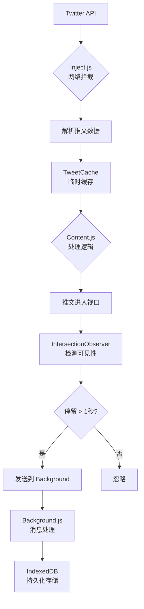

# Chrome 扩展逆向工程完整指南

**编写日期**: 2026-02-05
**更新日期**: 2026-07-06
**版本**: 5.0
**适用范围**: Chrome/Edge 扩展逆向分析
**配套文档**: [逆向工程案例库](逆向工程案例库.md) | [AI辅助逆向工程Skills指南](AI辅助逆向工程Skills指南.md)

---

## 目录

1. [准备工作](#准备工作)
2. [CRX 文件提取](#crx-文件提取)
3. [代码结构分析](#代码结构分析)
4. [混淆识别与处理](#混淆识别与处理)
5. [核心功能还原](#核心功能还原)
6. [数据流追踪](#数据流追踪)
7. [类型系统重建](#类型系统重建)
8. [安全审计要点](#安全审计要点)
9. [常见陷阱与解决方案](#常见陷阱与解决方案)
10. [下一个插件逆向清单](#下一个插件逆向清单)
11. [结语](#结语)

---

## 准备工作

### 必备工具

| 工具 | 用途 | 安装 |
|------|------|------|
| 7z / unzip | 解压 CRX 文件 | `brew install p7zip` |
| prettier | 代码格式化 | `npm install -g prettier` |
| js-beautify | JavaScript 美化 | `npm install -g js-beautify` |
| Chrome DevTools | 调试分析 | 内置 |
| grep/rg | 代码搜索 | `brew install ripgrep` |
| tree | 目录结构可视化 | `brew install tree` |

### 工作目录结构

```bash
mkdir chrome-reverse-project
cd chrome-reverse-project

# 推荐目录结构
├── 2026-02-05-plugin-name/
│   ├── plugin-name.crx              # 原始 CRX 文件
│   ├── plugin-export.json           # 插件导出数据样本
│   ├── plugin-source-code/          # 提取的原始代码
│   ├── plugin-by-ai/                # 还原的项目（可运行）
│   │   ├── src/                     # TypeScript 源代码
│   │   ├── dist/                    # 可运行的扩展
│   │   ├── package.json
│   │   └── README.md
│   ├── README.md                    # 归档说明
│   └── REVERSE_ENGINEERING_NOTES.md # 逆向笔记
```

---

## CRX 文件提取

### CRX 文件格式

```
CRX 文件结构:
┌─────────────────┐
│ CRX Header (32B)│  包含版本号、公钥长度、签名长度
├─────────────────┤
│ Public Key      │  RSA 公钥
├─────────────────┤
│ Signature       │  文件签名
├─────────────────┤
│ ZIP Archive     │  扩展文件（标准的 ZIP 格式）
└─────────────────┘
```

### 提取方法

#### 方法 1: 使用 7zip（推荐）

```bash
# CRX 2/3 格式（头部 32 字节后是 ZIP）
7z x plugin.crx -Oplugin-extracted

# 或者先跳过头部再解压
dd if=plugin.crx of=plugin.zip bs=1 skip=32
unzip plugin.zip -d plugin-extracted
```

#### 方法 2: 使用 Python 脚本

```python
import zipfile
import os

def extract_crx(crx_path, output_dir):
    """提取 CRX 文件"""
    with open(crx_path, 'rb') as f:
        # 跳过 CRX 头部（前 4 字节是 "Cr24" + 版本号）
        f.seek(32)
        # 写入 ZIP 内容
        zip_content = f.read()

    # 创建输出目录
    os.makedirs(output_dir, exist_ok=True)

    # 解压 ZIP
    with zipfile.ZipFile(os.path.join(output_dir, 'temp.zip'), 'w') as zf:
        zf.writestr('content', zip_content)

    with zipfile.ZipFile(os.path.join(output_dir, 'temp.zip'), 'r') as zf:
        zf.extractall(output_dir)

    os.remove(os.path.join(output_dir, 'temp.zip'))
    print(f"✅ 提取完成: {output_dir}")

# 使用
extract_crx('plugin.crx', 'plugin-extracted')
```

---

## 代码结构分析

### 第一步：分析 manifest.json

```json
{
  "manifest_version": 3,  // ⚠️ MV2 vs MV3 差异巨大
  "name": "...",
  "version": "1.3.1",

  "permissions": [         // 分析权限需求
    "storage",            // ⚠️ 本地存储能力
    "tabs",               // ⚠️ 标签页访问
    "webRequest"          // ⚠️ 网络拦截
  ],

  "host_permissions": [    // ⚠️ 目标网站
    "https://*.x.com/*"
  ],

  "background": {
    "service_worker": "background.js",  // MV3 使用 SW
    "type": "module"                    // ⚠️ ES Module
  },

  "content_scripts": [{
    "matches": ["https://*.x.com/*"],
    "js": ["content.js"],
    "run_at": "document_idle"           // ⚠️ 执行时机
  }]
}
```

### 代码文件分类优先级

```
优先级排序（根据可读性和重要性）:

🔴 高优先级（未混淆，核心逻辑）
├── inject.js (通常很短，网络拦截)
├── content.js (内容脚本，主要功能)
└── popup.html (UI 结构，HTML 易读）

🟡 中优先级（部分混淆，但可推断）
├── background.js (可能打包混淆)
├── assets/*.js (功能模块)
└── _locales/*/messages.json (国际化，了解功能)

🟢 低优先级（第三方库）
└── assets/vendor-*.js (React, Vue 等)
```

---

## 混淆识别与处理

### 混淆类型识别

#### 类型 1: 未混淆（最佳）

```javascript
// content.js - 可读性强
const TWEET_CACHE = new Map();
const DWELL_THRESHOLD = 1000;

function parseTweet(tweetData) {
  const tweet = {
    id: tweetData.id_str,
    content: tweetData.full_text,
    // ...
  };
  return tweet;
}
```

#### 类型 2: 压缩但未混淆（可处理）

```javascript
// background.js - 压缩但变量名保留
!function(){const e=new Map,t=1000;function n(n){const r={id:n.id_str,content:n.full_text};return r}}();
```

**处理策略**:
```bash
# 使用 prettier 格式化
prettier --write background.js

# 或使用 js-beautify
js-beautify background.js -o background.formatted.js
```

#### 类型 3: Webpack 打包（常见）

```javascript
// background.js - Webpack 打包特征
/******/ (function(modules) { // webpackBootstrap
/******/    // The module cache
/******/    var installedModules = {};
/******/
/******/    // The require function
/******/    function __webpack_require__(moduleId) {
/******/
/******/    // Load entry module and return exports
/******/    return __webpack_require__(__webpack_require__.s = 0);
/******/ })
```

**处理策略**:
1. **格式化代码**（使用 prettier）
2. **提取模块列表**：
   ```javascript
   // 查找所有模块定义
   grep -o '"[^"]*":' background.js | head -20
   ```
3. **分析模块依赖**：
   ```javascript
   // 追踪 __webpack_require__(n) 调用
   // n 是模块 ID，追踪被导入的模块
   ```

---

## 核心功能还原

### 还原工作流程

```
1️⃣ 类型定义先行
   ↓
   创建 src/types/ 目录
   - index.ts (核心类型)
   - api.ts (API 响应类型)
   - storage.ts (存储类型)
   - messages.ts (消息类型)

2️⃣ 核心模块还原
   ↓
   按优先级还原代码
   - inject/ (网络拦截)
   - content/ (内容脚本)
   - background/ (后台服务)
   - storage/ (数据存储)

3️⃣ 功能模块还原
   ↓
   - ui/ (界面组件)
   - ai/ (AI 功能)
   - charts/ (图表)

4️⃣ 文档生成
   ↓
   - ARCHITECTURE.md (架构)
   - DATA_FLOW.md (数据流)
   - SECURITY_AUDIT.md (安全审计)
```

### TypeScript 类型定义模板

```typescript
// src/types/index.ts
// ========================================
// 核心数据类型
// ========================================

/** 主数据实体 */
export interface Tweet {
  /** 唯一标识符 */
  id: string;
  /** 作者 ID */
  authorId: string;
  /** 作者信息（关联） */
  author?: User;
  /** 推文内容 */
  content: string;
  /** 创建时间 (ISO 8601) */
  createdAt: string;
  /** 统计数据 */
  stats: TweetStats;
  /** 推文类型 */
  tweetType: TweetType;
  /** 媒体附件 */
  media?: MediaItem[];
}

/** 推文类型枚举 */
export enum TweetType {
  ORIGINAL = 'ORIGINAL',
  RETWEET = 'RETWEET',
  QUOTE = 'QUOTE',
  REPLY = 'REPLY',
  ARTICLE = 'ARTICLE'
}

/** 用户信息 */
export interface User {
  id: string;
  screenName: string;
  name: string;
  avatarUrl: string;
}

/** 浏览历史记录 */
export interface HistoryEntry {
  id?: number;
  tweetId: string;
  viewedAt: string;
  duration: number;
  type: HistoryType;
}
```

---

## 数据流追踪

### 数据流分析步骤

```
1️⃣ 确定数据源
   ├─ DOM 元素（用户交互）
   ├─ 网络响应（API 调用）
   └─ 用户输入（表单、点击）

2️⃣ 追踪数据处理
   ├─ 解析/转换
   ├─ 验证/过滤
   └─ 缓存/存储

3️⃣ 确定数据目的地
   ├─ IndexedDB（持久化）
   ├─ chrome.storage（同步）
   └─ 外部服务器（网络请求）

4️⃣ 绘制数据流图
   └─ 使用 Mermaid 语法
```

### Mermaid 数据流图模板



---

## 安全审计要点

### 安全检查清单

| 检查项 | 风险等级 | 检查方法 |
|--------|----------|----------|
| 数据外传 | 🔴 高 | 搜索 `fetch(`, `XMLHttpRequest`, `send(` |
| 敏感信息泄露 | 🔴 高 | 搜索 `password`, `token`, `apiKey` |
| 第三方域名 | 🟡 中 | 检查 `host_permissions` |
| 代码注入 | 🟡 中 | 搜索 `innerHTML`, `eval(`, `Function(` |
| 权限过度 | 🟡 中 | 检查 `permissions` 是否最小化 |
| 隐私追踪 | 🟡 中 | 分析存储的数据类型 |

### 数据外传检测

```bash
# 1. 搜索网络请求
grep -rn "fetch(" . --include="*.js"
grep -rn "XMLHttpRequest" . --include="*.js"

# 2. 搜索外部 URL
grep -rn "http://" . --include="*.js" | grep -v "example.com"

# 3. 搜索 base64 编码的 URL
grep -rn "data:text/javascript" . --include="*.js"
```

---

## 常见陷阱与解决方案

### 陷阱 1: Content Script 与 Page Context 混淆

**问题**:
```javascript
// content.js - ❌ 错误：无法访问页面的全局变量
const pageVariable = window.somePageFunction; // undefined
```

**解决方案**:
```javascript
// ✅ 使用 inject.js 注入到页面上下文
// inject.js (在 web_accessible_resources 中声明)
const pageVariable = window.somePageFunction; // 可以访问
```

### 陷阱 2: Service Worker 生命周期

**问题**:
```javascript
// ❌ 错误：异步操作未保持通道
chrome.runtime.onMessage.addListener((message, sender, sendResponse) => {
  fetch('https://api.example.com/data')
    .then(response => sendResponse(response.json()));
});
```

**解决方案**:
```javascript
// ✅ 返回 true 保持通道
chrome.runtime.onMessage.addListener((message, sender, sendResponse) => {
  fetch('https://api.example.com/data')
    .then(response => response.json())
    .then(data => sendResponse({ success: true, data }));
  return true; // 保持消息通道开启
});
```

### 陷阱 3: IndexedDB 异步操作

**问题**:
```javascript
// ❌ 错误：试图同步获取异步结果
const tweet = await db.tweets.get('123');
console.log(tweet.author.screenName); // TypeError
```

**解决方案**:
```javascript
// ✅ 明确关联查询
const tweet = await db.tweets.get('123');
if (tweet && tweet.authorId) {
  const author = await db.users.get(tweet.authorId);
  tweet.author = author;
}
```

### 陷阱 4: 版本号不一致问题

**问题**:
```bash
# 文件名显示 v0.4.9
WebInk_ 智能网页转Markdown工具 0.4.9.crx

# 但 manifest.json 显示 v0.4.2
"version": "0.4.2"
```

**根本原因**:
- 下载源可能错误标记文件名
- 开发者忘记更新 manifest.json
- 构建系统版本号注入失败

**解决方案**:
```bash
# ✅ 以 manifest.json 中的版本为准
VERSION=$(grep '"version"' manifest.json | grep -o '[0-9.]*')

# 验证步骤
echo "文件名版本: 0.4.9"
echo "Manifest版本: $VERSION"
echo "以 manifest.json 为准进行逆向分析"
```

**检测方法**:
```bash
# 提取 CRX 后立即检查
unzip -p plugin.crx manifest.json | grep '"version"'

# 对比文件名和 manifest 版本
ls *.crx
unzip -p *.crx manifest.json | grep '"version"'
```

---

## 下一个插件逆向清单

### 开始逆向前准备

- [ ] **获取 CRX 文件路径**
- [ ] **获取插件基本信息**（名称、版本、功能描述）
- [ ] **明确分析重点**（特定功能、数据流、安全关注点）

### 逆向工作流程检查表

#### Phase 1: 提取与扫描 ⏱️ ~5 分钟
- [ ] 提取 CRX 文件
- [ ] 检查 manifest.json
- [ ] 扫描代码文件

#### Phase 2: 代码结构分析 ⏱️ ~15 分钟
- [ ] 分析 content.js
- [ ] 分析 inject.js
- [ ] 分析 background.js

#### Phase 3: 类型定义 ⏱️ ~30 分钟
- [ ] 创建 `src/types/` 目录
- [ ] 定义核心数据类型

#### Phase 4: 代码还原 ⏱️ ~2-4 小时
- [ ] 还原 inject/
- [ ] 还原 content/
- [ ] 还原 background/
- [ ] 还原 storage/

#### Phase 5: 数据流分析 ⏱️ ~30 分钟
- [ ] 追踪主要数据流
- [ ] 绘制数据流图

#### Phase 6: 安全审计 ⏱️ ~20 分钟
- [ ] 检查数据外传
- [ ] 检查代码注入风险
- [ ] 生成安全报告

#### Phase 7: 文档生成 ⏱️ ~30 分钟
- [ ] ARCHITECTURE.md
- [ ] DATA_FLOW.md
- [ ] SECURITY_AUDIT.md

#### Phase 8: 项目打包 ⏱️ ~10 分钟
- [ ] 创建可运行项目
- [ ] 生成 package.json

---

## 结语

Chrome 扩展逆向工程是一项**系统性的学习过程**，需要：

1. **耐心**: 混淆代码需要逐步分析
2. **方法**: 建立清晰的类型系统
3. **验证**: 通过实际运行验证理解
4. **文档**: 记录发现的经验教训

本指南基于**四个完整项目**的逆向工程实践，涵盖：

- ✅ CRX 文件提取（CRX2/CRX3）
- ✅ 代码结构分析（Webpack & Parcel & Vite & rspack）
- ✅ 混淆识别与处理（未混淆 / 压缩 / Webpack打包 / Parcel打包 / Vite打包）
- ✅ TypeScript 类型系统重建
- ✅ Mermaid 数据流追踪
- ✅ 9 维度安全审计
- ✅ 三段式文档生成（ARCHITECTURE / DATA_FLOW / SECURITY_AUDIT）
- ✅ 常见陷阱与解决方案（Content Script 隔离 / Service Worker 生命周期 / IndexedDB 异步 / 版本号不一致）

**期待下一个插件的逆向分析！** 🚀

---

## 相关文档

- [逆向工程案例库](逆向工程案例库.md) — 早期项目实战案例对比、打包工具特征识别、核心库检测方法
- [AI辅助逆向工程Skills指南](AI辅助逆向工程Skills指南.md) — ReVa 四个专业逆向 Skills (binary-triage / ctf-rev / ctf-pwn / deep-analysis) 介绍与 Chrome 扩展场景映射
- [根 README](README.md) — 48 插件总索引

---

**更新日期**: 2026-07-06
**版本**: 5.0 — 拆分案例库和 Skills 为独立文档，主指南聚焦 Chrome 扩展逆向核心方法论
**作者**: DeepSeek V4 Pro (Claude Code)
