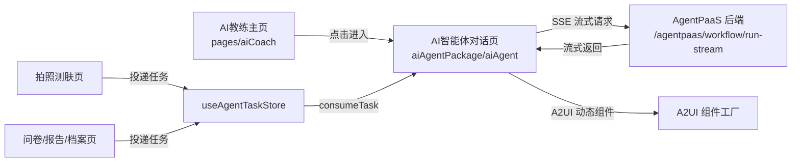
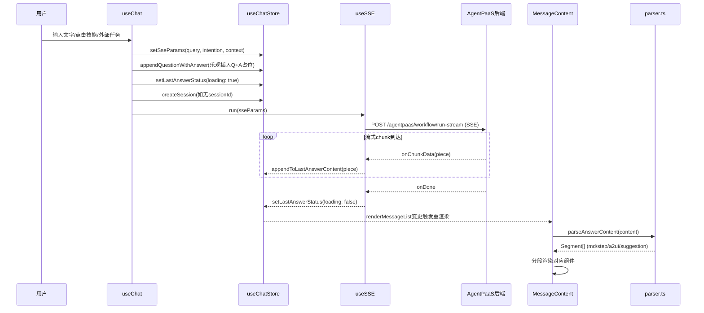
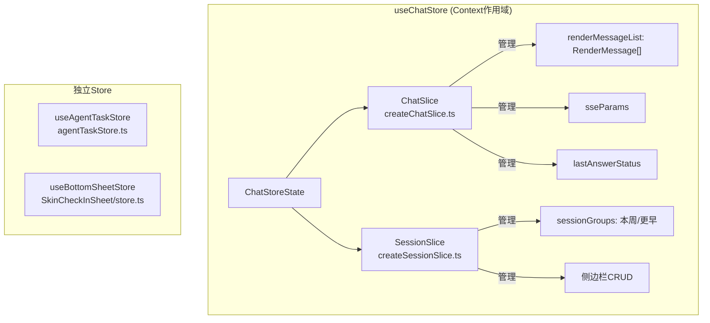
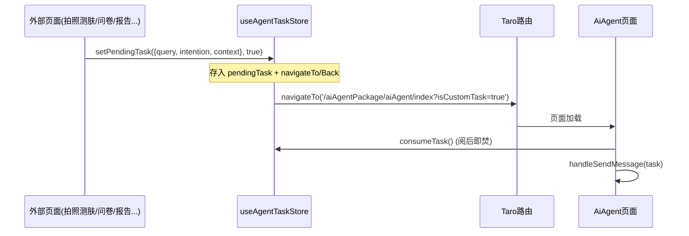

# aiAgentPackage 模块 — 新人上手指南

## 一、模块定位：这个模块做什么？

`aiAgentPackage` 是**AI 智能教练对话页面**的完整实现，是一个 Taro 微信小程序/H5 双端的功能分包。

**一句话概括**：用户与 AI 教练的对话界面，支持 SSE 流式消息、多轮会话管理、14 种行动建议（拍照测肤/打卡/预约等）、以及结构化内容渲染（Markdown + 分析步骤卡片 + A2UI 动态组件 + 行动建议）。

**在整条产品链中的位置**：



---

## 二、文件结构速览（53 个文件）

```
src/aiAgentPackage/
└── aiAgent/
    ├── index.tsx                    ← 【入口】页面根组件
    ├── index.config.ts              ← Taro 页面配置（标题/导航栏）
    ├── index.module.scss            ← 页面全局样式
    ├── type.ts                      ← 【核心类型】AgentAction/AgentSkill/AgentSendMessageParams
    ├── constants.ts                 ← 智能体ID、图标CDN地址
    ├── services.ts                  ← 【API层】10个接口封装
    │
    ├── hooks/                       ← 【业务逻辑层】5个自定义Hook
    │   ├── useChat.ts               ← 核心：发送/停止/刷新/动作分发/任务消费
    │   ├── useSSE.ts                ← 核心：微信小程序SSE流式通信
    │   ├── useBaseContent.ts        ← 首页技能列表数据拉取
    │   ├── usePinToBottom.ts        ← 消息列表自动锁定底部
    │   └── useTypewriter.ts         ← 打字机效果（rAF驱动）
    │
    ├── store/                       ← 【状态管理层】Zustand + Context
    │   ├── agentTaskStore.ts        ← 跨页面任务投递（外部→对话页）
    │   └── chatStore/
    │       ├── index.ts             ← store入口（createContext包裹）
    │       ├── types.ts             ← RenderMessage/ChatSlice/SessionSlice
    │       └── sliceChunk/
    │           ├── createChatSlice.ts    ← 当前会话消息/SSE参数/UI状态
    │           └── createSessionSlice.ts ← 历史会话列表/详情/侧边栏CRUD
    │
    └── components/                  ← 【视图层】17个组件
        ├── Header/                  ← 导航栏 + 历史会话侧边栏
        ├── BaseContent/             ← 首页（技能卡片 + 话题标签）
        ├── AangeBottom/             ← 底部（输入栏 + 技能菜单）
        ├── MessageContent/          ← 消息列表 + 渲染器（核心复杂度所在）
        │   ├── QuestionRender/      ← 用户问题气泡
        │   ├── AnswerRender/        ← AI回答渲染（SSE+打字机+parser）
        │   └── ErrorBoundary/       ← 错误边界
        ├── StepProgressCard/        ← 分析步骤进度卡片
        └── SkinCheckInSheet/        ← 护肤打卡弹窗（独立子系统）
```

---

## 三、核心架构设计

### 3.1 数据流全景图



### 3.2 Store 架构：Zustand Slice 模式



**关键设计决策**：
- `useChatStore` 使用 `createContext` 创建作用域 store，仅在 `AiAgent` 页面组件树内有效，避免全局污染
- 外部页面通过独立的 `useAgentTaskStore` 投递任务（单向数据流：写入 → 跳转 → 消费销毁）

### 3.3 两层打字机

模块中存在**两套** `useTypewriter`，用途不同：

| 位置 | 驱动方式 | 复杂度 | 用途 |
|------|----------|--------|------|
| `hooks/useTypewriter.ts` | requestAnimationFrame | 高（支持结构化块保序、自适应速率、急速模式） | 主用版本，目前被 `AnswerRender/index.tsx` 导入 |
| `AnswerRender/useTypewriter.ts` | setInterval | 低（简单逐字推进） | 备用/遗留版本 |

---

## 四、关键函数详解

### 4.1 useChat — 聊天核心引擎

> 文件：[hooks/useChat.ts](src/aiAgentPackage/aiAgent/hooks/useChat.ts)

| 函数 | 功能 | 调用时机 |
|------|------|----------|
| `handleSendMessage(params)` | 发送消息全流程：构建SSE参数 → 乐观插入 → 创建会话(首次) → 启动SSE | 用户输入、点击话题/技能、外部任务消费 |
| `handleActionClick(action, query)` | 14种动作分发：跳转页面/打开弹窗/发送意图消息 | 用户点击技能卡片或菜单 |
| `handleStopMessage()` | 三层中断：cancel()本地断流 → markLastAnswerInterrupted()标记 → interruptWorkflow()通知后端 | 用户点击停止按钮 |
| `handleRefresh()` | 重发上一条消息（用缓存的sseParams） | 用户点击回答区刷新按钮 |
| `handleNewConversation()` | cancel()中断流 + clearCurrentSession()清空 | 用户点击新建对话 |
| `consumeTask()` | 从 useAgentTaskStore 取出外部投递的任务并发送 | 页面进入时（useEffect + useDidShow） |

### 4.2 useSSE — 小程序流式通信

> 文件：[hooks/useSSE.ts](src/aiAgentPackage/aiAgent/hooks/useSSE.ts)

**为什么不用浏览器 EventSource？** 因为微信小程序不支持 EventSource API。使用 `Taro.request` + `enableChunked: true` + `onChunkReceived` 模拟。

| 关键机制 | 实现 |
|----------|------|
| 解码 | ArrayBuffer → TextDecoder 逐 chunk 解码 |
| 解析 | 累积 buffer，按 `\n` 分行，每行解析为 JSON |
| 合流窗口 | chunk 先入 `pendingPieceRef`，按 48ms(小程序)/16ms(H5) 批量 flush，减少 setData 次数 |
| 过期丢弃 | `activeRunIdRef` 递增序号，旧请求回调直接丢弃 |
| 中断 | `cancel()` 调用 abort + 清空缓冲 |

### 4.3 parser.ts — 流式内容解析器

> 文件：[AnswerRender/parser.ts](src/aiAgentPackage/aiAgent/components/MessageContent/AnswerRender/parser.ts)

**核心职责**：将 SSE 流中的混合文本拆分为 4 种 Segment：

| 类型 | 分隔符 | 渲染组件 | 说明 |
|------|--------|----------|------|
| `md` | 无（默认） | MarkdownPreview | 普通 Markdown 文本 |
| `step` | `------step-start/end------` | StepRender → StepProgressCard | 分析步骤进度 |
| `a2ui` | `------a2ui-start/end--------` | A2UIRender → getA2UIComponent | 动态业务组件（三段式JSON） |
| `suggestion` | `------suggestion-start/end------` | SuggestionRender | 行动建议+相关问题 |

**关键函数**：
- `parseAnswerContent(content, opts?)`: 主解析函数，支持 `trimTrailingPartialMarker` 选项（流式态隐藏未闭合的分隔符前缀）
- `collapseSingletons(segs)`: step/a2ui/suggestion 每种类型只保留最后一块（因为后续块是增量更新）
- `parseA2UIChunk(raw)`: 解析 A2UI 的三段式 JSON（createSurface → updateComponents → updateDataModel）
- `extractJsonObjects(text)`: 按花括号配对从文本中提取多个顶层 JSON 对象

### 4.4 services.ts — API 服务层

> 文件：[services.ts](src/aiAgentPackage/aiAgent/services.ts)

| API | 方法 | 路径 | 功能 |
|-----|------|------|------|
| `createConversation` | POST | `/agentpaas/conversation/create` | 创建会话 |
| `getSessionsRecordList` | GET | `/agentpaas/sessions/record/list` | 会话历史列表 |
| `getSessionsRecordDetails` | GET | `/agentpaas/sessions/record/details` | 会话详情 |
| `deleteConversation` | GET | `/agentpaas/sessions/record/delete` | 删除会话 |
| `runWorkflow` | POST | `/agentpaas/workflow/run` | 同步执行工作流 |
| `getRunWorkflowStreamUrl` | - | `/agentpaas/workflow/run-stream` | 流式工作流 URL |
| `getWorkflowResult` | POST | `/agentpaas/workflow/result` | 查询异步结果 |
| `interruptWorkflow` | POST | `/agentpaas/workflow/interrupt` | 中断工作流 |
| `getAiCoachSkillsList` | GET | `/v1/homing/ai/aicoach/config/get-skills-list` | 技能列表 |
| `hasExecutingScheme` | GET | `/v1/beautycamp/.../has-executing-scheme` | 检查执行中方案 |

> 注意：后端域名为 `https://cms.clife.cn`，路由匹配逻辑在 `src/services/baseUrl.ts:31-33`，URL 含 `agentpaas` 时自动切换。

---

## 五、组件通信与传参方式

### 5.1 Props 传递（父→子）

入口组件 `AiAgentInner` 是核心调度中枢，所有子组件通过 props 接收回调：

```tsx
// AiAgentInner 的组件树与 props 流向

<Header onNewConversation={handleNewConversation} />

{currentSessionId ? (
  <MessageContent
    onActionClick={handleActionClick}    // 动作分发
    onSendMessage={handleSendMessage}    // 发送消息
    onRefresh={handleRefresh}            // 刷新
  />
) : (
  <BaseContent
    actionList={actionList}              // 技能列表数据
    actionListLoading={actionListLoading}
    onActionClick={handleActionClick}
    onSendMessage={handleSendMessage}
  />
)}

<AgentBottom
  onActionClick={handleActionClick}
  onSendMessage={handleSendMessage}
  onStopMessage={handleStopMessage}      // 停止生成
  loading={loading}                      // 是否生成中
/>

<CheckInBottomSheet
  visible={bottomSheetVisible}           // 弹窗显隐
  presetType={bottomSheetPresetType}     // 打卡类型
  onClose={() => setBottomSheetVisible(false)}
/>
```

### 5.2 Zustand Store 读取（全局状态）

子组件通过 `useChatStore.useStore(selector)` 读取 store 中的状态：

```tsx
// 例：MessageContent 读取消息列表
const { renderMessageList } = useChatStore.useStore(s => ({
  renderMessageList: s.renderMessageList
}));

// 例：Header/Sidebar 读取会话历史
const { sessionGroups, fetchSessionDetail } = useChatStore.useStore(s => ({
  sessionGroups: s.sessionGroups,
  fetchSessionDetail: s.fetchSessionDetail
}));
```

### 5.3 跨页面通信（useAgentTaskStore）

外部页面向 AI 对话页投递任务的完整流程：



### 5.4 组件间隐式通信

| 通信方式 | 说明 | 示例 |
|----------|------|------|
| **回调 props** | 父组件定义处理函数，通过 props 传给子组件 | `onActionClick`, `onSendMessage` |
| **Zustand store** | 所有子组件共享读取同一 store 实例 | `useChatStore.useStore()` |
| **Taro 路由参数** | 外部页面通过 URL query 控制行为 | `?isCustomTask=true`, `?checkInType=xxx` |
| **page.__data__** | navigateBack 场景下通过页面实例传递任务对象 | `currentPage.__data__.task` |

---

## 六、代码风格与规范速查

| 维度 | 规范 |
|------|------|
| 组件组织 | 目录式：每个组件一个文件夹，含 `index.tsx` + `index.module.scss` |
| 样式方案 | CSS Modules (`.module.scss`)，类名 camelCase |
| 状态管理 | Zustand + Context（页面级隔离）+ Slice 模式（按职责拆分） |
| 业务逻辑 | 抽到独立 hooks 目录，组件保持薄/纯展示 |
| 命名规范 | 组件 PascalCase，hooks `use` 前缀，常量 UPPER_SNAKE_CASE |
| 跨端适配 | `process.env.TARO_ENV === 'weapp'` 判断，小程序降频 48ms |
| UI组件库 | @nutui/nutui-react-taro（Popup/ScrollView 等） |
| 工具库 | lodash-es, dayjs, taro-hooks |

### 值得注意的点

1. **文件夹拼写问题**：`AangeBottom` 应为 `AgentBottom`，但组件导出名已修正为 `AgentBottom`
2. **Token 硬编码**：`services.ts` 中多处存在硬编码的 `HomingToken`，原始代码注释掉了 `useGlobalDataStore.getState().token`（可能为调试遗留）
3. **两套 useTypewriter**：`hooks/useTypewriter.ts` 是主力版本（rAF 驱动、结构化块保序），`AnswerRender/useTypewriter.ts` 是简化版（setInterval），注意不要混用
4. **AI_AGENT_ID 硬编码**：`constants.ts` 中 `AI_AGENT_ID = 129541731758`，如更换智能体需手动修改

---

## 七、快速上手建议（阅读顺序）

1. **先读类型**：`type.ts` → `store/chatStore/types.ts`（理解数据结构）
2. **再看入口**：`index.tsx`（理解页面结构和组件组合）
3. **核心逻辑**：`useChat.ts` → `useSSE.ts`（理解数据流和通信机制）
4. **渲染管线**：`parser.ts` → `AnswerContent.tsx`（理解流式内容如何变成UI）
5. **状态管理**：`createChatSlice.ts` → `createSessionSlice.ts`（理解 store 设计）
6. **按需深入**：各组件的具体实现
