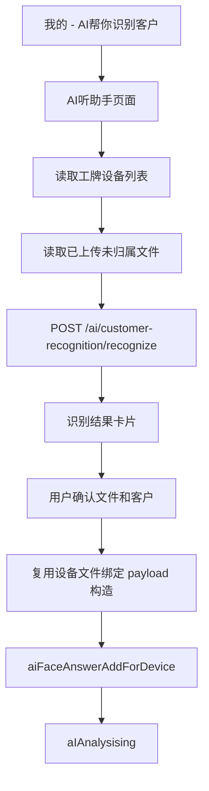

# AI识别客户前端落地计划

## 目标边界

- 入口只新增在 `[src/pages/mine/comp/entranceList/index.tsx](e:\Projects\frontend\homing-miniapp-workbench\src\pages\mine\comp\entranceList\index.tsx)`，放在 `设置` 下面。
- 新页面落在 `[src/subPackage/aiCustomerRecognition](e:\Projects\frontend\homing-miniapp-workbench\src\subPackage\aiCustomerRecognition)`。
- 后端首版只对接同步接口：`POST ${BACKEND_PATH}/ai/customer-recognition/recognize`。
- 前端不直连 Node 8088；仍使用现有 `request` 与 `BACKEND_PATH`。
- 不改 `audioEdit`，不在本轮增加设备中心入口。

## 当前代码事实

- “我的”入口列表当前是 `ENTRANCE_LIST`：`Ai听设置`、`我的企业`、`设置`。
- 路由在 `[src/app.config.ts](e:\Projects\frontend\homing-miniapp-workbench\src\app.config.ts)` 的 `subPackages[0].pages` 注册。
- 设备文件列表已有接口：`getFaceAnswerFileRecordPageListApi`，请求 `bindFlag: 0`。
- 提交分析已有接口：`aiFaceAnswerAddForDevice`。
- 设备中心现有 `handleBindingSubmit` 已包含 payload 构造、5 小时校验、最多 5 条、跳转 `aIAnalysising`，但现在逻辑内聚在页面中，需要抽出公共构造能力。

## 数据流

## 文件改动计划

- `[src/pages/mine/comp/entranceList/index.tsx](e:\Projects\frontend\homing-miniapp-workbench\src\pages\mine\comp\entranceList\index.tsx)`
  - 在 `设置` 后追加：`AI帮你识别客户`。
  - 跳转：`/subPackage/aiCustomerRecognition/index`。

- `[src/app.config.ts](e:\Projects\frontend\homing-miniapp-workbench\src\app.config.ts)`
  - 在 `subPackage` 分包注册：`aiCustomerRecognition/index`。

- 新增 `[src/subPackage/aiCustomerRecognition/index.tsx](e:\Projects\frontend\homing-miniapp-workbench\src\subPackage\aiCustomerRecognition\index.tsx)`
  - 页面标题：`AI帮你识别客户` 或 `AI听助手`。
  - 页面状态机：`loading`、`empty`、`recognizing`、`matched`、`unknown`、`failed`、`submitting`。
  - 进入页面后自加载设备和未归属文件。
  - 有文件时调用 `recognize`；无文件时展示“没有需要待提交分析音频文件”。
  - 保留提示：`内容由 AI 生成，请仔细甄别`。

- 新增 `[src/subPackage/aiCustomerRecognition/service.ts](e:\Projects\frontend\homing-miniapp-workbench\src\subPackage\aiCustomerRecognition\service.ts)`
  - 封装 `recognizeAiCustomerRecognition(params)`。
  - 路径：`${BACKEND_PATH}/ai/customer-recognition/recognize`。
  - 请求体包含：`hmDeviceId`、`employeeId`、`orgId`、`clipDurationSec: 300`、`maxCandidates: 6`、`audioFiles`。

- 新增 `[src/subPackage/aiCustomerRecognition/types.ts](e:\Projects\frontend\homing-miniapp-workbench\src\subPackage\aiCustomerRecognition\types.ts)`
  - 定义 `RecognitionAudioItem`、`RecognitionGroup`、`RecognitionCustomerCandidate`、页面状态枚举。

- 新增 `[src/subPackage/aiCustomerRecognition/utils.ts](e:\Projects\frontend\homing-miniapp-workbench\src\subPackage\aiCustomerRecognition\utils.ts)`
  - 归一化设备文件为识别页面内部音频结构。
  - 过滤 `partListStatus === 'uploaded'` 且有 `fileUrl || url` 的文件。
  - 校验最多 5 条和总时长不超过 5 小时。

- 新增 `[src/subPackage/aiCustomerRecognition/index.module.scss](e:\Projects\frontend\homing-miniapp-workbench\src\subPackage\aiCustomerRecognition\index.module.scss)`
  - 使用普通 `padding`、`margin`、文档流布局。
  - 避免 `gap`、`inset`、CSS `var()`，照顾老安卓兼容。

- 新增页面内轻量组件，可按实现复杂度拆分到 `[src/subPackage/aiCustomerRecognition/components](e:\Projects\frontend\homing-miniapp-workbench\src\subPackage\aiCustomerRecognition\components)`：
  - `ThinkingCard`：思考中步骤。
  - `RecognitionGroupCard`：音频组 + 候选客户 + 操作按钮。
  - `AudioFilePickerPopup`：重选文件，最多 5 条。
  - `RecognitionFooter`：提交分析按钮。

- 新增 `[src/subPackage/deviceCenter/utils/buildDeviceBindingPayload.ts](e:\Projects\frontend\homing-miniapp-workbench\src\subPackage\deviceCenter\utils\buildDeviceBindingPayload.ts)`
  - 从 `deviceCenter/index.tsx` 抽出纯 payload 构造逻辑。
  - 输入：`selectedCustomer`、`selectedFlashList`、`employee`、`outerContext`。
  - 输出：`AifaceansweraddfordeviceReq`。
  - 设备中心和 AI 页面共用，避免两套提交规则分叉。

- 调整 `[src/subPackage/deviceCenter/index.tsx](e:\Projects\frontend\homing-miniapp-workbench\src\subPackage\deviceCenter\index.tsx)`
  - 保持 UI 不变。
  - `handleBindingSubmit` 改为调用公共 payload builder，行为不变。

- 调整 `[src/subPackage/selectCustomer/index.tsx](e:\Projects\frontend\homing-miniapp-workbench\src\subPackage\selectCustomer\index.tsx)`
  - 新增 `type=aiCustomerRecognition`。
  - 回传事件建议使用独立事件名：`customerSelected:aiCustomerRecognition`，避免和设备中心 `customerSelected` 串扰。
  - 仍复用行业类型确认弹窗，确保提交 payload 有 `industryType`。

## 页面行为

- 从“我的”点击入口：
  - 如果没有可用设备：展示空态和刷新按钮。
  - 如果有设备但没有已上传未归属文件：展示“没有需要待提交分析音频文件”。
  - 如果有已上传未归属文件：发起识别。

- 识别成功：
  - 展示后端返回的音频组和最多 6 个候选客户。
  - 用户可以查看音频、重选文件、重选客户。
  - 默认选中后端推荐的客户和文件，但提交前必须允许人工修改。

- 识别失败或无法识别：
  - 展示失败/无法识别说明。
  - 允许重新识别或手动选择客户后继续提交。

- 提交分析：
  - 复用 `aiFaceAnswerAddForDevice`。
  - 成功后跳转：`/subPackage/aIAnalysising/index?recordId=${recordId}&type=deviceCenter`。

## 验证计划

- 静态检查：最近改动 TS/TSX/SCSS 的 lint 诊断。
- 命令验证：优先运行 `npm run quality:check`；如果环境仍因缓存或 Node 兼容失败，则补跑 `git diff --check` 并记录真实失败原因。
- 人工验收：
  - “我的”页 `设置` 下方出现 `AI帮你识别客户`。
  - 无设备、无文件、有文件、识别失败、识别成功、重选客户、提交成功分别可走通。
  - 提交成功进入现有分析中页面。
