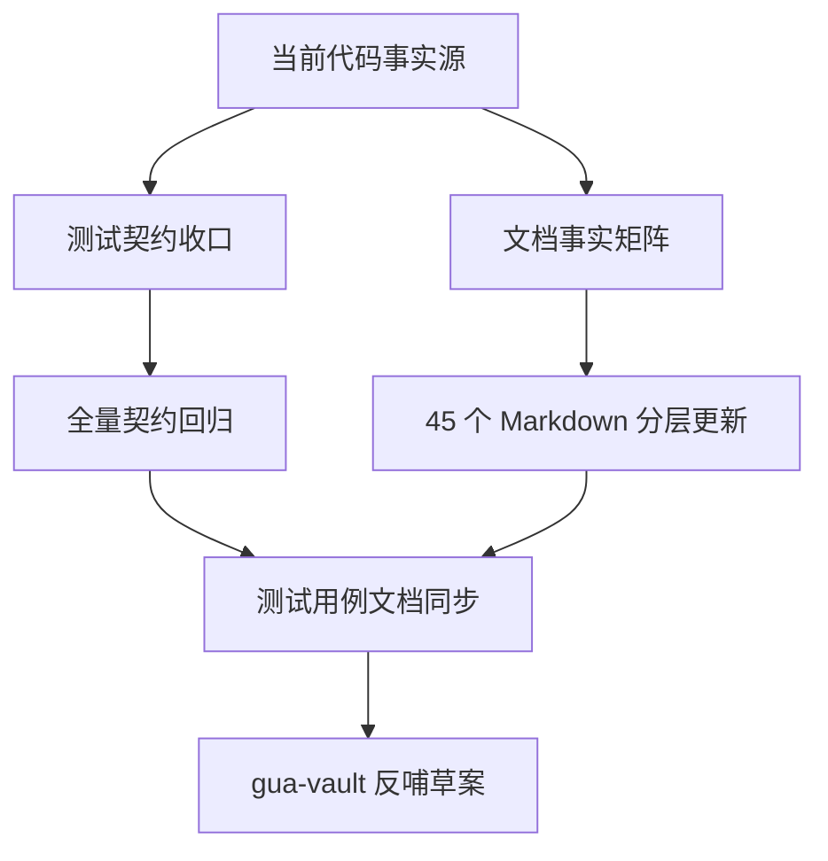

# audioEdit 契约与文档同步计划

## 已确认边界

- 用户选择：全量审核并更新 `E:\ggbdpq\开发文档\03.功能开发\3.3-AI音频编辑` 下所有 Markdown，历史留痕不删，只标注过期/迁移。
- 用户选择：`gua-vault` 本轮只产出建议条目草案，不直接写入 `C:\Users\802165\.agents\skills\gua-vault`。
- 当前只读诊断发现 `src/subPackage/audioEdit/test` 共 30+ 个契约/测试文件，其中以下旧契约当前失败：
  - [entry-context.contract.test.cjs](E:/Projects/frontend/homing-miniapp-workbench/src/subPackage/audioEdit/test/entry-context.contract.test.cjs)
  - [figmaVisual.contract.test.cjs](E:/Projects/frontend/homing-miniapp-workbench/src/subPackage/audioEdit/test/figmaVisual.contract.test.cjs)
  - [manualTrimProcessing.contract.test.cjs](E:/Projects/frontend/homing-miniapp-workbench/src/subPackage/audioEdit/test/manualTrimProcessing.contract.test.cjs)
  - [page.contract.test.cjs](E:/Projects/frontend/homing-miniapp-workbench/src/subPackage/audioEdit/test/page.contract.test.cjs)
  - [pageHookSplit.contract.test.cjs](E:/Projects/frontend/homing-miniapp-workbench/src/subPackage/audioEdit/test/pageHookSplit.contract.test.cjs)
  - [removeSilenceFlow.contract.test.cjs](E:/Projects/frontend/homing-miniapp-workbench/src/subPackage/audioEdit/test/removeSilenceFlow.contract.test.cjs)
  - [responsiveRuntimeWidth.contract.test.cjs](E:/Projects/frontend/homing-miniapp-workbench/src/subPackage/audioEdit/test/responsiveRuntimeWidth.contract.test.cjs)
  - [saveAsState.contract.test.cjs](E:/Projects/frontend/homing-miniapp-workbench/src/subPackage/audioEdit/test/saveAsState.contract.test.cjs)
  - [taskPolling.contract.test.cjs](E:/Projects/frontend/homing-miniapp-workbench/src/subPackage/audioEdit/test/taskPolling.contract.test.cjs)
  - [timelineWaveform.contract.test.cjs](E:/Projects/frontend/homing-miniapp-workbench/src/subPackage/audioEdit/test/timelineWaveform.contract.test.cjs)
  - [viewportPeakMax.contract.test.cjs](E:/Projects/frontend/homing-miniapp-workbench/src/subPackage/audioEdit/test/viewportPeakMax.contract.test.cjs)
- 当前文档目录下有 45 个 Markdown，需要按“当前代码口径 / 历史留痕 / 过期标记 / 待联调项”分层处理。
- `gua-vault` 检索命中规则：优先按 `gua-tech-writer` 事实收集、`gua-tdd/gua-quality-gate` 契约测试、`gua-taro-multiplatform` 运行路径判定执行。

## 执行策略

## 具体计划

1. 建立当前事实矩阵
   - 读取并对齐核心实现：
     - [useAudioPlayer.ts](E:/Projects/frontend/homing-miniapp-workbench/src/subPackage/audioEdit/hooks/useAudioPlayer.ts)
     - [useAudioEditPage.ts](E:/Projects/frontend/homing-miniapp-workbench/src/subPackage/audioEdit/hooks/useAudioEditPage.ts)
     - [useAudioEditRuntime.ts](E:/Projects/frontend/homing-miniapp-workbench/src/subPackage/audioEdit/hooks/useAudioEditRuntime.ts)
     - [useAudioEditTask.ts](E:/Projects/frontend/homing-miniapp-workbench/src/subPackage/audioEdit/hooks/useAudioEditTask.ts)
     - [useAudioEditTaskActions.ts](E:/Projects/frontend/homing-miniapp-workbench/src/subPackage/audioEdit/hooks/useAudioEditTaskActions.ts)
     - [service.ts](E:/Projects/frontend/homing-miniapp-workbench/src/subPackage/audioEdit/service.ts)
     - [WaveformPanel/index.tsx](E:/Projects/frontend/homing-miniapp-workbench/src/subPackage/audioEdit/components/WaveformPanel/index.tsx)
     - [WaveformStrip/index.tsx](E:/Projects/frontend/homing-miniapp-workbench/src/subPackage/audioEdit/components/WaveformStrip/index.tsx)
   - 输出内部核对维度：入口上下文、播放状态机、主波形/底部时间轴、手动剪辑、智能剪辑、去静音、任务轮询、另存为、接口字段、响应式布局。

2. 按失败清单更新旧契约
   - 原则：以当前运行代码为准，不为旧契约回退实现。
   - 修正明显过期的断言来源，例如：
     - `entry-context` 从 `useAudioEditPage` 直读改为 `useAudioEditRuntime` 承接入口上下文。
     - `figmaVisual` 中固定 `top=262` 这类画布定位断言，改为当前盒子化布局和可验证尺寸关系。
     - `pageHookSplit` 不再用机械行数阈值作为质量目标，改为 hook 职责边界和状态出口稳定性。
     - `taskPolling` 不再断言 `test` 目录必须不被 `.gitignore` 忽略，改为要求新增测试使用 `git add -f` 或文档注明。
     - `viewportPeakMax` 对齐当前 `WaveformBars` / waveform utils 的真实职责，不要求已删除工具函数复活。
   - 对每个失败契约先确认它是“旧契约过期”还是“当前代码真实缺陷”；只有代码确实不符合当前设计时才改实现。

3. 补齐关键路径契约覆盖
   - 播放链路：保持 `firstDragPlayback`、`playbackProgress`、`loading` 对首拖、暂停态回调、播放后补偿、真实播放到达目标的覆盖。
   - 波形链路：覆盖顶部主波形拖拽结束补交进度、底部时间轴触摸层、手动编辑顶部窗口和底部整轨坐标分离。
   - 任务链路：覆盖创建、轮询、取消、恢复、保存、去静音 no-op、结果音频切换。
   - 文档链路：让 [AI音频编辑测试用例.md](E:/ggbdpq/开发文档/03.功能开发/3.3-AI音频编辑/06-测试用例/AI音频编辑测试用例.md) 与真实测试文件清单一致。

4. 全量回归与格式化
   - 运行 `src/subPackage/audioEdit/test/*.cjs` 全量契约，目标是旧契约统一绿灯。
   - 对 touched 测试和 TS/TSX 文件运行 Prettier。
   - 若涉及 TS/TSX 代码实现改动，尝试最小范围 ESLint；如果仍受本机 Node/ESLint 兼容问题影响，如实记录，不扩大处理范围。
   - 使用 `ReadLints` 检查本轮编辑过的源码文件。

5. 全量审核并更新开发文档
   - 文档处理规则：不删除历史留痕；在文档顶部或章节内标注“当前代码口径 / 历史方案 / 已迁移 / 待联调”。
   - 优先更新核心入口：
     - [AI音频编辑接口定义-当前代码口径.md](E:/ggbdpq/开发文档/03.功能开发/3.3-AI音频编辑/05-接口定义/AI音频编辑接口定义-当前代码口径.md)
     - [AI音频编辑测试用例.md](E:/ggbdpq/开发文档/03.功能开发/3.3-AI音频编辑/06-测试用例/AI音频编辑测试用例.md)
     - [AI音频编辑-BUG与踩坑记录汇总.md](E:/ggbdpq/开发文档/03.功能开发/3.3-AI音频编辑/04-BUG报错/AI音频编辑-BUG与踩坑记录汇总.md)
     - [AI音频编辑-UI样式还原.md](E:/ggbdpq/开发文档/03.功能开发/3.3-AI音频编辑/03-UI设计/AI音频编辑-UI样式还原.md)
   - 再审核 01/02/03/04/05/06/07/08/10 下其它 Markdown，按事实矩阵更新或标注过期。

6. 产出 `gua-vault` 反哺草案
   - 不直接写入 `gua-vault`。
   - 生成建议条目，建议归属：
     - `gua-tdd`：契约必须锁真实事故路径，不只锁源码字符串。
     - `gua-quality-gate`：全量契约红灯清单必须先分类再修。
     - `gua-taro-multiplatform`：Taro 音频播放必须区分展示时间、seek 意图、原生真实位置。
     - `gua-tech-writer`：半月未更新文档必须以当前代码事实矩阵重建文档口径。
   - 每条建议按 `gua-vault` CSV schema 输出：Rule ID、Category、Rule、Detail、Why、Do、Don't、Code Example、Keywords、Severity。

7. 最终交付
   - 不自动提交。
   - 只暂存本轮相关仓库内文件；外部开发文档和 `gua-vault` 草案按路径说明。
   - 输出：已修测试清单、仍需人工/真机验证项、更新过的文档清单、`gua-vault` 建议条目草案。
