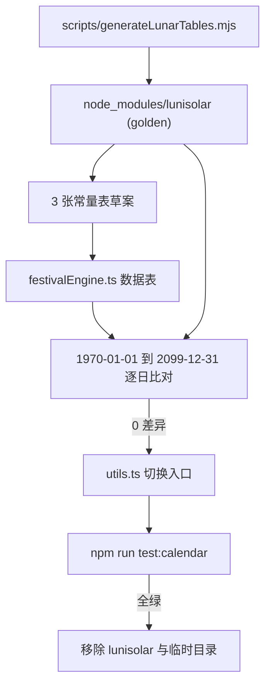

## 结论摘要

GPT-5.4 已经写好引擎骨架与测试骨架，剩下三件事必须按顺序做完：先用 lunisolar 作为黄金答案重新生成并校核 `festivalEngine.ts` 的农历表与节气表（已发现 2027 春节有 1 天误差），再把 `utils.ts` 切到新引擎并补一条本机可跑的测试入口，最后才能移除 `lunisolar` 依赖与 `.tmp-calendar-test/` 临时目录。

## 修改文件清单（白名单）

- 新增 `scripts/generateLunarTables.mjs`（一次性，生成 + 校核）
- 修改 [src/components/Calendar/festivalEngine.ts](src/components/Calendar/festivalEngine.ts)（仅替换三张常量表，函数实现不动）
- 修改 [src/components/Calendar/festivalEngine.test.ts](src/components/Calendar/festivalEngine.test.ts)（补关键边界用例）
- 修改 [src/components/Calendar/utils.ts](src/components/Calendar/utils.ts)（删 lunisolar 相关，切到 `getCalendarLabel`）
- 修改 [package.json](package.json)（新增 `test:calendar` 脚本，校核通过后移除 `lunisolar`）
- 删除 [.tmp-calendar-test/festivalEngine.test.js](.tmp-calendar-test/festivalEngine.test.js) 与目录

## 改动目的

- 用真实可校核的农历/节气数据替换可能含偏差的 `Intl` 推算结果，避免上线后 2027 年起春节、除夕、元宵等标签整月漂移
- 完成 `utils.ts` 与 `festivalEngine` 的对接，使日历组件外部 API 零变化
- 让 `lunisolar` 可以从主包安全移除，缓解 weapp 包体积超 2M 的压力
- 留下一条最小 Node 断言测试入口，未来农历/节气逻辑回归可重复执行

## 数据流与执行顺序



## 可执行步骤

### 1 生成与校核数据表

新增 `scripts/generateLunarTables.mjs`，职责：

- 引入 `lunisolar`，遍历 `1969-12-25` 到 `2100-02-15`，按规则编码出：
  - `LUNAR_NEW_YEAR_DATES`（1969-2100，共 132 项，元素为 `MMDD` 整数）
  - `LUNAR_MONTH_DATAS`（同长度，编码：低 12 位每位代表月 1-12 是否 30 日，bit 12 为闰月天数标志，>>13 为闰月序号，0 表示无闰月，与 [src/components/Calendar/festivalEngine.ts](src/components/Calendar/festivalEngine.ts) 现有 `getLeapMonth` / `getMonthDays` 解码完全对齐）
  - `SOLAR_TERM_DAY_ROWS`（1970-2099 共 130 行，每行 24 个数表示该年 24 节气日）
- 把生成的三张表以 `// AUTO-GENERATED ...` 注释段写回 `festivalEngine.ts`，仅替换原数据块，函数实现保持不动
- 生成后立即跑全量校核：循环 1970-01-01 到 2099-12-31 每一天，对比引擎 `getLunarInfo`、`getSolarTermLabel` 与 `lunisolar` 的真值，任一日不一致脚本以非零退出，并打印首条差异定位
- 校核通过才打印 `OK: 47482 days verified`

### 2 补关键测试用例

在 [src/components/Calendar/festivalEngine.test.ts](src/components/Calendar/festivalEngine.test.ts) 现有 6 组之外增加：

- 远期年校核：`2027-02-06 春节`、`2030-02-03 春节`、`2099-01-01` 系列
- 闰月场景：随手挑一个 1970-2099 内有闰月的年份，验证闰月文案 `闰X月` 与天数
- 跨年除夕：`2099-02-...` 边界年（最后一年）+ 一个农历廿九除夕年
- 节气与农历日同日的优先级回退样本

这些用例不依赖 lunisolar，只依赖引擎自身，可在脚本校核通过后稳定保留。

### 3 落地 npm test 入口

在 [package.json](package.json) `scripts` 段加入：

```json
"test:calendar": "tsc --target ES2019 --module commonjs --esModuleInterop --skipLibCheck --outDir .tmp-calendar-test src/components/Calendar/festivalEngine.ts src/components/Calendar/festivalEngine.test.ts && node .tmp-calendar-test/src/components/Calendar/festivalEngine.test.js"
```

- 不引入新依赖，沿用仓库已装的 `typescript`
- 编译产物落到 `.tmp-calendar-test/`，与现有 `.gitignore` 规则保持一致（执行前确认或追加忽略）
- 同步加入 `"test:calendar:gen": "node scripts/generateLunarTables.mjs"`，便于未来回归

### 4 改造 utils.ts

最小 diff 改造 [src/components/Calendar/utils.ts](src/components/Calendar/utils.ts)：

- 删除以下 import 与常量：`lunisolar`、`lunisolar/markers/festivals.zh-cn`、`CALENDAR_LUNISOLAR_MARKER_TAG`、`OFFICIAL_HOLIDAY_LABEL_MAP`、`CUSTOM_CALENDAR_LABELS`、`SOLAR_TERM_LABEL_MAP`
- 删除函数：`getHolidayLabel`、`isNthWeekdayOfMonth`、`getDynamicCustomCalendarLabel`、`getCustomCalendarLabel`、`getTraditionalFestivalLabel`、`getSolarTermLabel`，以及顶层 `lunisolar.Markers.removeByTag/add` 副作用
- `getLunarDayLabelByDate` 改写为单行委托：

```ts
const getLunarDayLabelByDate = (date: string): string => getCalendarLabel(date);
```

- 保留导出：`LIFE_CALENDAR_ICON`、`CHECK_IN_COLORS`、`DEFAULT_TABS`、`getCalendarDayLabel`、`generateCalendarDays`、`formatDate`、`transformCheckInData` 签名与行为不动
- 保留模块顶部 `currentCalendarDayDateMap` 与 `dayjs` 依赖，因 `generateCalendarDays` 仍需要它

### 5 移除 lunisolar 依赖与清理

- 在第 1 / 4 步全部跑通且 `npm run test:calendar` 全绿后，从 [package.json](package.json) `dependencies` 中删除 `"lunisolar": "^2.6.0"`
- 删除 [.tmp-calendar-test/festivalEngine.test.js](.tmp-calendar-test/festivalEngine.test.js) 与上一轮临时目录（保留 `.gitignore` 已有忽略）
- `pnpm install --frozen-lockfile=false` 同步 lockfile，由用户手动执行（涉及锁文件不主动变更）
- 用 `npm run dev:weapp:itest` 对照实机日历视图核对一个完整月份的标签（春节、元宵、清明、节气混合月），作为人工冒烟验收

## 公共接口与类型变更

- `Calendar` 组件 props 不变
- [src/components/Calendar/utils.ts](src/components/Calendar/utils.ts) 对外导出签名不变
- `festivalEngine.ts` 仍只服务 Calendar 内部，暂不抽到 `src/utils`

## 验收点

- `npm run test:calendar` 全绿（含新加的远期年与闰月用例）
- `scripts/generateLunarTables.mjs` 跑完打印 `OK: 47482 days verified`，0 差异
- `utils.ts` 中已无 `lunisolar` 字样（`rg lunisolar src/components/Calendar` 为空）
- `package.json` 中已无 `lunisolar` 依赖
- `npm run build:weapp:itest` 构建通过且主包体积下降（用 `webpack-bundle-analyzer` 对比前后）
- 实机日历至少完整跑通一个跨月切换（含春节那一周）

## 回滚点

- 每一步独立提交，回滚粒度：
  - 数据表回滚：`git checkout HEAD -- src/components/Calendar/festivalEngine.ts`
  - utils 回滚：`git checkout HEAD -- src/components/Calendar/utils.ts`
  - lunisolar 复装：`pnpm add lunisolar@^2.6.0`
- 校核脚本失败时立即停步，不进入 utils.ts 改造与依赖移除阶段

## 风险与假设

- 假设 `lunisolar@2.6.0` 自身的农历/节气数据可作为 1970-2099 的"黄金答案"。该库基于香港天文台口径（来源：[lunisolar 官方文档](https://lunisolar.js.org/)），观测口径上属于行业可接受基线
- 假设 `tsc` 单文件编译产物在 Node 12+ 可直接执行，与项目 `engines.node` 约束一致
- 假设 weapp 端 `dayjs` 仍保留，不在本次范围内
- 不在本次处理：母亲节/父亲节/感恩节/植树节/愚人节/读书日/平安夜等被计划文档明确排除的标签，业务若线上强依赖需要单独回到 Plan 阶段补一轮范围确认
