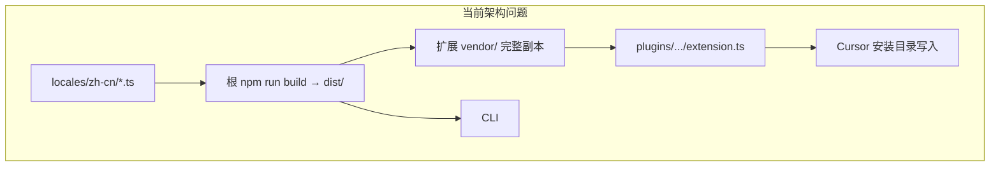
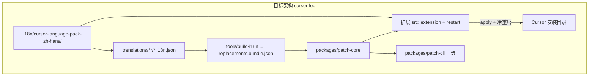

# cursor-loc 架构重构计划

## 现状诊断：为什么「像 patch 不像 loc」

当前 [`cursor-zh-patch-v2`](_archives/Cursor配置汉化插件/cursor-zh-patch-v2) 把 **词典、引擎、CLI、扩展** 揉在一个仓库里，扩展又通过 `vendor/patch-core` 复制整份 `dist/`，导致：



| 问题               | 根因                                                                                                                                                                                                         |
| ------------------ | ------------------------------------------------------------------------------------------------------------------------------------------------------------------------------------------------------------ |
| clone 后扩展不可用 | `vendor/` gitignore，必须先 root build + sync                                                                                                                                                                |
| 词典与引擎耦合     | `locales/*.ts` import `../../src/types.js`                                                                                                                                                                   |
| CLI/扩展逻辑重复   | [`cli.ts`](_archives/Cursor配置汉化插件/cursor-zh-patch-v2/src/cli.ts) 与 [`patchService.ts`](_archives/Cursor配置汉化插件/cursor-zh-patch-v2/plugins/cursor-language-pack-zh-hans/src/patchService.ts) 镜像 |
| 不像 MS 语言包     | 词典是 TS 模块而非 JSON；扩展目录在 `plugins/` 而非 `i18n/`                                                                                                                                                  |

## 目标架构：对齐 vscode-loc 外观，保留 Cursor 必需运行时

参考 [microsoft/vscode-loc](https://github.com/microsoft/vscode-loc) 与 [package.json 模板](https://github.com/microsoft/vscode-loc/blob/main/media/vscode-language-pack-package-json.PNG)：



**关键结论（你已选混合模式）**：

- **可对齐 vscode-loc 的**：仓库命名、`i18n/` 目录、JSON 词典分文件、`package.json` 的 `Language Packs` 分类与 README 结构
- **不能删的**：`patch-core`（写 workbench 副本 + 协议拦截 + DOM 注入）、扩展内 apply/restart/deactivate revert
- **不能照搬的**：MS 的 `contributes.localizations` **无法覆盖** Cursor Settings/Agent/Composer 等专有 UI（设计文档 [§4.3](_archives/Cursor配置汉化插件/cursor-zh-patch-v2/docs/cursor-专有界面汉化扩展-设计与实施.md) 已论证）；可保留该字段作**元数据/未来兼容**，但运行时仍走 patch 管线

---

## 目标目录结构

```
cursor-loc/                                    # 原 cursor-zh-patch-v2
├── README.md                                  # 仓库总览（loc 风格）
├── package.json                               # npm workspaces 根
├── packages/
│   ├── patch-core/                            # 补丁引擎（原 src/services + assets）
│   │   ├── package.json                       # @cursor-loc/patch-core
│   │   └── src/
│   │       ├── index.ts                       # 统一 API: apply/revert/status/doctor
│   │       ├── types.ts
│   │       ├── services/
│   │       └── assets/                        # cursor.inject.js, cursorTranslatorMain.js
│   └── patch-cli/                             # 可选，原根 cli
│       └── src/cli.ts
├── i18n/
│   └── cursor-language-pack-zh-hans/          # 对外发布的语言包扩展（类似 vscode-loc 子目录）
│       ├── package.json                       # displayName / categories / contributes
│       ├── README.md                          # 市场页（已 MS 风格化）
│       ├── translations/                      # JSON SSOT（人工维护）
│       │   ├── meta.json                      # testedCursorVersion, locale
│       │   ├── common.i18n.json
│       │   ├── dialogs.i18n.json
│       │   ├── settings/
│       │   │   ├── general.i18n.json
│       │   │   ├── agents.i18n.json
│       │   │   └── ...
│       │   ├── agent/
│       │   └── review/
│       ├── generated/                         # 构建产物（gitignore）
│       │   └── replacements.bundle.json     # 供 inject 注入的扁平 REPLACEMENTS
│       └── src/                               # 薄扩展壳（无 vendor 副本）
│           ├── extension.ts
│           ├── patchService.ts                # 调用 @cursor-loc/patch-core
│           └── restartCursor.ts
├── tools/
│   ├── build-i18n.mjs                         # JSON → replacements.bundle.json
│   ├── migrate-locales-ts-to-json.mjs         # 一次性迁移脚本
│   ├── extract-candidates.ts                  # 原 scripts/ 迁入
│   └── validate-i18n.mjs                      # 去重/冲突/ dropdown 校验
└── docs/                                      # 保留，更新路径引用
```

与 MS 结构对照：

| MS vscode-loc                        | cursor-loc（目标）                                                   |
| ------------------------------------ | -------------------------------------------------------------------- |
| `i18n/vscode-language-pack-zh-hans/` | `i18n/cursor-language-pack-zh-hans/`                                 |
| `translations/main.i18n.json`        | `translations/settings/*.i18n.json` + `agent/` + `dialogs.i18n.json` |
| `contributes.localizations` → NLS    | **元数据 + 文档**；运行时仍用 `replacements.bundle.json` + patch     |
| 无 runtime 代码                      | `src/` 仅 patch 调度 + 冷重启（Cursor 特有）                         |

---

## JSON 词典 schema（Cursor 专有，非 VS Code NLS）

MS 的 `main.i18n.json` 是 `{ "vs/workbench/...": { "key": "译文" } }`，与 DOM 注入的 `originalText → changeText` 模型不同。建议采用 **Cursor 专用 schema**，构建时编译为现有 `Replacement[]`：

```json
{
  "version": "1.0.0",
  "locale": "zh-cn",
  "meta": {"testedCursorVersion": "3.7.42", "module": "settings.general"},
  "replacements": [
    {
      "originalText": "Meet the new Agents Window",
      "changeText": "认识全新的智能体窗口",
      "searchType": "exact"
    }
  ]
}
```

`tools/build-i18n.mjs` 职责：

1. 递归读取 `translations/**/*.i18n.json`
2. 按优先级合并（`dropdown-options` > `dialogs` > `common` > settings 侧栏顺序…，与现 [`index.ts`](_archives/Cursor配置汉化插件/cursor-zh-patch-v2/locales/zh-cn/index.ts) 一致）
3. `dedupe` 输出 `generated/replacements.bundle.json`
4. 生成 `generated/meta.json` 供 status/doctor 显示版本信息

**不**在运行时解析分散 JSON；apply 时只读单一 bundle（与现 inject 占位符替换一致，性能与确定性更好）。

---

## patch-core 统一 API（消除 CLI/扩展重复）

将 [`WindowsTranslator`](_archives/Cursor配置汉化插件/cursor-zh-patch-v2/src/services/WindowsTranslator.ts) 封装为包级 API：

```typescript
// packages/patch-core/src/index.ts
export async function applyPatch(options: {installRoot?: string; replacements: Replacement[]}): Promise<ApplyResult>

export async function revertPatch(installRoot?: string): Promise<RevertResult>
export async function getPatchStatus(installRoot?: string): Promise<PatchStatus>
export async function runDoctor(installRoot?: string): Promise<DoctorResult>
```

- 扩展 [`patchService.ts`](_archives/Cursor配置汉化插件/cursor-zh-patch-v2/plugins/cursor-language-pack-zh-hans/src/patchService.ts) → 薄包装 + 读 `../generated/replacements.bundle.json`
- CLI → 同样调用 patch-core，删除 dynamic import vendor
- **删除** `sync-patch-core.mjs` 与 `vendor/patch-core/`

---

## 分阶段实施（循序渐进，每阶段可发版）

### Phase 0：重命名与物理搬迁（零逻辑变更）

- `cursor-zh-patch-v2` → `cursor-loc`
- `plugins/cursor-language-pack-zh-hans` → `i18n/cursor-language-pack-zh-hans`
- 更新所有文档路径、`.gitignore`、CI（若有）
- **验收**：现有 `npm run build` + 扩展 `package` + apply/restart 行为不变

### Phase 1：Monorepo 骨架 + 消除 vendor

- 根 `package.json` 增加 `"workspaces": ["packages/*", "i18n/*"]`
- 抽出 `packages/patch-core`，扩展 `dependencies: { "@cursor-loc/patch-core": "workspace:*" }`
- 删除 vendor sync 脚本
- **验收**：Vitest [`restartCursor.*.test.ts`](_archives/Cursor配置汉化插件/cursor-zh-patch-v2/plugins/cursor-language-pack-zh-hans/src/__tests__/) 全绿；VSIX 体积略减

### Phase 2：TS 词典 → JSON（最大维护性收益）

- 编写 `tools/migrate-locales-ts-to-json.mjs`，将现 [`locales/zh-cn/`](_archives/Cursor配置汉化插件/cursor-zh-patch-v2/locales/zh-cn/) 转为 `translations/**/*.i18n.json`
- 实现 `tools/build-i18n.mjs` + `validate-i18n.mjs`
- 扩展 `package.json` scripts：`"build:i18n": "node ../../tools/build-i18n.mjs"`
- `compile` 链：`build:i18n` → `tsc` → `vsce package`
- 删除 `locales/` TS 源（或保留一版 `_archive/` 后移除）
- **验收**：`replacements.bundle.json` 条目数与现 `REPLACEMENTS.length` 一致；UI 汉化回归 Settings/Agent/Quit 弹窗

### Phase 3：扩展 package.json 对齐 vscode-loc 市场形态

- 完善 [`package.json`](_archives/Cursor配置汉化插件/cursor-zh-patch-v2/plugins/cursor-language-pack-zh-hans/package.json)：
  - `contributes.localizations` 增加 **cursor 专有** 说明性条目（或 `translations/cursor-proprietary.i18n.json` 注册为附加 translation id）
  - `engines.vscode` 对齐目标 Cursor 版本
  - `scripts.update` 占位（指向 `tools/build-i18n`）
- README 保持 MS 风格（已完成），`README.developer.md` 指向 `docs/`
- **验收**：扩展市场详情页结构清晰；标识符 `ggbdpq.cursor-language-pack-zh-hans` 不变

### Phase 4：工具链与质量门（可选，发布前推荐）

- `extract-candidates` 输出直接为 `.i18n.json` 草稿
- CI：`validate-i18n` + patch-core 单测 + 扩展单测
- `meta.testedCursorVersion` 与 Cursor 安装版本 diff 警告（doctor 增强）

---

## 风险与规避

| 风险                                     | 规避                                                 |
| ---------------------------------------- | ---------------------------------------------------- |
| 误以为 JSON + localizations 可去掉 patch | README/架构图明确「混合模式」；doctor 检测 trio 状态 |
| JSON 合并顺序导致覆盖                    | `build-i18n` 固化优先级 + `validate-i18n` 冲突检测   |
| 重构期间用户已装旧 VSIX                  | 扩展 id 不变；apply 幂等；文档写「升级后重新 apply」 |
| 目录重命名 Permission denied             | 关闭 Cursor/IDE 占用后重命名；或 git mv 新分支       |

---

## 成功标准

1. 仓库名 `cursor-loc`，语言包位于 `i18n/cursor-language-pack-zh-hans/`
2. 词典维护只需编辑 JSON，无 TS import 引擎类型
3. 无 `vendor/` 副本；扩展通过 workspace 依赖 patch-core
4. apply / restart / revert / deactivate 行为与现网一致
5. 扩展 README 与 MS 语言包同级可读性，便于 Cursor 市场上架

---

## 建议的首批 PR 切分

1. **PR-1** Phase 0 重命名 + 路径更新
2. **PR-2** Phase 1 patch-core 包 + 去 vendor
3. **PR-3** Phase 2 JSON 迁移 + build-i18n（最大 diff，单独 PR）
4. **PR-4** Phase 3 市场 package.json + 文档

每 PR 可独立验收，避免「大爆炸重构」导致 2–3 小时级别的调试回归。
