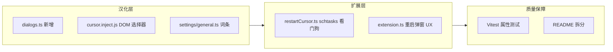

# cursor-zh-patch-v2 本地修改 Git 提交计划

## 变更摘要

本次待提交内容围绕 **Cursor 冷重启失败修复** 及配套汉化/文档/测试，共 16 个文件（排除 `.claude/` 后为 14 个）。



### 核心改动

| 区域        | 文件                                                                                                                                                                                                                                                                                                                                             | 要点                                                                                                                                     |
| ----------- | ------------------------------------------------------------------------------------------------------------------------------------------------------------------------------------------------------------------------------------------------------------------------------------------------------------------------------------------------ | ---------------------------------------------------------------------------------------------------------------------------------------- |
| 重启修复    | [`plugins/cursor-language-pack-zh-hans/src/restartCursor.ts`](E:/agents-product/_archives/Cursor配置汉化插件/cursor-zh-patch-v2/plugins/cursor-language-pack-zh-hans/src/restartCursor.ts)                                                                                                                                                       | 弃用 `spawn(cmd)` + `workbench.action.restart`；改用 **schtasks 一次性任务 + VBS + .bat 看门狗**，脱离 Cursor Job Object；失败时降级提示 |
| 扩展 UX     | [`plugins/cursor-language-pack-zh-hans/src/extension.ts`](E:/agents-product/_archives/Cursor配置汉化插件/cursor-zh-patch-v2/plugins/cursor-language-pack-zh-hans/src/extension.ts)                                                                                                                                                               | 对齐原生重启弹窗文案；modal 对话框；重启失败 warning                                                                                     |
| 对话框汉化  | [`locales/zh-cn/dialogs.ts`](E:/agents-product/_archives/Cursor配置汉化插件/cursor-zh-patch-v2/locales/zh-cn/dialogs.ts)（新）                                                                                                                                                                                                                   | Quit/Close 确认对话框词条                                                                                                                |
| 注入层      | [`src/assets/cursor.inject.js`](E:/agents-product/_archives/Cursor配置汉化插件/cursor-zh-patch-v2/src/assets/cursor.inject.js)                                                                                                                                                                                                                   | 新增 `.monaco-dialog-box`、`.dialog-message` 扫描根                                                                                      |
| 测试        | [`src/__tests__/restartCursor.*.test.ts`](E:/agents-product/_archives/Cursor配置汉化插件/cursor-zh-patch-v2/plugins/cursor-language-pack-zh-hans/src/__tests__/) + [`vitest.config.ts`](E:/agents-product/_archives/Cursor配置汉化插件/cursor-zh-patch-v2/plugins/cursor-language-pack-zh-hans/vitest.config.ts)                                 | bug 条件探索测试 + 行为保持测试                                                                                                          |
| 文档/元数据 | README 精简 + [`README.developer.md`](E:/agents-product/_archives/Cursor配置汉化插件/cursor-zh-patch-v2/plugins/cursor-language-pack-zh-hans/README.developer.md)（新）；[`package.json`](E:/agents-product/_archives/Cursor配置汉化插件/cursor-zh-patch-v2/plugins/cursor-language-pack-zh-hans/package.json) 增加 vitest、keywords、repository |
| 忽略规则    | [`.gitignore`](E:/agents-product/_archives/Cursor配置汉化插件/cursor-zh-patch-v2/.gitignore)                                                                                                                                                                                                                                                     | 新增 `.kiro/specs`                                                                                                                       |

### 历史 commit 风格参考

```
ae7bc41 docs: 新增 VSIX 扩展教程系列并完善文档体系
d507728 feat: 项目 0.0.1 版本已完成
```

格式：`type: 中文简述`，type 使用 `feat` / `fix` / `docs` 等。

### 建议 commit message

本次以 **fix** 为主（冷重启失败是核心动机），兼顾 feat/docs：

```
fix: 用 schtasks 看门狗修复冷重启失败并补充对话框汉化

- restartCursor 改用 schtasks 脱离 Job Object，失败时降级提示
- 新增 dialogs 词条与 inject DOM 选择器，对齐原生重启弹窗 UX
- 添加 Vitest 属性测试，拆分开发者文档
```

（若偏好更短单行：`fix: 修复 Cursor 冷重启失败并完善对话框汉化与测试`）

### 不纳入本次提交

- [`.claude/settings.json`](E:/agents-product/_archives/Cursor配置汉化插件/cursor-zh-patch-v2/.claude/settings.json)
- [`.claude/settings.local.json`](E:/agents-product/_archives/Cursor配置汉化插件/cursor-zh-patch-v2/.claude/settings.local.json)

（按你的选择排除；后续可考虑在 `.gitignore` 增加 `.claude/` 避免误提交，**本次不主动改**）

## 执行步骤

### 1. 提交前验证（推荐）

在扩展目录运行测试，确认 schtasks 修复与测试通过：

```bash
cd "E:/agents-product/_archives/Cursor配置汉化插件/cursor-zh-patch-v2/plugins/cursor-language-pack-zh-hans"
npm test
```

### 2. 暂存文件

```bash
cd "E:/agents-product/_archives/Cursor配置汉化插件/cursor-zh-patch-v2"

git add \
  .gitignore \
  locales/zh-cn/index.ts \
  locales/zh-cn/settings/general.ts \
  locales/zh-cn/dialogs.ts \
  src/assets/cursor.inject.js \
  plugins/cursor-language-pack-zh-hans/README.md \
  plugins/cursor-language-pack-zh-hans/README.developer.md \
  plugins/cursor-language-pack-zh-hans/package.json \
  plugins/cursor-language-pack-zh-hans/package-lock.json \
  plugins/cursor-language-pack-zh-hans/src/extension.ts \
  plugins/cursor-language-pack-zh-hans/src/restartCursor.ts \
  plugins/cursor-language-pack-zh-hans/vitest.config.ts \
  plugins/cursor-language-pack-zh-hans/src/__tests__/
```

### 3. 创建 commit

使用 HEREDOC 传递多行 message（与仓库 user rule 一致）：

```bash
git commit -m "$(cat <<'EOF'
fix: 用 schtasks 看门狗修复冷重启失败并补充对话框汉化

- restartCursor 改用 schtasks 脱离 Job Object，失败时降级提示
- 新增 dialogs 词条与 inject DOM 选择器，对齐原生重启弹窗 UX
- 添加 Vitest 属性测试，拆分开发者文档
EOF
)"
```

### 4. 提交后确认

```bash
git status
git log -1 --stat
```

预期：`master` 工作区干净（仅剩未跟踪的 `.claude/`）；HEAD 为第 3 个 commit。

## 注意事项

- **不 push**：除非你另行要求，仅做本地 commit
- **不 amend 历史 commit**：在现有 2 个 commit 之上新增第 3 个
- `package-lock.json` 体积较大（vitest/fast-check 依赖），属正常变更，需一并提交以保证可复现构建
