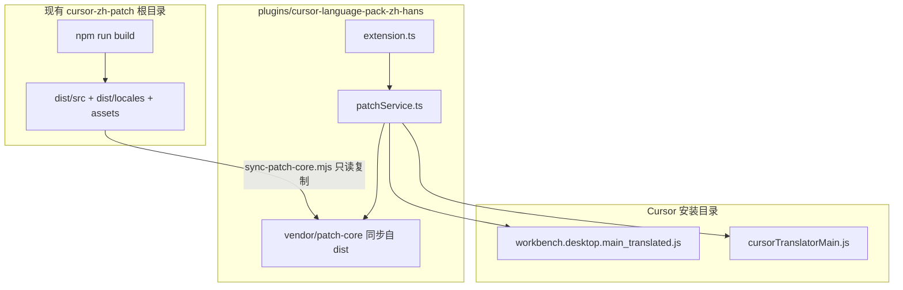
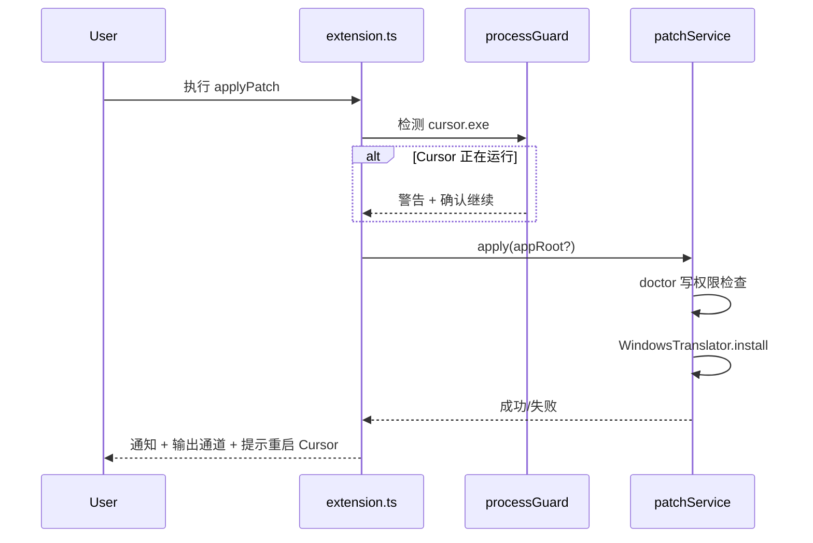

# Cursor 简体中文 VS Code 扩展实施计划

## 目标与约束

- **目标**：提供类似「安装语言包 → 点命令汉化」的体验，覆盖 Cursor 专有 UI（第二层汉化）。
- **硬约束**：**不修改**现有 [`src/`](src/)、[`locales/`](locales/)、根 [`package.json`](package.json) 等代码；所有新文件仅落在 [`plugins/`](plugins/) 下。
- **底座 UI**：通过 Extension Pack 依赖微软官方包 `MS-CEINTL.vscode-language-pack-zh-hans`，用户仍需 `Configure Display Language → zh-cn`（与 [README](README.md) 一致）。
- **MVP 范围**：对应规划文档 **阶段 1+2**（Extension Pack + 四条命令 + 输出通道/通知）；状态栏与 walkthrough 留作后续迭代。

## 架构概览



## 目录结构（新建）

```
plugins/
└── cursor-language-pack-zh-hans/
    ├── package.json          # Extension Pack + commands + configuration
    ├── tsconfig.json
    ├── .vscodeignore
    ├── .vscode/launch.json     # F5 调试
    ├── scripts/
    │   └── sync-patch-core.mjs # 从 ../../dist 复制到 vendor/
    ├── vendor/                 # gitignore，构建产物
    │   └── patch-core/         # 镜像 dist 结构（cli、services、locales、assets）
    ├── src/
    │   ├── extension.ts        # activate/deactivate、注册命令
    │   ├── patchService.ts     # 封装 apply/revert/status/doctor
    │   ├── processGuard.ts     # 检测 cursor.exe 是否运行
    │   └── outputChannel.ts    # 统一日志输出
    └── README.md               # 安装/使用/免责声明
```

根目录 [`.gitignore`](.gitignore) **仅追加**一行 `plugins/**/vendor/`（最小改动，避免 vendor 入库）。

## 补丁引擎集成策略

采用 **vendor 同步**（规划文档 8.4 资产复用，但不抽离 patch-core 包、不改现有代码）：

1. 开发/打包前在仓库根执行 `npm run build`。
2. 扩展目录执行 `npm run sync` → [`scripts/sync-patch-core.mjs`](plugins/cursor-language-pack-zh-hans/scripts/sync-patch-core.mjs) 只读复制：
   - `dist/src/**`（含 `services/`、`assets/`、`cli.js`）
   - `dist/locales/**`
3. [`patchService.ts`](plugins/cursor-language-pack-zh-hans/src/patchService.ts) 通过 **dynamic import** 加载 vendor 模块（与 CLI 相同入口逻辑）：
   - `createTranslator` / `loadInterceptorMain` ← `WindowsTranslator.js`
   - `resolveCursorInstallPath` / `checkWriteAccess` 等 ← `pathResolver.js`
   - `locale.REPLACEMENTS` ← `locales/zh-cn/index.js`

> 不 spawn 根目录 CLI：`.vsix` 安装后路径不可依赖 monorepo 结构；vendor 同步保证扩展自包含。

## 扩展 manifest 要点

[`plugins/cursor-language-pack-zh-hans/package.json`](plugins/cursor-language-pack-zh-hans/package.json) 核心字段（参考 [规划文档 9.2](docs/cursor-language-pack-plan.md)）：

| 字段 | 值 |
|------|-----|
| `displayName` | Chinese (Simplified) Language Pack for Cursor |
| `categories` | `["Language Packs"]` |
| `extensionKind` | `["ui"]` |
| `extensionPack` | `["MS-CEINTL.vscode-language-pack-zh-hans"]` |
| `engines.vscode` | `^1.85.0`（与 Cursor 内置 VS Code 版本对齐，可后续微调） |
| `publisher` | 占位 `cursor-zh-patch`（发布前可改） |

**命令**（`contributes.commands`）：

| command id | 标题 |
|------------|------|
| `cursorZh.applyPatch` | Cursor 中文：应用界面汉化 |
| `cursorZh.revertPatch` | Cursor 中文：恢复英文界面 |
| `cursorZh.showStatus` | Cursor 中文：查看汉化状态 |
| `cursorZh.doctor` | Cursor 中文：环境诊断 |

**配置项**（`contributes.configuration`）：

- `cursorZh.appRoot`：可选，覆盖 Cursor 安装路径（对应 CLI `--app-root`）
- `cursorZh.autoApplyOnInstall`：默认 `false`（方案 B，不自动 apply）

## 核心交互流程

### apply 命令



- **进程检测**（扩展新增逻辑）：`tasklist` / `Get-Process cursor` 检测；若运行中则 `showWarningMessage` 提示「建议完全关闭 Cursor 后再应用」，用户确认后才继续（CLI 本身无此检测）。
- **权限失败**：复用 `checkWriteAccess`，提示以管理员身份运行或配置 `cursorZh.appRoot`。
- **平台**：非 `win32` 直接提示「当前仅支持 Windows」（与 CLI 一致）。

### revert / status / doctor

- 直接调用 vendor 中对应逻辑，结果写入 **Output Channel**「Cursor 中文语言包」。
- `status` 额外比对 `locale.meta.testedCursorVersion` 与当前 Cursor 版本，版本不匹配时 `showWarningMessage`（词典维护提示，逻辑对齐 CLI `status` 命令）。

## 构建与调试

扩展 `package.json` scripts：

```json
{
  "compile": "npm run sync && tsc -p .",
  "sync": "node scripts/sync-patch-core.mjs",
  "watch": "tsc -watch -p .",
  "package": "npm run compile && vsce package"
}
```

**本地调试**：

1. 根目录 `npm run build`
2. `cd plugins/cursor-language-pack-zh-hans && npm install && npm run compile`
3. F5 启动 Extension Development Host
4. 命令面板执行四条命令验收

**侧载测试**：`vsce package` → Cursor 扩展视图 → 从 VSIX 安装

## 与现有 CLI 的关系

| 场景 | 推荐方式 |
|------|----------|
| 开发/CI | 根 CLI `npm run apply` 仍可用 |
| 普通用户 | 安装扩展 → 命令面板一键操作 |
| 词典更新 | 仍编辑根 [`locales/`](locales/) → 根 `npm run build` → 扩展 `npm run sync` → 重编译扩展 |

扩展 README 明确说明：专有 UI 汉化仍通过 workbench 注入实现，与 [规划文档 4.1](docs/cursor-language-pack-plan.md) 约束一致；**非官方**，Cursor 更新后需 re-apply。

## 风险与应对（扩展层新增）

| 风险 | 应对 |
|------|------|
| 在 Cursor 内 apply 时文件被占用 | 进程检测 + 强提示关闭后重试 |
| vendor 未同步导致 import 失败 | `activate` 时检查 vendor 存在，否则提示先 `npm run sync` |
| MS 中文包未安装 | Extension Pack 自动拉取；README 补充手动安装步骤 |
| 管理员权限不足 | doctor 命令 + 配置项 `appRoot` |

## 验收标准

- [ ] F5 调试扩展可加载，四条命令均可执行
- [ ] `doctor` 能识别 `D:\WEBDEV\cursor`（依赖 vendor 内已修复的 pathResolver）
- [ ] `apply` 后 Cursor 专有 Settings/Agent 界面为中文（需重启）
- [ ] `revert` 可恢复英文
- [ ] `vsce package` 生成可侧载的 `.vsix`
- [ ] 根目录 `src/`、`locales/` 无 diff（除 `.gitignore` 追加 vendor 忽略规则）

## 后续迭代（不在本次 MVP）

- 状态栏补丁状态指示（阶段 3）
- `walkthroughs` 首次安装引导
- `deactivate` 可选自动 revert
- macOS / Linux 平台支持
