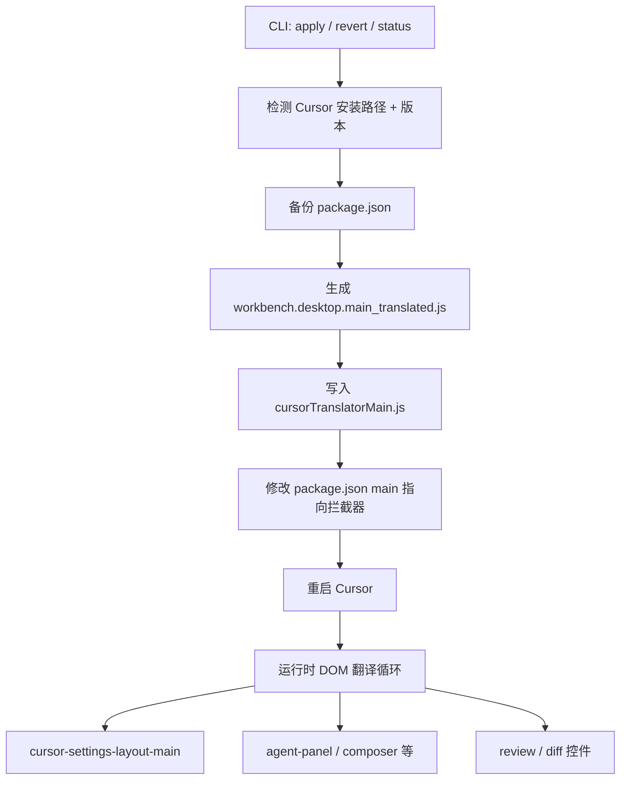

# Cursor 专有界面汉化补丁（CLI）实施计划

## 核心结论：为什么不能做成“普通 VS Code 语言包”

| 层级 | VS Code 中文语言包 | Cursor Settings / Agent 等 |
|------|-------------------|---------------------------|
| 文案存放 | `package.nls.json` + `%key%` 占位符 | 硬编码在 [`workbench.desktop.main.js`](D:/Program Files/cursor/resources/app/out/vs/workbench/workbench.desktop.main.js) |
| 加载机制 | `contributes.localizations` 扩展贡献点 | 无公开 i18n API |
| 扩展能否覆盖 | 能 | **不能**（扩展运行在 Extension Host，无法注入 Cursor 自研 Web UI） |

Cursor 官方也确认：VS Code 语言包只能翻译基础 UI，**Cursor 专有部分（Settings、Agent、Composer 等）不在覆盖范围内**。

因此，你选择的 **补丁/CLI 方案** 是当前唯一可行且效果最好的路径。社区已有参考实现：[cursor-i18n](https://github.com/somersby10ml/cursor-i18n)（含 `zh-cn` 模块，但注入范围偏窄）。

---

## 技术架构（推荐复用 cursor-i18n 思路并扩展）



### 1. 协议拦截层（不改动原文件）

参考 cursor-i18n 的 [`cursorTranslatorMain.js`](https://github.com/somersby10ml/cursor-i18n/blob/main/src/cursorTranslatorMain.js.file)：

- 拦截 `vscode-file://` 协议
- 当请求 `workbench.desktop.main.js` 时，重定向到 `workbench.desktop.main_translated.js`
- 原文件保持只读，便于 `revert` 一键恢复

### 2. 运行时 DOM 翻译层（核心）

在 `workbench.desktop.main.js` **头部注入**翻译脚本（参考 [`cursor.inject.js.file`](https://github.com/somersby10ml/cursor-i18n/blob/main/src/cursorTranslateService/cursor.inject.js.file)）：

- 用 `TreeWalker` 遍历文本节点
- 按映射表做 `exact` / `partial` / `regex` 替换
- 每 100ms 轮询（应对 Solid.js 动态渲染）

**cursor-i18n 的局限（你需要扩展）**：当前只监听两个容器：

```javascript
document.getElementsByClassName('cursor-settings-layout-main')
document.getElementsByClassName('settings-editor')
```

全量 Cursor UI 需扩展为**多根节点扫描**，建议按模块维护 selector 列表：

| 模块 | 建议 DOM 根选择器（需在目标版本实测） |
|------|--------------------------------------|
| Settings 侧栏/详情 | `.cursor-settings-layout-main` |
| VS Code 设置编辑器 | `.settings-editor` |
| Agent 面板 | `[data-component="agent-panel"]` |
| Composer/Chat | `.composer-*` / `[data-component="composer"]`（需 grep 确认） |
| Agent Review | review/diff 相关 class（需实测） |
| 工具调用状态 | tool-call 相关节点 |
| 模式切换 | Plan / Ask / Debug 等模式 UI |

注入逻辑改为：遍历所有 root → 对每个 root 执行 `translateElement()`，并记录已翻译节点避免重复抖动。

### 3. 翻译词典层

按功能拆分 TypeScript 模块（参考 cursor-i18n 的 [`lang/zh-cn/`](https://github.com/somersby10ml/cursor-i18n/tree/main/lang/zh-cn)）：

```
locales/zh-cn/
├── index.ts          # 聚合导出 REPLACEMENTS
├── settings/
│   ├── sidebar.ts    # General, Agents, Models, Plugins...
│   ├── general.ts    # 截图中的 Cursor Account, Layout 等
│   ├── agents.ts
│   ├── models.ts
│   ├── mcp.ts
│   └── ...
├── agent/
│   ├── modes.ts      # Agent / Plan / Ask / Debug
│   ├── toolcalls.ts  # Reading, Searching, Terminal...
│   └── composer.ts
├── review/
│   └── pr-review.ts
└── common.ts         # Open, Import, Show, Learn more...
```

映射条目结构：

```typescript
interface Replacement {
  originalText: string;
  changeText: string;
  searchType: 'exact' | 'partial' | 'regex';
  flags?: string; // regex 用
}
```

**翻译优先级**（对应你的截图）：

1. Settings 侧栏导航（General → 常规，Agents → 智能体…）
2. General 页各 setting label + description
3. Agent/Chat/Review/工具状态（全量范围）

`exact` 优先于 `partial`，避免误伤代码片段；短词（如 "Tab"）需结合容器上下文或仅用 `exact`。

---

## 项目结构建议

在 [`e:\projects`](e:\projects) 新建独立仓库，例如 `cursor-zh-patch`：

```
cursor-zh-patch/
├── package.json              # bin: cursor-zh
├── tsconfig.json
├── src/
│   ├── cli.ts                # apply | revert | status | list-missing
│   ├── services/
│   │   ├── WindowsTranslator.ts
│   │   ├── CursorTranslator.ts
│   │   └── pathResolver.ts   # 注册表/常见路径探测
│   ├── assets/
│   │   ├── cursorTranslatorMain.js
│   │   └── cursor.inject.js  # 扩展多 selector
│   └── types.ts
├── locales/zh-cn/            # 翻译词典
├── scripts/
│   ├── extract-candidates.ts # 从 workbench JS 提取候选英文字 字符串
│   └── diff-coverage.ts      # 对比 UI 截图/手动清单
└── README.md
```

技术栈：TypeScript + Commander（CLI）+ Node.js 22（与你环境一致）。

---

## CLI 命令设计

| 命令 | 作用 |
|------|------|
| `cursor-zh apply` | 检测安装路径 → 备份 → 注入 → 改 main |
| `cursor-zh revert` | 恢复 package.json + 删除 translated 文件 |
| `cursor-zh status` | 显示是否已打补丁、Cursor 版本、词典条目数 |
| `cursor-zh doctor` | 检查写权限（`Program Files` 可能需要管理员） |

Windows 安装路径探测（你的环境实测为 `D:\Program Files\cursor`）：

- `where cursor` → 反推 `resources/app`
- 注册表 `HKCU\Software\Microsoft\Windows\CurrentVersion\Uninstall\Cursor`
- 常见路径 `%LOCALAPPDATA%\Programs\cursor`

---

## 词典构建工作流（最大工作量）

Cursor 无公开字符串清单，需**半自动 + 人工验收**：

1. **静态提取**：对 `workbench.desktop.main.js` grep 常见 UI 模式
   - `label:"..."`, `description:"..."`, `title:"..."`, `placeholder:"..."`
   - 过滤掉明显非 UI 的短串和变量名
2. **动态高亮**（开发模式）：在 inject 脚本中加 `highlightTranslatableTexts()`，打开各页面看哪些英文未被词典覆盖
3. **分模块翻译**：按 Settings 各 Tab 逐页补全（与你截图一致先从 General 开始）
4. **版本标记**：在 `locales/zh-cn/meta.json` 记录 testedCursorVersion（如当前 `3.7.42`）

每次 Cursor 大版本升级后：

- 运行 `status` 检查补丁是否被覆盖
- 重新 `apply`
- 跑一遍 Settings + Agent + Review 冒烟清单

---

## 与官方 VS Code 中文语言包的关系

建议 README 明确说明**两者互补**：

1. 先安装 **Chinese (Simplified) Language Pack for Visual Studio Code**（MS-CEINTL）
2. `Ctrl+Shift+P` → Configure Display Language → `zh-cn`
3. 再运行 `cursor-zh apply` 补 Cursor 专有 UI

这样菜单、命令面板等 VS Code 部分由官方包负责，你的补丁专注 Cursor 增量部分。

---

## 风险与约束

- **Cursor 更新会覆盖补丁**：需在 README 和 `status` 命令中明确提示
- **Windows Program Files 写权限**：安装到 `D:\Program Files\cursor` 时可能需要“以管理员运行”终端，或提供 `--app-root` 参数
- **非官方方案**：修改本地安装包，不违反使用条款需自行确认；建议在 issue 中声明非 Anysphere 官方
- **误翻译风险**：`partial` 替换可能影响非 UI 文本；优先 `exact`，短词加容器限定
- **维护成本**：全量 UI 是持续工程，建议 MVP 分阶段交付

---

## 分阶段交付建议

### Phase 1 — 脚手架 + Settings 全 Tab（1-2 周）
- CLI apply/revert/status
- Windows 路径探测 + 写权限处理
- 扩展 inject 至少覆盖 Settings 全部侧栏与详情页
- 词典：General / Agents / Models / Plugins / Rules / MCP / Indexing / Network / Beta（参考截图）

### Phase 2 — Agent & Composer（1-2 周）
- 扩展 DOM selector 到 Agent 面板、模式切换、Composer 输入区
- 工具调用状态文案（Reading file, Running command…）

### Phase 3 — Review & 杂项（持续）
- Agent Review、PR 相关、通知/toast、空状态、时间单位
- 自动化 extract + coverage 报告
- Cursor 版本升级适配流程文档

---

## 可选：Fork vs 从零

| 方案 | 优点 | 缺点 |
|------|------|------|
| Fork [cursor-i18n](https://github.com/somersby10ml/cursor-i18n) | 拦截器/Windows 逻辑现成，已有 zh-cn 基础 | 仅 Settings 注入、中文词条不全、项目 Beta |
| 从零新建 `cursor-zh-patch` | 命名/结构贴合中文社区，专注 zh-cn | 需复制拦截器代码（MIT 可复用） |

**推荐**：Fork cursor-i18n 或复制其 `src/cursorTranslateService` + 协议拦截代码（MIT），在此基础上扩展 inject selector 和 zh-cn 词典规模。

---

## 验收标准

- [ ] `cursor-zh apply` 后重启，Settings 截图区域全部中文
- [ ] Agent / Plan / Ask / Debug 模式名称与说明中文化
- [ ] 常见工具调用状态（Read, Grep, Shell, MCP）中文化
- [ ] `cursor-zh revert` 后完全恢复英文原貌
- [ ] Cursor 小版本更新后 `status` 能检测到补丁失效并提示 re-apply
