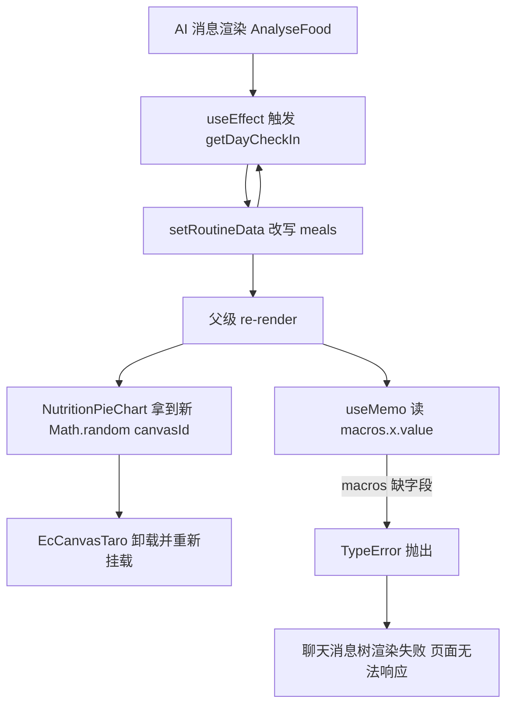

## 一、根因结论（按致死优先级）

控制台 `TypeError: Cannot read properties of undefined (reading 'value')` 的栈帧是 `t.useMemo`，在本组件树里**唯一**带 `useMemo` 的就是 [src/components/A2UI/FoodAssessmentCheckln/NutritionPieChart.tsx](src/components/A2UI/FoodAssessmentCheckln/NutritionPieChart.tsx)。三条互相叠加的故障链共同造成「卡死、点不动」：

### R1（直接致死）NutritionPieChart 在 useMemo 里裸读 `macros.x.value`
[NutritionPieChart.tsx:36-53](src/components/A2UI/FoodAssessmentCheckln/NutritionPieChart.tsx)：

```36:53:src/components/A2UI/FoodAssessmentCheckln/NutritionPieChart.tsx
const NutritionPieChart: React.FC<{ data: DietAnalysis }> = ({ data }) => {
  const { macros = {} as NutritionSummaryData } = data;
  ...
  const chartData = useMemo(
    () => [
      { value: macros.calories.value + macros.carbs.value, ... },
      { value: macros.fat.value, ... },
      { value: macros.protein.value, ... }
    ],
    [macros]
  );
```

`AnalyseFood` 把 `dietAnalysis = {}`（解构默认值）原样传进来，只要后端 `dietAnalysis.macros` 缺失或缺任一字段，`macros.calories` 就是 `undefined`，再读 `.value` 直接抛错。Taro/小程序没有顶层 ErrorBoundary，整棵聊天消息树渲染失败 → 看上去就是「卡死、点不动、滚不动」。

### R2（持续重渲）EChart `canvasId` 用了 `Math.random()`
[NutritionPieChart.tsx:102](src/components/A2UI/FoodAssessmentCheckln/NutritionPieChart.tsx)：

```102:102:src/components/A2UI/FoodAssessmentCheckln/NutritionPieChart.tsx
        <EChart ref={chartRef} canvasId={`nutrition-pie-chart-${Math.random()}`} />
```

每次 render 生成新 id。weapp 的 `canvas-id` 必须稳定，否则：父组件每次 setState 都换 canvas、查询不到老 canvas，并触发 `EcCanvasTaro` 重挂载，叠加 R3 后 CPU 直接打满，主线程被吃满 → 触摸事件无法响应。

### R3（潜在死循环）AnalyseFood 的 useEffect 依赖含数组引用，又会自我覆盖
[AnalyseFood.tsx:83-111](src/components/A2UI/FoodAssessmentCheckln/AnalyseFood.tsx)：

```83:111:src/components/A2UI/FoodAssessmentCheckln/AnalyseFood.tsx
useEffect(() => {
  ...
  (async function () {
    const res = await getDayCheckInFn(dayjs(date));
    const data = res?.data;
    if (!data) {
      setRoutineData({ date });
      return;
    }
    ...
    if (findItem) {
      ...
      setRoutineData(prev => ({ ...prev, ...checkInData }));
    } else {
      setRoutineData({ date });
    }
  })();
}, [routineData.date, routineData.meals]);
```

依赖里挂了 `routineData.meals`（数组引用），而 effect 内部多条分支会用 `setRoutineData({ date })` 把 `meals` 抹成 `undefined`，下一轮 deps 又变化 → 再次发起 `getDayCheckIn` → 再次 setState … 这是经典的「自激发循环」，会持续触发网络请求 + 父级重渲，与 R2 叠加把 UI 彻底拖死。



## 二、修复范围（最小 diff，仅三处文件）

只动 `NutritionPieChart.tsx` 与 `AnalyseFood.tsx`，不改样式、不改类型、不改 `EvaluateFood`、不引 ErrorBoundary。

### 改动 1：NutritionPieChart 容错 + 稳定 canvasId
- 文件：[src/components/A2UI/FoodAssessmentCheckln/NutritionPieChart.tsx](src/components/A2UI/FoodAssessmentCheckln/NutritionPieChart.tsx)
- 在读取每一项前用可选链 + 兜底 `0` / `''`：
  - `macros?.carbs?.value ?? 0`、`macros?.fat?.value ?? 0`、`macros?.protein?.value ?? 0`
  - 同步把 `unit` 改为 `macros?.x?.unit ?? 'g'`
- `碳水化合物` 当前是 `macros.calories.value + macros.carbs.value`（这是与崩溃同源的取值，最小修复保持「不再访问 undefined」即可，不改业务口径，仅加 `?.` 与默认 `0`，避免顺手改业务）。
- 把 `canvasId` 改为组件挂载期内稳定的值：用 `useRef` 在首次渲染时生成一次，例如：
  ```ts
  const canvasIdRef = useRef(`nutrition-pie-chart-${Date.now()}-${Math.floor(Math.random() * 1e6)}`);
  ```
  然后 `<EChart canvasId={canvasIdRef.current} />`。
- 不动 `useEffect` 的 deps 与 buildOption 逻辑，避免越权。

### 改动 2：AnalyseFood 切断 useEffect 自激发
- 文件：[src/components/A2UI/FoodAssessmentCheckln/AnalyseFood.tsx](src/components/A2UI/FoodAssessmentCheckln/AnalyseFood.tsx)
- 把 effect 依赖从 `[routineData.date, routineData.meals]` 收窄为 `[routineData.date, customerId]`（`meals` 不该作为触发拉取的输入；`customerId` 本来就在 effect 内被使用，列入依赖更安全）。
- effect 内**保留**现有 setState 分支，只去掉对 `meals` 的依赖，循环即断；不动 API、不动数据合并语义。
- 仅这一处依赖数组调整，最小 diff。

> 不在本次改动里做的事（明确越权红线）：
> - 不新增 ErrorBoundary、不改 `EvaluateFood.tsx`、不删 `Button` 等死导入
> - 不修「碳水 = calories + carbs」的业务口径
> - 不改 `ActionSheet` / `Popup` 的滚动容器
> - 不动 `customerId` 之外的全局 store 选择器
> - 不动类型定义、不动 SCSS

## 三、验收点
- 后端返回 `dietAnalysis` 缺 `macros` 或缺任一字段时，组件不再抛错，页面可正常滚动与点击。
- 同一会话多次 setState 不再触发 `EChart` 重挂载（canvasId 在组件实例内保持稳定）。
- 「饮食打卡详情」页停留时，Network 不再出现重复刷的 `getDayCheckIn`。
- `npm run lint` 对修改文件无新增告警。

## 四、回滚点
- 三处编辑均为局部修改，单文件 `git checkout -- <file>` 即可回滚到当前 HEAD。