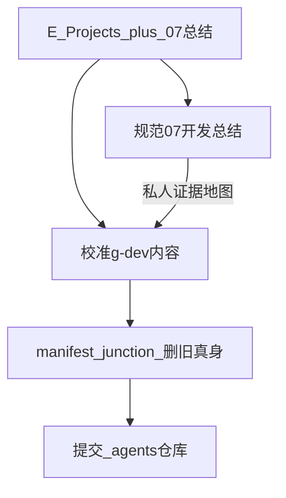

# 用真实代码校准 g-dev-best-practices

分层约定已确认：**总结库保留真实项目名作私人证据索引；skill 只吸收通用模式，禁止写回项目名、端口、私有路径。** 本轮同时做内容校准、07-开发总结规范、以及 [g-dev-merge-plan.md](C:\Users\802165.agents\plans\g-dev-merge-plan.md) 机械收尾。

## 0. 先核对的事实（执行时只读）

- 代码根是两层，不是散落仓库：[E:\Projects\frontend](E:\Projects\frontend)、[E:\Projects\backend\node](E:\Projects\backend\node)、[E:\Projects\backend\java](E:\Projects\backend\java)。
- 作者提交筛选用 `802165@clife.cn` / 关天豪；只采本人提交过的仓库，不把别人代码当个人习惯。
- Node 不是单一形态：`ai-audio-editing-node-bff` 是 Fastify + worker；`homing-miniapp-node-bff` 是 Next.js BFF（带 React UI）。当前路由器把所有 `package.json` 判成 Web，会误路由 Node 服务。
- 总结库证据地图路径已过期：写的是 `E:\projects\backend\ai-audio-editing-node-bff` 和 `E:/开发文档/97-前端项目规范`，实际分别是 `E:\Projects\backend\node\...` 与 `E:\开发文档\07-开发总结\01-项目规范`。
- skill 专题 frontmatter 仍是 `gua-*` / `minimal-diff-fix`；[agents/openai.yaml](C:\Users\802165.agents\categories\08-个人经验沉淀\g-dev-best-practices\agents\openai.yaml) 仍指向旧 skill 名。
- `minimal-diff-fix` 在 [08 真身](C:\Users\802165.agents\categories\08-个人经验沉淀\minimal-diff-fix) 和 [05 副本/junction](C:\Users\802165.agents\categories\05-全栈工程与交付质量\06-代码审查与重构\minimal-diff-fix) 同时存在。删前必须用 `dir` / reparse point 确认哪边是真身。
- [07-开发总结](E:\开发文档\07-开发总结) 不在 `.agents` git 仓库内。两套改动分开提交，禁止混进一次 commit。

## 1. 规范 07-开发总结（私人证据层）

目标：让总结库能被 skill 当证据索引用，而不是再写一套平行规范。

改动范围（最小、可回滚，不删正文）：

- 补根入口 `E:\开发文档\07-开发总结\README.md`：说明四块职责（01 规范 / 02 模板 / 03 迭代 / 04 记录）以及与 skill 的分层。
- 新增 `E:\开发文档\07-开发总结\证据地图.md`：项目名 + 真实路径 + 对应 skill 专题（`web/fe-standards`、`web/ai-audio`、`node/bff`、`java/ddd-service` 等）。这是**唯一允许集中写项目名的索引**。
- 修正 [01-项目规范/README.md](E:\开发文档\07-开发总结\01-项目规范\README.md) 与 [00-项目规范概览.md](E:\开发文档\07-开发总结\01-项目规范\docs\00-项目规范概览.md) 的过期路径：`97-前端项目规范` → `07-开发总结/01-项目规范`；Node BFF 路径补上 `backend\node\`。
- 修正 04 记录 README / INDEX 中的 `codex-knowledge-vault` 旧路径；INDEX 把「待沉淀」和 inbox 已有资产分开，避免假空白。
- inbox 不整批搬家。只把可复用模式抽 3–5 条进 `20-question-patterns` / `30-answer-patterns` / `40-decisions`（TypeScript 迁移、Mock 分区、资源清理、前后端任务身份），正文可保留项目名。
- 02 模板保留 `reservation-flow` / `my-customer` / `audio-task` 等业务目录名；只在 README 标明它们是证据样板，不是 skill 对外 API。
- 01 规范 28 篇**不重写去项目名**。只修路径、补「对应 skill 专题」一行交叉引用。

验收：打开证据地图能从项目走到 skill 专题；skill 正文 grep 不到这些项目路径。

## 2. 用真实代码校准 skill（通用模式层）

工作目录只改 [g-dev-best-practices](C:\Users\802165.agents\categories\08-个人经验沉淀\g-dev-best-practices)。

### 2.1 执行前抽样（只读）

在代表性仓库跑 `git log --author=802165@clife.cn --oneline -20`，至少覆盖：

- 前端：`homing-miniapp-workbench`、`beauty-smart-advisor`、`homing-miniapp-brand`
- Node：`ai-audio-editing-node-bff`、`homing-miniapp-node-bff`
- Java：一个 `*-center` + 一个 `*-bff`

对照本人提交习惯校准规则，不把仓库里别人的写法写进 skill。

### 2.2 路由器改成三栈

改 [SKILL.md](C:\Users\802165.agents\categories\08-个人经验沉淀\g-dev-best-practices\SKILL.md)：

| 判定                                                                                                       | 栈                 | 专题                    |
| ---------------------------------------------------------------------------------------------------------- | ------------------ | ----------------------- |
| `pom.xml` / `application.yml` / `*-support/{common,client,start}`                                          | Java               | `references/java/`      |
| `fastify`/`express`/`koa` 依赖，或 `src/app/server.ts` + route/schema/worker，且无 Taro/`src/pages` 产品壳 | Node 服务          | `references/node/`      |
| `package.json` + Taro/`src/pages`/`src/app.config.ts`/Umi                                                  | Web                | `references/web/`       |
| 同仓多栈                                                                                                   | 按当前编辑文件目录 | 对应专题                |
| 模糊修复                                                                                                   | debugging          | `references/debugging/` |

禁止继续用「有 package.json 就是 Web」。

### 2.3 新增 Node 专题（当前最大缺口）

新增 `references/node/bff/SKILL.md`（frontmatter 名 `g-dev-node-bff`），从真实代码抽**通用**模式，不写仓库名：

- Fastify：route / JSON Schema / service / worker 边界；媒体任务状态机；对象存储适配。
- Next.js BFF：薄聚合、契约测试、本地 mock 网关；前端不直连 worker。
- TypeScript 迁移：先契约测试再改类型，不一次改完。
- 质量门：`type-check`、契约测试、敏感日志脱敏。

来源：Node 仓库结构 + [04 inbox 的 TS 迁移/Mock 审计](E:\开发文档\07-开发总结\04-项目记录\00-inbox)，写入时去掉项目名。

### 2.4 校准现有 Web / Java / debugging

- 全部专题 `name:` 从 `gua-*` / `minimal-diff-fix` 改为 `g-dev-*`（如 `g-dev-fe-standards`、`g-dev-debugging`）。
- 正文交叉引用同步替换；[business-ui](C:\Users\802165.agents\categories\08-个人经验沉淀\g-dev-best-practices\references\web\business-ui\SKILL.md) 里的 `gua-css-writing-guidelines` 等全部改掉。
- 改 [agents/openai.yaml](C:\Users\802165.agents\categories\08-个人经验沉淀\g-dev-best-practices\agents\openai.yaml)：`$g-dev-best-practices` + 专题相对路径，不再提旧 skill。
- 从 [27-八年项目经验沉淀规范.md](E:\开发文档\07-开发总结\01-项目规范\docs\27-八年项目经验沉淀规范.md) 把已验证规则吸收进现有专题，**不新开一堆专题**：
  - `quality-gate`：禁止长期 `console.log`、ESLint 长期关闭要写退出条件。
  - `fe-standards` / `zustand`：typed storage adapter；定时器/监听/播放器/图表必须成对清理。
  - `css-writing` / `business-ui`：资源型组件生命周期。
  - 可选薄专题 `web/vue/`：只收 Vue3 与 React 分叉点（Options 大文件、`v-html`、Pinia vs Zustand），其余仍走 fe-standards。Electron/PACS/PDF 不单开专题，各 3–5 条并入 quality-gate。
- Java 4 专题用 `E:\Projects\backend\java` 本人提交做对照校准，不扩专题；仍禁止 `clife`/`beautycamp` 等词。
- 再跑一遍 merge-plan 禁用词 grep：`myshow 预约看板 audioEdit DTC 27602 8088 clife beautycamp SHEIN` 等必须为 0。

## 3. merge-plan 机械收尾（内容稳定后再做）

顺序不可反：先内容、再删旧。工作目录 `C:\Users\802165\.agents`。

1. `node scripts/sk-doctor.js` 记基线（现约 global 14）。
2. 改 [skills.manifest.json](C:\Users\802165.agents\scripts\config\skills.manifest.json)：删 `gua-web-best-practices`、`gua-java-best-practices`、`minimal-diff-fix`，在 `find-skills` 后插入 `g-dev-best-practices`（global 14→12）。scenarios 当前未引用三旧名，默认不改。
3. 改 [SKILL_TARGET_OVERRIDES.json](C:\Users\802165.agents\scripts\config\SKILL_TARGET_OVERRIDES.json)：删 `minimal-diff-fix`，保留 `tech-writer`。
4. 更新人读清单：[README.md](C:\Users\802165.agents\README.md)、[categories/README.md](C:\Users\802165.agents\categories\README.md)、[scripts/MANIFEST.md](C:\Users\802165.agents\scripts\MANIFEST.md)、[docs/日常研发使用手册/03-通用skill速查.md](C:\Users\802165.agents\docs\日常研发使用手册\03-通用skill速查.md)。`g-dev-merge-plan.md` 可留作历史，不要求清零旧名。
5. `git add categories/08-个人经验沉淀/g-dev-best-practices` 留档 → `sk-rebuild.js` → `sk-sync.js` → `sk-doctor.js`（期望 global 12, problems 0）。
6. 确认 g-dev 专题非空后 `git rm` 三个旧真身：
   - `categories/08-个人经验沉淀/gua-web-best-practices`
   - `categories/08-个人经验沉淀/gua-java-best-practices`
   - `categories/08-个人经验沉淀/minimal-diff-fix`
   - 若 05 下是独立副本而非 junction，一并 `git rm`；若是 junction，rebuild 后应已消失。
7. 终验：六端 CLI 含 g-dev、不含三旧名；g-dev `references/` 无旧 skill 名。

## 4. 提交策略

- `.agents` 一次提交（用户已授权本轮包含提交），标题沿用 merge-plan Conventional Commit，正文补两条：新增 Node 专题、07 总结分层不进本仓库。
- `E:\开发文档\07-开发总结` 若有独立 git 则单独提交；若无 git，只改文件并在交付说明里写明「总结库未纳入 .agents 提交」。
- 不 `git add -A`。不提交凭证、`.env`、项目源码。

## 5. 明确不做

- 不把 `E:\Projects` 源码拷进 skill。
- 不重写 01 规范 28 篇去项目名。
- 不把 04 inbox 全部迁出。
- 不在 skill 里写端口 `27602` 或 Next BFF 仓库名。
- 不在内容未校准前删除旧 skill 真身。
