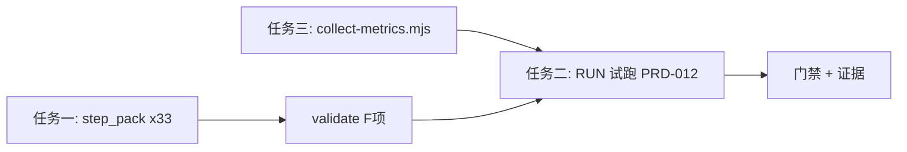

# step_pack 补齐 + 完整 RUN 试跑 + Metrics 自动提取

## 现状

- 34 个 PRD item 中仅 PRD-001 有 `step_pack`，其余 33 个缺失
- `init-run.mjs` 已就绪，但从未实际跑过完整 RUNBOOK 流程
- `collect-metrics.mjs` 不存在，Metrics 9 个字段全部需手工填写
- evidence/ 下 PRD-001~034 文件齐全，registry.json 条目齐全
- `agent_runs/` 下无任何 RUN 目录（仅 README.md + .gitkeep）

## 任务一：为 33 个 PRD item 补齐 step_pack

**策略**：用并行 subagent 分批处理，每批约 8-9 个 item。每个 item 的 step_pack 从其已有 `steps` 三行文本中机械提取：

- `acceptance_criteria` — 从每条 step 的"验收命令"行前的产物描述提取
- `commands_to_run` — 从每条 step 的"验收命令："后提取
- `expected_outputs` — 从每条 step 的"产物："后提取
- `allowed_paths` — 从"操作："和"产物："中提取涉及的路径
- `forbidden_paths` — 统一为 `["AGENTS.md", ".ggbdpq/actions/EXECUTION.md"]`
- `evidence_requirements` — 统一为 `[".ggbdpq/agent-orchestration/artifacts/evidence/PRD-{id}.md"]`

**修改文件**：[.ggbdpq/actions/prd.json](.ggbdpq/actions/prd.json)

**质量门**：完成后运行 `pnpm orchestration:validate`，F 项应报告 34 个 item 含 step_pack 且字段完整。

## 任务二：完整 RUN 试跑

**选择 PRD-012**（质量门禁与最终验收）作为试跑对象，原因：

- 已完成（passes: true），不会触发实际代码变更
- 只有 2 个 step，规模适中
- 验收命令全部是门禁类命令，可实际执行

**流程**（严格遵循 [RUNBOOK.md](.ggbdpq/agent-orchestration/RUNBOOK.md)）：

1. **Phase 0.5**：`pnpm orchestration:init-run -- --task_id PRD-012 --mode review`
2. **Phase 1**：检查生成的 `conformance_report.json`，确认 `conformant: true`
3. **Phase 2**：按 PRD-012 的 2 个 step 模拟 Controller 下发 → Worker 执行
   - S1：检查 `package.json` scripts 包含 lint/typecheck/build
   - S2：运行 `pnpm lint && pnpm typecheck`（build 跳过，review mode）
   - 每步在 `steps/S1/rounds/R1/` 下写入 `input.json` + `output.md` + `verdict.json`
4. **Phase 3**：证据归档到 `<RUN_ID>/evidence/`
5. **Phase 4**：Controller 验收，写入 verdict
6. **Phase 5**：无需 Rework（预期全部 PASS）
7. **Phase 6**：填写 `report/final_report.md`，含 Metrics 小节

**产出**：`agent_runs/<RUN_ID>/` 完整目录树，验证 `pnpm orchestration:validate` E 项通过。

## 任务三：collect-metrics.mjs

**新增文件**：[.ggbdpq/agent-orchestration/scripts/collect-metrics.mjs](.ggbdpq/agent-orchestration/scripts/collect-metrics.mjs)

**功能**：

- 输入：`--run_id <RUN_ID>` 或 `--run_dir <path>`
- 自动提取可机械化的 5 个指标：
  - `retries` — 统计 `steps/*/rounds/R[2-9]*` 目录数
  - `gates_run` — 解析 `report/final_report.md` 门禁表行数
  - `gates_failed` — 解析门禁表中 FAIL 行数
  - `change_orders_count` — 统计 `change_order/*.md` 文件数
  - `rework_rounds` — 统计所有非 R1 轮次总数
- 无法自动提取的 4 个指标（`model`/`token_budget`/`token_used`/`latency_ms_p50`）标记为 `null`，提示手工填写
- 输出 JSON 到 stdout，可选 `--write` 回写到 `report/final_report.md` 的 Metrics 表

**npm script**：`"orchestration:metrics": "node .ggbdpq/agent-orchestration/scripts/collect-metrics.mjs"`

**修改文件**：

- [package.json](package.json) — 新增 script
- [.ggbdpq/agent-orchestration/RUNBOOK.md](.ggbdpq/agent-orchestration/RUNBOOK.md) — Metrics 小节补充自动提取命令
- [.ggbdpq/agent-orchestration/INDEX.md](.ggbdpq/agent-orchestration/INDEX.md) — Validation 段补充 metrics 命令

## 门禁与验收

```bash
pnpm typecheck
pnpm test
pnpm orchestration:validate    # A~F 全部 PASS
pnpm orchestration:metrics -- --run_id <试跑产生的 RUN_ID>
```

产出证据：在试跑 RUN 目录的 `report/final_report.md` 中填入自动提取的 Metrics。

## 执行顺序

任务一（step_pack）和任务三（collect-metrics.mjs）可并行。任务二（RUN 试跑）依赖任务一完成后的 validate 通过，且需要任务三的 collect-metrics 来自动填充 Metrics。


