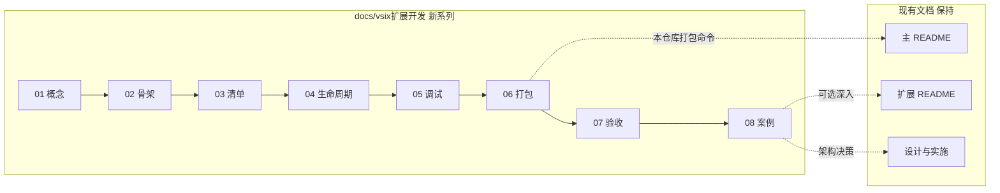

# VSIX 扩展从零到发布 — 文档系列计划

## 目标与边界

- **定位**：通用 VS Code / Cursor **VSIX 扩展**开发教程（非 Cursor 汉化补丁专论）。
- **形式**：`docs/vsix扩展开发/` 子目录 + 索引页，**系列分篇**，每篇可独立阅读，按序阅读形成完整路径。
- **风格**：逻辑严谨、条理清晰、结构分明、循序渐进；每章固定骨架（目标 → 概念 → 步骤 → 验收 → 常见错误 → 延伸）。
- **与现有文档关系**：
  - 不替代 [README.md](README.md)、[扩展 README](plugins/cursor-language-pack-zh-hans/README.md)、[设计与实施](docs/cursor-专有界面汉化扩展-设计与实施.md)。
  - 新系列负责「**如何从零做一个 VSIX 扩展**」；现有三份负责「**本仓库汉化补丁是什么、怎么用**」。
  - 第 8 篇「案例对照」链到本仓库 `plugins/cursor-language-pack-zh-hans/`，避免在前 7 篇混入过多业务细节。



---

## 目录结构（拟新建）

```
docs/vsix扩展开发/
├── README.md                 # 系列索引、学习路径、术语速查、文档地图
├── 01-概念与全景.md
├── 02-环境与项目骨架.md
├── 03-扩展清单与贡献点.md
├── 04-扩展入口与生命周期.md
├── 05-调试与本地验证.md
├── 06-打包VSIX与安装.md
├── 07-发布验收与故障排查.md
└── 08-进阶模式与案例对照.md
```

---

## 各篇内容纲要

### 索引 [`docs/vsix扩展开发/README.md`](docs/vsix扩展开发/README.md)

- 系列说明：适用读者（有 Node/TS 基础、第一次在 VS Code/Cursor 里做扩展）。
- **推荐学习路径**（约 2–4 小时通读 + 动手）。
- ASCII **信息架构图**：Extension Host ↔ `package.json` ↔ `extension.ts` ↔ VSIX ↔ 用户安装。
- 与仓库现有三文档的对照表（读哪篇解决什么问题）。
- 术语迷你表：VSIX、Extension Host、activationEvents、contributes、vsce、Reload Window vs 冷重启（通用说明）。

### 01 — 概念与全景

- VS Code 扩展是什么：Extension Host 进程、与主进程/工作区的关系。
- VSIX 是什么：ZIP 结构、`package.json` 为清单中心。
- 扩展能做什么 / 不能做什么（API 边界、无公开 API 时的限制）。
- **Mermaid**：用户安装 → activate → 命令/配置 → 业务逻辑。
- 本章验收：能口述「扩展清单 → 入口文件 → 打包产物」三者关系。

### 02 — 环境与项目骨架

- 前置：Node ≥ 18、npm、VS Code 或 Cursor、（可选）Yeoman `generator-code` 对比说明。
- **从零建目录**（不依赖生成器的最小集）：
  - `package.json`（name、publisher、version、engines、main）
  - `tsconfig.json`（参考 [plugins/.../tsconfig.json](plugins/cursor-language-pack-zh-hans/tsconfig.json) 的 outDir/rootDir 模式）
  - `src/extension.ts`（Hello World 级 activate/deactivate）
  - `.vscode/launch.json`（Extension Development Host）
  - `.vscodeignore`（参考 [plugins/.../.vscodeignore](plugins/cursor-language-pack-zh-hans/.vscodeignore)：排除 src/ts/map，只打 out/）
- **ASCII**：推荐目录树（通用最小扩展 vs 含 scripts/vendor 的进阶结构）。
- 本章验收：F5 能启动 Extension Host，输出「扩展已激活」日志。

### 03 — 扩展清单与贡献点

- `package.json` 核心字段逐项说明：`displayName`、`activationEvents`、`extensionKind`、`contributes`。
- **contributes 常用块**（通用）：
  - `commands` + `category`
  - `configuration`（settings 类型、default、description）
  - 简要提及 `menus`、`keybindings`、`views`（点到为止，不深展开）。
- `engines.vscode` 与 Cursor 兼容性说明。
- **Mermaid**：manifest 字段 → 运行时可见 UI（命令面板、设置页）。
- 本章验收：能在命令面板看到自定义命令，设置里能搜到配置项。

### 04 — 扩展入口与生命周期

- `activate(context)` / `deactivate()` 职责与 `ExtensionContext`（subscriptions、globalState、workspaceState）。
- 注册命令：`vscode.commands.registerCommand` + `context.subscriptions.push`。
- 读取配置：`workspace.getConfiguration`。
- 输出与用户反馈：`OutputChannel`、`window.showInformationMessage` / `showErrorMessage`。
- **Mermaid 状态图**：安装 → activate → 命令执行 → deactivate（卸载/禁用）。
- 通用最佳实践：模块化（service 层）、错误处理、不在 activate 里做重 IO（与本仓库 `patchService` 模式对照，仅 08 篇展开）。
- 本章验收：实现 2 个命令 + 1 个配置项 + 1 个输出通道。

### 05 — 调试与本地验证

- F5 / Extension Development Host 工作方式。
- `npm run watch` + 重载扩展宿主。
- 断点、Output、Developer Tools 基本用法。
- **ASCII**：调试循环（改代码 → compile → 重载/重启 Host）。
- 本章验收：能断点调试命令回调，能定位「扩展未激活 / 命令未注册」类问题。

### 06 — 打包 VSIX 与安装

- 构建链：`tsc` → `out/` → `vsce package`（`@vscode/vsce`）。
- `vscode:prepublish`、`compile` script 惯例。
- `.vscodeignore` 与 `--no-dependencies` 取舍（何时打包 node_modules）。
- **Mermaid**：源码 → 编译 → vsce → `.vsix` → 侧载安装。
- 安装方式：扩展视图「从 VSIX 安装」、`code --install-extension` / `cursor --install-extension`。
- Reload Window vs 完整重启（通用：何时必须重启主进程 — 点到为止，案例见 08）。
- 本章验收：本地生成 `.vsix` 并在 Cursor/VS Code 中安装成功。

### 07 — 发布验收与故障排查

- 发布前检查清单（manifest 版本、engines、图标、LICENSE、README）。
- 安装后验收：命令可用、配置生效、卸载/禁用行为符合预期。
- **决策树 Mermaid**：扩展不显示 / 命令找不到 / 打包失败 / 安装后无效果。
- 版本号策略、`CHANGELOG` 建议。
- 发布渠道概览：侧载 VSIX、Open VSX、Marketplace（流程级说明，不写审核细节）。
- 本章验收：能按清单完成一次「打包 → 安装 → 验收 → 卸载」闭环。

### 08 — 进阶模式与案例对照

- 进阶主题（通用模式，非本仓库必需）：
  - 扩展内封装 CLI/库（dynamic import、vendor 目录、pre-build sync）。
  - 多包仓库：根目录引擎 + `plugins/` 扩展壳（架构图）。
  - 写磁盘 / 权限 / 非 Workspace 操作的风险提示。
- **本仓库可选案例对照表**：

| 通用概念 | 本仓库实现 |
|---------|-----------|
| contributes.commands | [package.json](plugins/cursor-language-pack-zh-hans/package.json) 四条 Cursor 中文命令 |
| configuration | `cursorZh.appRoot`、`cursorZh.autoApplyOnInstall` |
| activate/deactivate | [extension.ts](plugins/cursor-language-pack-zh-hans/src/extension.ts) + suppressDeactivateRevert |
| 业务封装 | [patchService.ts](plugins/cursor-language-pack-zh-hans/src/patchService.ts) |
| 打包 | `npm run compile` + `vsce package --no-dependencies` |
| 设计决策 | [设计与实施 §6–§10](docs/cursor-专有界面汉化扩展-设计与实施.md) |

- 链到现有三文档的「深入阅读」索引，避免系列内重复 §15 逐步截图级内容。

---

## 写作规范（全系列统一）

- **语言**：简体中文；代码标识符、CLI、路径保持英文。
- **每章结构**（固定）：
  1. 本章目标（1–3 条）
  2. 前置条件（链接上一章）
  3. 核心概念（表格 + 至少 1 张 Mermaid 或 ASCII）
  4. 动手步骤（编号，可复制命令）
  5. 验收标准（checkbox）
  6. 常见错误与对策
  7. 下一章 / 延伸阅读
- **代码示例**：优先最小可运行片段；本仓库路径作「参考实现」脚注，不作为教程主路径。
- **图表**：遵循 Mermaid 语法约束（节点 ID 无空格、特殊字符加引号）。

---

## 需要同步更新的现有文件（轻量）

| 文件 | 变更 |
|------|------|
| [README.md](README.md) | 「相关文档」增加系列索引链接 |
| [docs/cursor-专有界面汉化扩展-设计与实施.md](docs/cursor-专有界面汉化扩展-设计与实施.md) | 「三份文档怎么读」扩展为「文档体系」，加入新系列入口 |
| [plugins/.../README.md](plugins/cursor-language-pack-zh-hans/README.md) | §7 开发打包处增加「通用 VSIX 教程见 docs/vsix扩展开发」 |

不修改代码与 `package.json`，仅文档。

---

## 实施顺序建议

1. 先写 **索引 README + 01 + 02**（建立概念与最小骨架，保证系列可启动）。
2. 再写 **03–05**（manifest、生命周期、调试 — 开发主路径）。
3. 再写 **06–07**（打包安装与验收 — 与你当前「做 VSIX」目标最直接相关）。
4. 最后写 **08**（案例对照 + 链到现有三文档）。
5. 通读一遍：消除与前 7 篇重复的段落；更新三处交叉链接。

预估：8 个 markdown 文件，合计约 3500–4500 行（含图表与清单，低于现有设计文档单文件体量分散到多篇）。
