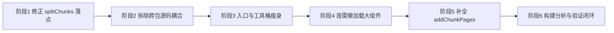

## 现状诊断（关键结论）

1. **`config/index.js` 里 splitChunks chunk 名用的是 `subPackages/...`（带 s），但项目真实分包 root 是 `subPackage/`、`aiAgentPackage/`、`cashierPackage/` 等（不带 s）。** 这些 chunk 没有落进任何真实分包目录，最终以文件形式留在主包的 `subPackages/` 子目录里，所以主包里能看到 729KB 的 `common.js` 和 509KB 的 `vendors.js`。这是当前拆分未生效的核心原因。
2. **主包页面存在多处跨包源码 import**（`pages/mine`→`@/subPackage`、`pages/aiCoach`→`@/subPackage`、`pages/home`→`@/bleDevicePackage`、`pages/mall/experience`→`@/pages/home copy`），把分包源码强制卷进了主包 bundle。
3. `src/app.tsx` 入口同步 import `@/utils/rum/index`（生产环境带入 aegis-mp-sdk），以及从 `@/utils/index` 大桶 import `handleToken`，放大了公共 chunk。
4. 现有 `addChunkPages` 只覆盖了 echarts / lunisolar / calendar，对 markdown-it、photoswipe、taro-ui、nutui 等没有关联。

## 目标产物

- 主包 ≤ 1.5MB（目标 1.4MB 上下）。
- 不破坏现有分包预加载策略；aiAgentPackage / subPackage 分包首屏加载表现持平或更快。
- 修改可逆、可分阶段上线，每阶段都有可测量验证点。

## 总体思路



---

## 阶段 1：修正 splitChunks 的分包落点（收益最大，风险最小）

**问题**：[config/index.js](config/index.js) 第 107~160 行的 `name: 'subPackages/xxx-vendors'` 路径错了（多了 s）。Taro 的 `optimizeMainPackage` 只对落在**真实分包 root**的 chunk 搬迁。

**做法**：

- 将通用大型第三方库拆到一个专门的"公共分包"中（推荐新增 `commonPackage` 作为分包 root，仅放 vendor chunks，不放页面），在 `src/app.config.ts` 的 `subPackages` 中增加：

```ts
{ root: 'commonPackage', pages: [] }
```

然后把 `config/index.js` 里的 `name` 统一改为真实 root 前缀，例如：

```javascript
echarts:   { name: 'commonPackage/echarts-vendors',  test: /node_modules[\\/](echarts|ec-canvas)[\\/]/, ... }
nutui:     { name: 'commonPackage/nutui-vendors',    test: /node_modules[\\/]@nutui[\\/]/, ... }
taroUi:    { name: 'commonPackage/taro-ui-vendors',  test: /node_modules[\\/]taro-ui[\\/]/, ... }
lunisolar: { name: 'commonPackage/lunisolar-vendors', ... }
photoswipe:{ name: 'commonPackage/photoswipe-vendors', ... }
markdown:  { name: 'commonPackage/markdown-vendors', test: /node_modules[\\/](markdown-it|entities|linkify-it|mdurl|uc\.micro|htmlparser2|domhandler|domutils|domelementtype)[\\/]/, ... }
calendar:  { name: 'commonPackage/calendar-chunk',   test: /src[\\/]components[\\/]Calendar[\\/]/, ... }
```

- 注意 markdown 相关的 `entities`、`linkify-it`、`mdurl`、`uc.micro` 等传递依赖也要一起拆（当前只测了 markdown-it + htmlparser2，会漏）。

- 去掉当前的 `vendors: { name: 'subPackages/common-vendors', priority: 10 }` 兜底 —— 这个兜底让**所有** node_modules 都进了一个大 chunk 并落在主包。改为让 Taro 自己按 pageChunk / miniCssExtract 默认策略处理，或保留为 `priority: 0 / minChunks: 2` 且仅把跨多处使用的放到 commonPackage。

**预期减重**：~250 ~ 400KB（主包 `vendors.js` / `common.js` 里这些库会物理搬到 commonPackage）。

---

## 阶段 2：拆除主包→分包的跨包源码耦合

仅做**搬移 / 抽取**，不改业务逻辑。涉及 4 处：

1. **gradeCard 从分包抽到公共位置**
   - 现状：[src/pages/mine/components/member-card/index.tsx](src/pages/mine/components/member-card/index.tsx) 第 11 行 `import ... from '@/subPackage/memberBenefits/components/gradeCard'`。
   - 做法：把 `src/subPackage/memberBenefits/components/gradeCard/` 物理移动到 `src/components/gradeCard/`，同步更新两处引用（主包的 member-card + 分包里 memberBenefits 页自身）。

2. **echarts 封装迁出分包**
   - 现状：[src/components/A2UI/FoodAssessmentCheckln/NutritionPieChart.tsx](src/components/A2UI/FoodAssessmentCheckln/NutritionPieChart.tsx) 第 4 行、`src/components/aiCoach/components/SkinHealthTrend/index.tsx` 等引用 `@/subPackage/components/echarts-taro3-react`。
   - 做法：把 `src/subPackage/components/echarts-taro3-react/` 移到 `src/components/echarts-taro3-react/`。echarts 库本身仍由阶段 1 的 splitChunks 拆到 commonPackage。

3. **抽出 `isBleTenant` 工具函数**
   - 现状：[src/pages/home/index.tsx](src/pages/home/index.tsx) 第 14 行 `import { isBleTenant } from '@/bleDevicePackage/bluetooth/devices'`。
   - 做法：把 `isBleTenant`（及它最小的依赖）抽到 `src/utils/bleTenant.ts`，主包/分包都从这里引用。原文件保留向后兼容 re-export。

4. **storeCard 从 `home copy` 抽到 components**（符合你选的 B 选项）
   - 现状：[src/pages/mall/experience/index.tsx](src/pages/mall/experience/index.tsx) 引用 `@/pages/home copy/goodsAndStores/components/storeCard`。
   - 做法：把该 `storeCard` 目录复制到 `src/components/storeCard/`，仅更新 experience 页引用；`home copy/` 整体保留不动。

**预期减重**：~60 ~ 150KB，更重要的是让分包 `optimizeMainPackage` 能正确识别哪些代码只属于分包。

---

## 阶段 3：入口与 utils 桶的按需化

1. **RUM/Aegis 改为动态加载**
   - 现状：[src/app.tsx](src/app.tsx) 顶部同步 import `@/utils/rum/index`，该文件顶层 `import 'aegis-mp-sdk'`。
   - 做法：改 `src/utils/rum/index.ts` 使用 `await import('aegis-mp-sdk')`，并且只有 `API_ENV === 'pro'` 才动态加载；app.tsx 保持 import，rum 内部负责懒加载。

2. **`handleToken` 从巨型 `@/utils/index` 直接细化**
   - 现状：`app.tsx` 里 `import { handleToken } from '@/utils/index'`。
   - 做法：把 `handleToken` 实现独立成 `src/utils/handleToken.ts`，入口改为 `import { handleToken } from '@/utils/handleToken'`；原 `@/utils/index` 保留 re-export 不影响其它模块。副作用：阻断 utils/index 里 `ShareContainer`、`mp` 服务、`dayjs` 封装等被连坐打进主包 common。

**预期减重**：~30 ~ 80KB（主要发生在主包 common.js）。

---

## 阶段 4：按需懒加载大组件

只在非首屏路径使用的大组件通过 `React.lazy` + `Suspense`：

- **`markdownPreview`**（使用 markdown-it）—— 仅在 AI 回复、报告解读等场景用。
- **`progressivePhotoBox`**（使用 photoswipe）—— 仅图片详情弹出时用。
- **`pagView`**（使用 libpag-lite-miniprogram）—— 非首屏才展示的 PAG 动画。

用法参考你们报告里那份 `NextTickComponent` 组合：先 `React.lazy`，再外套 `NextTickComponent` 包裹，保证首屏不等待。

**预期减重**：~50 ~ 100KB（配合阶段 1 的 markdown / photoswipe chunk 才能完整把包挪走）。

---

## 阶段 5：补全 `addChunkPages` 映射

[config/index.js](config/index.js) 第 166~176 行的 `addChunkPages` 只映射了 aiCoach、home 两个主包页面的 echarts/calendar/lunisolar。补齐以下映射（按真实使用页面精确到点，避免误杀）：

- `pages/aiCoach/index` → `commonPackage/nutui-vendors`、`commonPackage/taro-ui-vendors`、`commonPackage/echarts-vendors`、`commonPackage/calendar-chunk`、`commonPackage/lunisolar-vendors`
- `pages/home/index` → `commonPackage/calendar-chunk`、`commonPackage/lunisolar-vendors`
- `pages/mine/index` → `commonPackage/taro-ui-vendors`（AtButton）
- `pages/cart/index` → `commonPackage/nutui-vendors`
- `pages/mall/index`（以及它的三个 Tab 子页）→ `commonPackage/nutui-vendors`
- 使用 markdown / photoswipe 的分包页面 → 对应 `commonPackage/markdown-vendors`、`commonPackage/photoswipe-vendors`

**注意**：原 `pages.set(...)` 对同一个页面多次调用会互相覆盖（Map.set 语义）。改成 `pages.set('pages/aiCoach/index', [...所有依赖])` 一次给全，或者使用 `pages.get(key)?.concat(...)` 合并。当前文件第 168、171 行就是两次 set 覆盖了 echarts-vendors，需要合并。

---

## 阶段 6：接入构建分析 + 建立主包体积守护

- 启用 `webpack-bundle-analyzer`（devDependency 已在）：在 `config/index.js` 的 `webpackChain` 中按环境变量 `ANALYZE=1` 开启 BundleAnalyzerPlugin，输出 HTML 报告。
- 每次重大改动后在开发者工具"代码依赖分析"面板对照。
- （可选）在 CI 中加一个主包体积阈值脚本，超过 1.5MB 失败。

---

## 实施顺序与风险控制

- 每个阶段独立 commit、独立体验包验证；即使只做阶段 1 + 阶段 5 已经能看到主要收益。
- 阶段 2 涉及文件搬移，记得更新所有 `@/subPackage/...` 的旧路径引用。搬完后全量 `lint` + 冒烟测试 aiCoach / home / mine / 会员权益 这几条路径。
- 所有 chunk 名都新增在 `commonPackage` 这个"仅拆库用"的空分包下，配合分包预加载（`preloadRule`）不需要用户主动跳转也能预拉取，等价于保留原加载表现。

## 验证清单

- 微信开发者工具"代码依赖分析" → 主包 ≤ 1.5MB。
- 启动时间、首屏白屏时间（Audits 面板）不劣化。
- aiCoach、home、mine、mall 四个 Tab + cart 一条购物链路冒烟通过。
- lunisolar 日历、echarts 图表、markdown 解读、photoswipe 图片预览四条重要功能路径回归。
- iOS / Android 真机各测一次（首开 + 冷启动）。